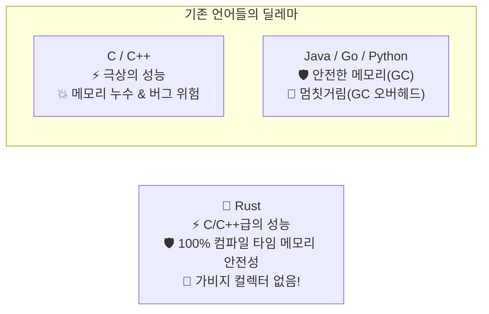

# 00. 시작하며: 왜 Rust인가? 🦀

> *"C 언어의 번개 같은 속도와 Python의 우아한 안전성을 한 번에 가질 수는 없을까?"*  
> 이 질문에 대한 대답이 바로 **러스트(Rust)**입니다!

---

## 0.1 왜 전 세계 개발자들은 Rust에 열광할까요?

개발자 설문조사(Stack Overflow Developer Survey)에서 **연속 8년 이상 "가장 사랑받는 언어 1위"**를 차지한 언어가 무엇인지 아시나요? 네, 바로 러스트(Rust)입니다! 

마이크로소프트, 구글, 아마존, 메타 같은 글로벌 빅테크 기업들도 시스템의 핵심 인프라와 OS 커널, 클라우드 엔진을 Rust로 재작성하고 있습니다. 심지어 미국 백악관과 사이버보안국(CISA)에서도 소프트웨어 보안 취약점의 70% 이상을 차지하는 '메모리 오류'를 없애기 위해 C/C++ 대신 Rust와 같은 메모리 안전 언어를 사용할 것을 권고하고 있습니다.

도대체 Rust에 어떤 마법이 숨어 있길래 이토록 뜨거운 지지를 받는 걸까요?

### 1. 가비지 컬렉터(GC) 없이도 안전한 메모리 관리
Java, Go, Python 같은 현대적인 언어들은 메모리를 자동으로 청소해주는 **가비지 컬렉터(Garbage Collector)**를 탑재하고 있습니다. 덕분에 개발자는 편하지만, 청소부가 일할 때 프로그램이 미세하게 멈칫거리는 비용(오버헤드)을 감수해야 합니다.

반면 Rust는 **가비지 컬렉터가 전혀 없습니다!**  
대신 **컴파일 타임(코드를 실행하기 전 빌드하는 순간)**에 메모리 사용 규칙을 엄격하게 검증하는 독창적인 시스템인 **'소유권(Ownership)'** 모델을 사용합니다. 덕분에 실행 속도는 C/C++처럼 빠르면서도, 메모리가 새거나 잘못 참조되어 프로그램이 터지는 일을 사전에 100% 차단합니다.

### 2. "컴파일이 성공하면 버그 없이 돌아간다"
Rust를 배울 때 처음엔 컴파일러가 유난히 깐깐하게 잔소리하는 것처럼 느껴질 수 있습니다. 하지만 이는 런타임(운영 서버)에서 새벽에 장애가 터지는 것을 막아주는 최고의 방패입니다.  
많은 러스트 개발자들이 입을 모아 말합니다:  
> **"Rust 컴파일러를 통과한 코드는, 믿고 잘 수 있다!"**

### 3. 제로 코스트 추상화 (Zero-Cost Abstractions)
고수준의 편리한 문법(고차 함수, 패턴 매칭, 제네릭 등)을 마음껏 사용해도, 최종 바이너리는 저수준의 손수 최적화한 어셈블리 코드와 다름없는 초고속 기계어로 변환됩니다. 편의성을 얻는 대가로 성능을 포기할 필요가 없습니다.

---

## 0.2 마스코트 페리스(Ferris) 이야기 🦀

Rust 생태계에는 아주 사랑받는 공식 마스코트가 있습니다. 바로 작은 게 **페리스(Ferris)**입니다!

- **왜 게(Crab)일까요?**  
  Rust(녹)는 철(Ferrum)이 산화되어 생깁니다. 철의 라틴어 원소 기호가 **Fe**이고, 철을 뜻하는 영단어가 'Ferrous'입니다. 여기서 이름을 따와 **Ferris**라는 귀여운 게가 탄생했습니다.
- Rust 개발자들은 스스로를 **"러스테이시안(Rustacean, 갑각류 Crustacean + Rust의 합성어)"**이라고 부르며 강한 유대감을 느낍니다.

앞으로 이 책 곳곳에서 페리스가 등장하여 꿀팁을 전해주고, 어려운 개념을 쉽게 풀어줄 테니 기대해 주세요!

---

## 0.3 이 책을 효과적으로 공부하는 방법

Rust는 진입 장벽이 조금 높다고 알려져 있습니다. 하지만 걱정하지 마세요! 몇 가지 마음가짐만 갖추면 누구보다 즐겁게 정복할 수 있습니다.

> [!TIP]
> **컴파일러의 빨간 밑줄을 두려워하지 마세요!**  
> 다른 언어의 컴파일러가 단순히 "여기 틀렸어!" 하고 불친절하게 에러 코드만 뱉는다면, Rust 컴파일러는 **"여기서 소유권이 넘어갔는데, 혹시 `&`를 붙여서 빌려 쓰려고 하셨나요? 이렇게 고쳐보세요!"** 라며 친절하게 해결책까지 제안해 줍니다.  
> 컴파일러는 여러분을 혼내는 감시관이 아니라, **항상 곁에 붙어 있는 무료 1:1 개인 과외 선생님**입니다.

### 학습 권장 순서
1. **눈으로만 읽지 말고 직접 타이핑하기**: 짧은 코드라도 직접 치고 `cargo run`을 눌러보세요.
2. **일부러 에러 내보기**: 컴파일러가 어떻게 오류를 지적하고 조언해 주는지 관찰해보면 실력이 2배 빠르게 늘어납니다.
3. **핵심인 03장 '소유권'에 시간 투자하기**: 3장만 제대로 넘어서면 그 뒤는 물 흐르듯 술술 풀립니다!

준비되셨나요? 다음 장에서 곧바로 우리 컴퓨터에 Rust 개발 환경을 세팅하고 첫 번째 프로그램을 실행해 보겠습니다! 🚀
