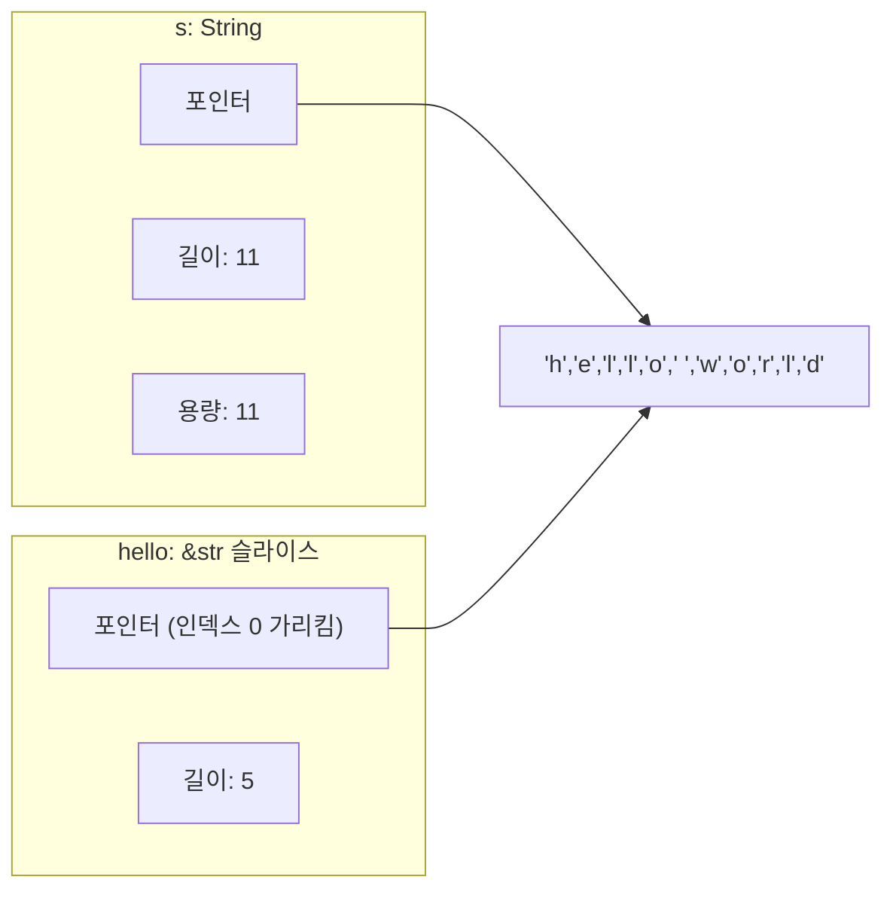

# 03. Rust의 심장: 소유권(Ownership)과 빌림(Borrowing) 🦀❤️

> *"소유권 개념을 이해하는 순간, 여러분은 러스트의 가장 깊은 지혜를 얻게 됩니다."*

---

## 3.1 가비지 컬렉터 없이 메모리를 비운다고? (스택 vs 힙)

프로그래밍 언어들이 컴퓨터 메모리(RAM)를 다루는 방식은 역사적으로 두 갈래였습니다:

1. **수동 관리 (C / C++)**: 개발자가 `malloc()`으로 메모리를 빌리고, 다 쓰면 직접 `free()`로 반납해야 합니다.  
   - ⚠️ *깜빡하고 반납을 안 하면 메모리 누수(Memory Leak)가 생기고, 이미 반납한 곳을 또 건드리면 치명적인 버그(Dangling Pointer / Double Free)로 프로그램이 폭발합니다.*
2. **자동 관리 (Java / Python / Go)**: **가비지 컬렉터(GC)**가 백그라운드에서 돌아다니며 안 쓰는 메모리를 청소합니다.  
   - ⚠️ *개발자는 편하지만, GC가 작동할 때마다 CPU 자원을 먹고 프로그램이 순간 멈칫거립니다.*

**Rust의 제3의 길**:  
Rust는 개발자에게 수동 해제의 부담을 주지도 않고, 런타임 성능을 갉아먹는 GC를 쓰지도 않습니다.  
대신 **'소유권(Ownership)'이라는 엄격한 컴파일 규칙**을 만들어, 코드가 스코프(`{ }`)를 벗어나는 순간 **컴파일러가 알아서 메모리 해제 코드(`drop`)를 정확한 타이밍에 자동으로 끼워 넣어 줍니다!**

### 스택(Stack)과 힙(Heap)의 차이


- **스택(Stack)**: 크기가 정해진 데이터를 책처럼 차곡차곡 쌓는 곳. 찾기도 빠르고 버리기도 초고속입니다.
- **힙(Heap)**: 런타임에 크기가 늘어나거나 줄어들 수 있는 큰 데이터(예: 사용자 입력 문자열)를 저장하는 넓은 공간입니다. 식당에 자리를 예약하듯 메모리를 할당받고, 스택에는 그 위치를 가리키는 주소(포인터)만 적어둡니다.

---

## 3.2 소유권의 3대 황금률

Rust의 모든 메모리 관리는 다음 세 가지 원칙 위에서 작동합니다:

> [!IMPORTANT]
> **소유권의 3가지 절대 규칙**
> 1. Rust의 **모든 값(Value)은 '소유자(Owner)'라 불리는 변수**를 갖는다.
> 2. 한 시점에 **소유자는 오직 단 하나**뿐이다.
> 3. 소유자가 스코프(코드 블록 `{ }`)를 벗어나면, **그 값은 메모리에서 즉시 버려진다(Drop).**

```rust
{                      // s는 아직 선언되지 않아 유효하지 않음
    let s = String::from("hello"); // s가 힙 메모리에 "hello"를 할당받고 소유자가 됨!
    // s를 마음껏 사용
}                      // 스코프 끝! Rust가 자동으로 s.drop()을 호출하여 메모리를 즉시 반납!
```

---

## 3.3 이동(Move)과 깊은 복사(Clone), 스택 복사(Copy)

소유권의 진짜 마법은 변수를 다른 변수에 대입할 때 일어납니다.

### 1. 소유권의 이전: 이동 (Move)
```rust
fn main() {
    let s1 = String::from("안녕");
    let s2 = s1; // 👈 소유권이 s1에서 s2로 "이동(Move)"했습니다!

    println!("{s1}"); // ❌ 컴파일 에러! s1은 더 이상 소유권이 없습니다!
}
```

```mermaid
graph LR
    subgraph 1단계
        s1["s1 (소유자)"] --> Data["힙 메모리 ('안녕')"]
    end
    subgraph 2단계: let s2 = s1 실행 후
        s1_invalid["s1 (무효화됨 ❌)"]
        s2["s2 (새 소유자 ⭕)"] --> Data
    end
```

다른 언어처럼 얕은 복사(Shallow Copy)를 한 채 두 변수를 살려두면, 스코프가 끝날 때 두 변수가 같은 힙 메모리를 두 번 해제(Double Free)하는 재앙이 발생합니다.  
Rust는 이를 막기 위해 **s1의 소유권을 박탈하고 무효화**해 버립니다. 이것을 **이동(Move)**이라고 합니다.

### 2. 값 전체를 복제하고 싶다면? `clone()`
힙에 있는 실제 데이터까지 완전히 새로 하나 더 만들고 싶을 때는 `.clone()`을 명시합니다.

```rust
let s1 = String::from("안녕");
let s2 = s1.clone(); // 힙 메모리 복제 (비용 발생)

println!("s1: {s1}, s2: {s2}"); // ⭕ 둘 다 사용 가능!
```

### 3. 정수나 불리언은 왜 에러가 안 날까? `Copy` 트레이트
```rust
let x = 5;
let y = x;
println!("x: {x}, y: {y}"); // ⭕ 문제없이 실행됨!
```
크기가 작고 고정되어 스택에만 온전히 저장되는 타입들(`i32`, `bool`, `char` 등)은 **`Copy` 트레이트**가 구현되어 있어, 대입 시 이동하지 않고 비트 단위로 값 자체가 복사됩니다.

---

## 3.4 빌림(Borrowing): 빌려 쓰되 망가뜨리지 않기

함수에 값을 넘길 때마다 매번 소유권을 넘겨주면, 함수가 끝난 뒤 그 변수를 다시 쓸 수 없어 매우 번거롭습니다.

이때 사용하는 것이 바로 **참조(Reference, `&`)**이며, 이를 **빌림(Borrowing)**이라고 부릅니다.  
친구에게 책을 영원히 주는 것(Move)이 아니라, "잠깐 읽고 돌려줄게(`&`)"라고 빌리는 것과 같습니다.

### 1. 불변 참조 (`&T`) - 읽기 전용 대출
```rust
fn main() {
    let s1 = String::from("페리스");
    let len = calculate_length(&s1); // 👈 &s1: s1의 참조(주소)만 빌려줌!

    println!("'{s1}'의 길이는 {len}글자입니다."); // ⭕ s1의 소유권은 여전히 나에게 있음!
}

fn calculate_length(s: &String) -> usize {
    s.len()
} // s가 스코프를 벗어나도, 애초에 빌려온 것이므로 원본 메모리는 해제되지 않음!
```

### 2. 가변 참조 (`&mut T`) - 빌려서 값 수정하기
빌려온 책에 밑줄을 긋거나 글자를 고치고 싶다면 `&mut`을 사용합니다.

```rust
fn main() {
    let mut s = String::from("안녕");
    add_world(&mut s);
    println!("{s}"); // "안녕, 세상아!"
}

fn add_world(some_string: &mut String) {
    some_string.push_str(", 세상아!");
}
```

### 3. 빌림의 절대 규칙 (데이터 레이스 방지)

Rust는 멀티스레드나 동시성 버그를 막기 위해 다음 두 가지 규칙을 컴파일 타임에 강제합니다:

> [!CAUTION]
> **빌림 체커(Borrow Checker)의 규칙**
> 1. 어떤 데이터에 대해 **불변 참조(`&T`)는 동시에 몇 개든** 만들 수 있다. (모두가 읽기만 하므로 안전!)
> 2. 하지만 **가변 참조(`&mut T`)는 특정 시점에 오직 딱 하나만** 존재할 수 있다!
> 3. **가변 참조와 불변 참조는 절대 동시에 공존할 수 없다!** (내가 읽고 있는 중에 다른 사람이 값을 고치면 안 되기 때문)

```rust
let mut s = String::from("hello");

let r1 = &s; // ⭕ 불변 대출
let r2 = &s; // ⭕ 불변 대출 (문제 없음)
let r3 = &mut s; // ❌ 컴파일 에러! 이미 r1, r2가 읽고 있는데 몰래 수정 권한을 줄 수 없음!

println!("{r1}, {r2}, {r3}");
```

---

## 3.5 슬라이스(Slice): 안전한 부분 참조

슬라이스는 컬렉션의 **연속된 일부분만을 참조**하는 특별한 뷰(View)입니다. 새로운 메모리를 할당하지 않고 원본 데이터의 특정 구간만 가리킵니다.

### 문자열 슬라이스 (`&str`)
```rust
fn main() {
    let s = String::from("hello world");

    let hello: &str = &s[0..5];  // "hello"
    let world: &str = &s[6..11]; // "world"
    let whole: &str = &s[..];    // 전체 슬라이스

    println!("{hello} {world}!");
}
```



슬라이스 역시 참조이므로, 슬라이스로 일부분을 빌려 쓰는 동안 원본 `String`의 내용을 수정하거나 삭제하려고 하면 컴파일러가 완벽하게 막아줍니다.

---

소유권과 빌림을 통과하셨다면, 축하합니다!  
여러분은 이미 Rust에서 가장 높고 험난한 고개를 정복하셨습니다.  
다음 장에서는 이 안전한 메모리 위에서 아름답고 견고한 프로그램을 조립하는 **구조체와 열거형, 패턴 매칭**을 배워보겠습니다! 🦀🚀
