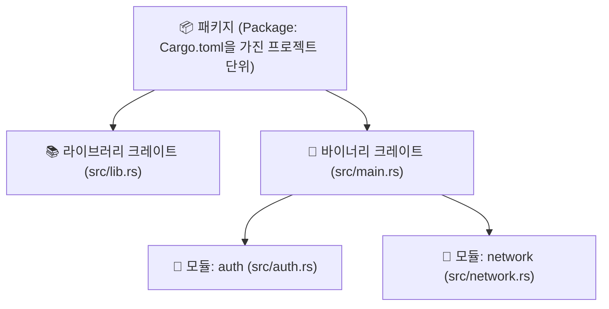

# 07. 모듈과 패키지 생태계 📦

> *"프로젝트가 커질수록 잘 정돈된 서랍장이 필요합니다. 러스트의 모듈 시스템과 crates.io 생태계를 만나보세요."*

---

## 7.1 패키지, 크레이트, 모듈 한눈에 정리

Rust의 코드 조직화 단위는 크게 세 가지 계층으로 나뉩니다:



1. **패키지 (Package)**:
   - 하나의 `Cargo.toml` 파일로 정의되는 프로젝트 전체입니다.
   - 0개 또는 1개의 **라이브러리 크레이트**와, 원하는 만큼 여러 개의 **바이너리 크레이트**를 포함할 수 있습니다.
2. **크레이트 (Crate)**:
   - Rust의 컴파일 단위입니다.
   - **바이너리 크레이트 (Binary Crate)**: `main` 함수를 가지며 실행 파일(`.exe` 등)로 빌드됩니다. (`src/main.rs`)
   - **라이브러리 크레이트 (Library Crate)**: 다른 프로그램에서 불러다 쓸 수 있는 재사용 가능한 코드 묶음입니다. (`src/lib.rs`)
3. **모듈 (Module)**:
   - 크레이트 내부에서 코드의 가시성(공개/비공개)과 네임스페이스를 관리하는 논리적 폴더/파일 단위입니다.

---

## 7.2 모듈 분리와 공개 범위 (`mod`, `use`, `pub`)

기본적으로 Rust의 모든 항목(함수, 구조체, 모듈 등)은 **비공개(Private)**가 기본값입니다.  
외부에서 접근하게 하려면 명시적으로 **`pub`** 키워드를 붙여주어야 합니다.

### 모듈 트리 예제

```
my_project/
├── Cargo.toml
└── src/
    ├── main.rs
    └── garden/
        └── vegetables.rs
```

#### `src/garden/vegetables.rs`
```rust
#[derive(Debug)]
pub struct Asparagus {
    pub count: i32,
}

impl Asparagus {
    pub fn new(count: i32) -> Self {
        Self { count }
    }
}
```

#### `src/main.rs`
```rust
// 1. garden 모듈 선언
pub mod garden {
    pub mod vegetables;
}

// 2. use를 사용해 긴 경로를 단축!
use garden::vegetables::Asparagus;

fn main() {
    let plant = Asparagus::new(5);
    println!("내가 기르는 채소: {:?}", plant);
}
```

> [!NOTE]
> 최신 Rust (2018 에디션 이후)에서는 `src/garden.rs` 파일을 두고 그 옆에 `src/garden/vegetables.rs`를 두는 직관적인 파일 기반 모듈 시스템을 지원합니다. 옛날 방식인 `mod.rs` 파일을 굳이 만들지 않아도 깔끔하게 동작합니다!

---

## 7.3 crates.io에서 외부 라이브러리 가져다 쓰기

Rust 개발의 가장 큰 즐거움 중 하나는 전 세계 개발자들이 오픈소스로 공유한 수십만 개의 고품질 크레이트가 모여 있는 **[crates.io](https://crates.io)** 생태계입니다.

### 외부 라이브러리 추가하는 가장 쉬운 방법 (`cargo add`)

예를 들어 임의의 난수를 생성해주는 인기 크레이트인 `rand`를 프로젝트에 추가해 보겠습니다.  
터미널에서 명령어 한 줄만 치면 끝납니다!

```bash
cargo add rand
```

명령을 실행하면 `Cargo.toml` 파일의 `[dependencies]` 섹션에 자동으로 최신 버전이 등록됩니다:

```toml
[dependencies]
rand = "0.8.5"
```

### 코드에서 사용하기
```rust
use rand::Rng; // Rng 트레이트를 가져옵니다.

fn main() {
    // 1부터 100 사이의 임의의 비밀 숫자 생성
    let secret_number = rand::thread_rng().gen_range(1..=100);
    println!("생성된 비밀 숫자: {secret_number}");
}
```

### 러스테이시안들이 가장 사랑하는 필수 추천 크레이트들

- **`serde` & `serde_json`**: 초고속 직렬화/역직렬화 (JSON, YAML, TOML 변환의 절대 강자)
- **`tokio`**: 비동기 네트워크 프로그래밍의 사실상 표준 런타임
- **`clap`**: 직관적이고 강력한 터미널 CLI 인자 파서
- **`anyhow` & `thiserror`**: 실무에서 에러 핸들링 코드를 깔끔하게 만들어주는 필수 라이브러리
- **`reqwest`**: 우아하고 강력한 HTTP 비동기/동기 클라이언트

---

이제 여러분은 모듈을 분리하고 외부 생태계의 막강한 라이브러리를 자유자재로 활용할 수 있는 능력을 갖추셨습니다!  
다음 08장에서는 지금까지 배운 모든 지식(소유권, 구조체, 열거형, 에러 처리, 모듈, 외부 크레이트)을 총동원하여 **실전 CLI Todo 매니저**를 직접 만들어 보겠습니다! 🦀🔨
