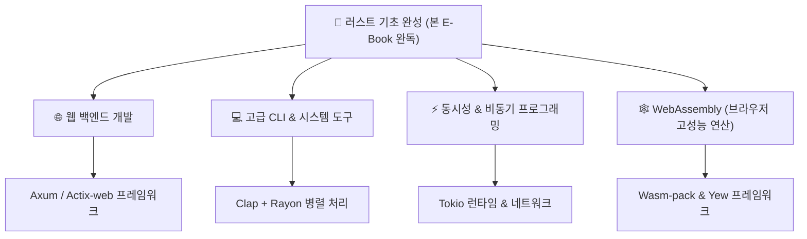

# 09. 부록: Rust 치트시트 & 추천 로드맵 🧭

> *"개발 중 헷갈릴 때마다 언제든 다시 펼쳐보는 든든한 요약 가이드와 다음 학습 이정표입니다."*

---

## 9.1 꼭 기억해야 할 Cargo 필수 명령어 치트시트

| 명령어 | 설명 | 꿀팁 |
| :--- | :--- | :--- |
| `cargo new <이름>` | 새로운 바이너리 프로젝트 생성 | `--lib`을 붙이면 라이브러리 프로젝트 생성 |
| `cargo check` | 바이너리 생성 없이 타입/문법 검사 | `cargo build`보다 훨씬 빠르므로 수시로 실행! |
| `cargo run` | 코드 컴파일 후 바로 실행 | `-- <인자>` 형태로 CLI 인자 전달 가능 |
| `cargo build` | 개발용 빌드 (`target/debug`) | 디버그 정보 포함, 빌드 빠름 |
| `cargo build --release` | **프로덕션 배포용 최적화 빌드** | 모든 컴파일러 최적화 활성화 (`target/release`), 극상의 실행 속도 |
| `cargo add <크레이트>` | 외부 라이브러리 의존성 추가 | `Cargo.toml`을 직접 편집하지 않아도 됨 |
| `cargo test` | 프로젝트 내 모든 단위/통합 테스트 실행 | `#[test]` 함수 자동 탐색 및 병렬 실행 |
| `cargo clippy` | Rust의 엄격한 AI 코드 린터 | 더 관용적이고 효율적인 코드 작성법을 조언해 줌 |
| `cargo fmt` | 공식 코드 스타일 가이드에 맞춰 자동 정렬 | 팀원 간의 코드 스타일 분쟁 종결자 |

---

## 9.2 초보자가 가장 많이 만나는 컴파일 에러 Top 5와 해결법

### 1. `cannot assign twice to immutable variable`
- **원인**: 기본적으로 불변인 변수에 값을 다시 대입하려고 했을 때 발생합니다.
- **해결법**: 변수 선언 시 `let` 뒤에 **`mut`**을 붙여주세요.
  ```rust
  let mut count = 0;
  count = 1;
  ```

### 2. `use of moved value` (이미 이동된 값 사용)
- **원인**: 힙 데이터를 가진 변수의 소유권이 다른 변수나 함수로 넘어갔는데, 옛 변수를 다시 읽으려 할 때 발생합니다.
- **해결법**:
  - 소유권을 넘기는 대신 **참조(`&`)**로 빌려주세요.
  - 꼭 독립된 데이터가 필요하다면 **`.clone()`**을 사용하세요.
  ```rust
  print_data(&my_string); // 소유권을 주지 않고 빌려줌!
  ```

### 3. `cannot borrow as mutable more than once at a time`
- **원인**: 같은 데이터에 대해 동시에 두 개 이상의 가변 참조(`&mut`)를 만들려고 했을 때 발생합니다.
- **해결법**: 첫 번째 가변 참조가 사용을 다 끝내고 스코프를 벗어난 후에 다음 가변 참조를 생성하세요.
  ```rust
  {
      let r1 = &mut data;
      r1.push('A');
  } // r1의 사용이 끝남!
  let r2 = &mut data; // ⭕ 이제 안전합니다!
  ```

### 4. `cannot return reference to local variable / temporary value`
- **원인**: 함수 안에서 만든 변수의 참조(`&`)를 반환하려고 할 때 발생합니다. (함수가 끝나면 원본이 소멸하므로 가리킬 대상이 사라짐)
- **해결법**: 참조(`&`) 대신 **값의 소유권 자체(`String`, `Vec` 등)를 통째로 반환**하세요.
  ```rust
  fn create_text() -> String {
      let s = String::from("Rust");
      s // &s 가 아닌 s 자체를 반환!
  }
  ```

### 5. `mismatched types (expected ..., found ...)`
- **원인**: Rust는 암시적 형변환(Implicit Coercion)을 거의 하지 않습니다. `i32`와 `i64`, `&str`과 `String`은 엄연히 다른 타입입니다.
- **해결법**: `as` 키워드로 캐스팅하거나, `.to_string()`, `String::from()`, `.as_str()` 등을 통해 명시적으로 변환하세요.

---

## 9.3 다음 걸음을 위한 추천 학습 로드맵

Rust의 기초와 철학을 익히신 여러분, 이제 날개를 펼칠 차례입니다! 관심 있는 분야에 맞춰 다음 학습 경로를 탐색해 보세요.



### 1. 무료 추천 공식 학습 리소스
- **[The Rust Programming Language (공식 바이블 러스트 북)](https://doc.rust-lang.org/book/)**: 가장 깊이 있고 권위 있는 공식 안내서 (한국어 번역본도 활발히 제공됨)
- **[Rustlings](https://github.com/rust-lang/rustlings)**: 컴파일 에러를 하나씩 고쳐가며 게임처럼 배우는 실습 튜토리얼
- **[Rust by Example](https://doc.rust-lang.org/rust-by-example/)**: 수많은 코드 예제로 빠르게 훑어보는 가이드

### 2. 관심 분야별 추천 생태계
- **고성능 웹 서버 구축**: `Axum` (Tokio 팀 공식 제작) 또는 `Actix-web`
- **비동기 네트워크 & 마이크로서비스**: `Tokio`, `Tonic (gRPC)`
- **데이터베이스 연동**: `SQLx` (컴파일 타임에 SQL 문법과 타입을 검증해 주는 혁신적인 ORM/드라이버)
- **데스크톱 GUI 앱 개발**: `Tauri` (Electron보다 용량이 1/10로 가볍고 메모리를 거의 안 먹는 차세대 크로스플랫폼 프레임워크)

---

페리스와 함께한 Rust 대탐험의 완주를 진심으로 축하드립니다!  
이제 여러분은 안전하고 번개처럼 빠른 코드를 작성할 수 있는 당당한 **러스테이시안(Rustacean)**입니다! 🦀🚀

