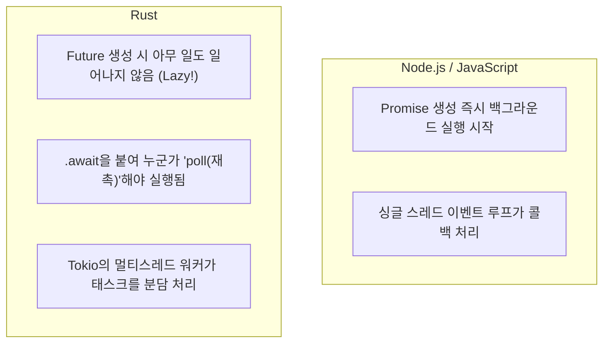

# 01. 비동기 Rust와 Axum 프레임워크 입문 🚀

> *"Node.js의 이벤트 루프보다 빠르고, Go의 고루틴보다 메모리를 아끼는 비동기 Rust의 세계로 오신 것을 환영합니다!"*

---

## 1.1 비동기 Rust의 원리: Node.js 개발자를 위한 비교

기존 웹 개발(Node.js, Python FastAPI, Go 등)에서 비동기는 이미 친숙한 개념일 것입니다.  
하지만 **Rust의 비동기(`async / await`)는 다른 언어들과 결정적인 차이점**이 있습니다.



### 1. Rust의 Future는 게으르다(Lazy)
JavaScript에서 `fetch(...)`를 호출하면 `.then()`이나 `await`을 쓰지 않아도 백그라운드에서 네트워크 요청이 즉시 출발합니다.  
하지만 Rust에서 `async fn`은 **호출하는 순간에는 아무 일도 하지 않고 `Future`라는 '계획표'만 생성**합니다.  
반드시 뒤에 **`.await`**을 붙여 런타임에 의해 '폴링(Poll)'되어야 비로소 실행됩니다. 이를 통해 불필요한 연산과 메모리 낭비를 원천 차단합니다.

### 2. 가비지 컬렉터 없이 상태 머신(State Machine)으로 컴파일
Rust 컴파일러는 `async / await` 코드를 만나면, 런타임에 동적 메모리를 할당하는 대신 **컴파일 타임에 정확한 크기의 거대한 열거형(Enum) 형태의 상태 머신**으로 변환합니다.  
따라서 비동기 처리를 수백만 개 띄워도 메모리 오버헤드가 사실상 0(Zero)에 가깝습니다.

---

## 1.2 Tokio 비동기 런타임이란? ⚡

Rust 표준 라이브러리(`std`)에는 비동기 문법(`async/await`)만 정의되어 있고, **실제로 비동기 작업을 스케줄링하고 네트워크 I/O를 처리하는 엔진(런타임)**은 포함되어 있지 않습니다.  
이 런타임의 사실상 글로벌 표준이 바로 **Tokio(도쿄)**입니다.

- **작업 훔치기(Work-Stealing) 스케줄러**: CPU 코어마다 워커 스레드가 배정되어 자기 할 일을 처리하다가, 일이 먼저 끝난 스레드가 다른 바쁜 스레드의 큐에서 남은 작업을 몰래 가져와 처리(Stealing)합니다. 모든 CPU 코어가 100% 균등하게 일합니다.
- **초경량 그린 태스크(`tokio::spawn`)**: OS 스레드 하나는 수 MB의 스택 메모리를 먹지만, Tokio의 태스크는 **단 수백 바이트(Byte)**에 불과합니다. 단일 서버에서 수백만 개의 동시 접속 태스크를 띄울 수 있는 비결입니다.

---

## 1.3 왜 수많은 웹 프레임워크 중 Axum인가? 🦀

Rust 생태계에는 Actix-web, Rocket 등 훌륭한 프레임워크들이 있습니다.  
그럼에도 불구하고 현재 전 세계 Rust 백엔드 개발자들이 **Axum(액섬)**을 압도적인 1위로 꼽는 이유는 다음과 같습니다:

1. **Tokio 공식 팀이 직접 개발 및 유지보수**: Tokio 비동기 엔진, Hyper(HTTP/1, HTTP/2 엔진), Tower(미들웨어)와 한 몸처럼 유기적으로 결합되어 있습니다.
2. **매크로 없는 순수 함수형 설계**: Rocket처럼 기괴한 컴파일러 매크로(`#[get("/")]`)를 남발하지 않고, 명확하고 직관적인 Rust 코드로 라우팅을 조립합니다.
3. **선언적 익스트랙터(Extractor)**: 핸들러 함수의 매개변수 타입만 적어두면, Path, Query, JSON 바디, 헤더, 인증 정보를 Axum이 알아서 검증하고 파싱해 줍니다.

---

## 1.4 첫 번째 실습 프로젝트: `sample-01-basic-api`

이제 직접 코드로 고성능 Axum 웹 서버를 만들어 보겠습니다!

### 프로젝트 주요 기능
- `GET /`: 서버 헬스체크 및 환영 메시지
- `GET /api/users/:id`: URL Path 파라미터 추출
- `GET /api/search?keyword=...&limit=...`: Query 파라미터 추출
- `POST /api/users`: JSON 요청 바디 수신 및 새 데이터 반환
- **Graceful Shutdown**: `Ctrl + C` 입력 시 진행 중인 요청을 안전하게 마무리하고 서버 종료

### 핵심 코드 살펴보기

#### 1. 강력한 익스트랙터 (Extractors)
```rust
// 1. Path 파라미터 추출: /api/users/:id
async fn get_user(Path(user_id): Path<u32>) -> String {
    format!("조회한 유저 ID: {user_id}")
}

// 2. Query 파라미터 추출: /api/search?keyword=rust&limit=10
#[derive(Deserialize)]
struct SearchQuery {
    keyword: String,
    limit: Option<usize>,
}

async fn search(Query(params): Query<SearchQuery>) -> String {
    format!("검색어: {}, 제한: {:?}", params.keyword, params.limit.unwrap_or(10))
}

// 3. JSON 요청 및 응답
#[derive(Deserialize)]
struct CreateUserRequest {
    username: String,
    email: String,
}

#[derive(Serialize)]
struct UserResponse {
    id: u32,
    username: String,
    email: String,
}

async fn create_user(
    Json(payload): Json<CreateUserRequest>,
) -> (StatusCode, Json<UserResponse>) {
    let user = UserResponse {
        id: 1,
        username: payload.username,
        email: payload.email,
    };
    (StatusCode::CREATED, Json(user))
}
```

#### 2. 라우터 조립과 서버 바인딩
```rust
let app = Router::new()
    .route("/", get(root_handler))
    .route("/api/users/:id", get(get_user))
    .route("/api/search", get(search))
    .route("/api/users", post(create_user));

let listener = tokio::net::TcpListener::bind("127.0.0.1:3000").await.unwrap();
axum::serve(listener, app).await.unwrap();
```

---

다음 섹션에서는 실제 워크스페이스를 만들고 이 프로젝트를 직접 실행해 테스트해 보겠습니다! 🏃‍♂️💨

