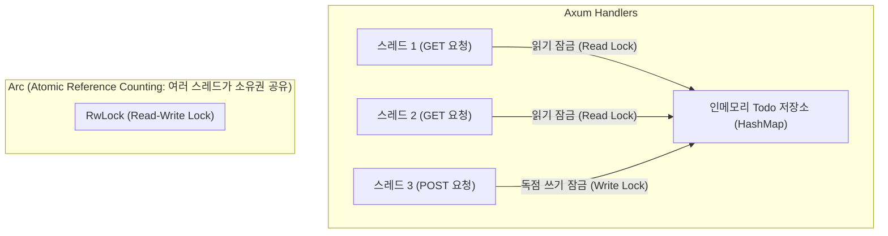

# 02. 견고한 RESTful API 아키텍처와 상태 공유 🏛️

> *"단순한 엔드포인트 나열을 넘어, 수천 개의 요청이 동시에 몰려와도 안전한 아키텍처와 관용적(Idiomatic) 에러 처리 체계를 만듭니다."*

---

## 2.1 멀티스레드 웹 서버의 상태 공유: 왜 `Arc<RwLock<T>>`일까?

Node.js는 싱글 스레드 이벤트 루프 모델이라 전역 변수에 데이터를 담고 아무 함수에서나 수정해도 스레드 충돌(Race Condition)이 일어나지 않습니다.  
하지만 **Rust와 Tokio는 여러 개의 CPU 코어를 동시에 활용하는 멀티스레드 환경**입니다!

여러 스레드가 동시에 메모리를 읽고 쓰려 할 때, Rust 컴파일러의 대원칙("가변 참조는 오직 단 하나만 존재할 수 있다")을 지키려면 **스레드 안전한 도구들**이 필요합니다.



### 1. `Arc<T>` (원자적 참조 카운팅)
- 일반적인 `Rc<T>`는 단일 스레드 전용입니다.
- **`Arc<T>` (Atomic Reference Counted)**는 여러 스레드가 동시에 안전하게 동일한 데이터를 가리키며 소유권을 공유할 수 있도록 원자적(Atomic) 연산을 수행합니다.

### 2. `RwLock<T>` (읽기/쓰기 잠금)
- `Mutex<T>`는 읽을 때나 쓸 때나 무조건 한 번에 딱 1개의 스레드만 접근을 허용합니다.
- 반면 웹 서버는 보통 **"조회(Read)가 90%, 수정(Write)이 10%"**입니다.
- **`RwLock<T>`**은 데이터를 읽기만 할 때는 수천 개의 스레드가 동시에 조회할 수 있게 열어두고, 데이터를 추가/수정/삭제할 때만 잠시 독점 쓰기 권한을 부여하여 **동시성 처리 성능을 극대화**합니다.

---

## 2.2 Axum의 `State` 추출기: 우아한 의존성 주입(DI)

Spring의 `@Autowired`나 NestJS의 의존성 주입(DI)처럼, Axum에서는 **`State` 추출기**를 사용하여 데이터베이스 풀이나 상태 객체를 각 핸들러에 주입합니다.

```rust
// 1. 상태 타입 정의
#[derive(Clone)]
struct AppState {
    db: Arc<RwLock<HashMap<u64, Todo>>>,
}

// 2. 라우터에 주입
let state = AppState { ... };
let app = Router::new()
    .route("/api/todos", get(list_todos).post(create_todo))
    .with_state(state); // 👈 전체 라우터에 상태 주입!

// 3. 핸들러에서 꺼내 쓰기
async fn list_todos(
    State(state): State<AppState>, // 👈 선언만 하면 Axum이 알아서 주입!
) -> impl IntoResponse {
    let todos = state.db.read().await;
    // ...
}
```

---

## 2.3 실무 수준의 에러 핸들링: `AppError`와 `IntoResponse`

초보자들은 에러가 날 때마다 핸들러에서 직접 `(StatusCode::NOT_FOUND, "없음")` 형태로 하드코딩하기 쉽습니다.  
하지만 실무에서는 **비즈니스 에러를 `enum`으로 깔끔하게 정의**하고, 이를 Axum이 이해할 수 있도록 **`IntoResponse` 트레이트**를 구현하는 것이 가장 관용적인 Rust 백엔드 스타일입니다.

```rust
// 1. 우리 서비스의 모든 에러를 열거형으로 정의
pub enum AppError {
    NotFound(String),
    BadRequest(String),
    InternalServerError(String),
}

// 2. 에러가 발생했을 때 클라이언트에 어떤 HTTP 응답을 보낼지 정의
impl IntoResponse for AppError {
    fn into_response(self) -> Response {
        let (status, error_message) = match self {
            AppError::NotFound(msg) => (StatusCode::NOT_FOUND, msg),
            AppError::BadRequest(msg) => (StatusCode::BAD_REQUEST, msg),
            AppError::InternalServerError(msg) => (StatusCode::INTERNAL_SERVER_ERROR, msg),
        };

        let body = Json(serde_json::json!({
            "success": false,
            "error": error_message,
            "code": status.as_u16(),
        }));

        (status, body).into_response()
    }
}
```

이제 핸들러에서는 지저분한 분기문 대신 물음표(`?`) 연산자나 직관적인 에러 반환을 사용할 수 있습니다!
```rust
async fn get_todo(
    State(state): State<AppState>,
    Path(id): Path<u64>,
) -> Result<Json<Todo>, AppError> {
    let store = state.db.read().await;
    let todo = store.get(&id).ok_or_else(|| {
        AppError::NotFound(format!("{id}번 할 일을 찾을 수 없습니다."))
    })?;

    Ok(Json(todo.clone()))
}
```

---

## 2.4 Phase 2 샘플 프로젝트: `sample-02-rest-crud`

이번 실습 프로젝트에서는 모듈화된 아키텍처로 완전한 Todo RESTful CRUD API를 구축합니다.

### 지원 엔드포인트
| HTTP 메서드 | 경로 | 설명 | 응답 코드 |
| :--- | :--- | :--- | :--- |
| `POST` | `/api/todos` | 새로운 Todo 생성 | `201 Created` |
| `GET` | `/api/todos` | 전체 Todo 목록 조회 | `200 OK` |
| `GET` | `/api/todos/{id}` | 특정 Todo 상세 조회 | `200 OK` or `404 Not Found` |
| `PUT` | `/api/todos/{id}` | 특정 Todo 내용/상태 수정 | `200 OK` or `404 Not Found` |
| `DELETE` | `/api/todos/{id}` | 특정 Todo 삭제 | `204 No Content` or `404 Not Found` |

코드로 직접 구현해 보러 갑시다! 🏃‍♂️💨

