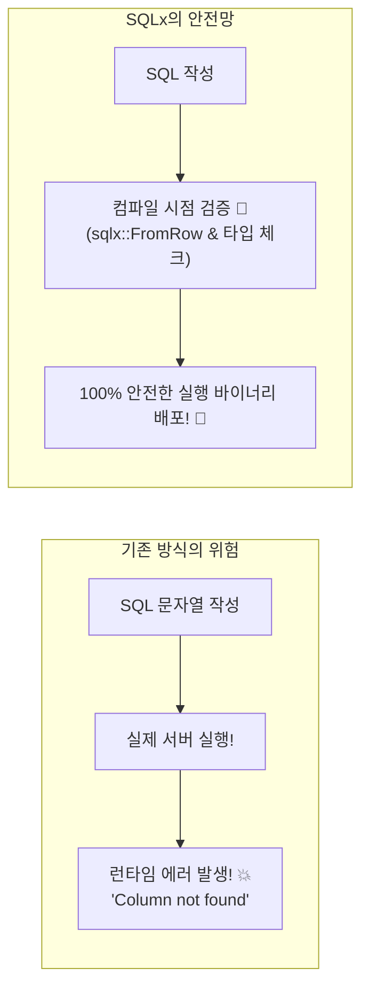
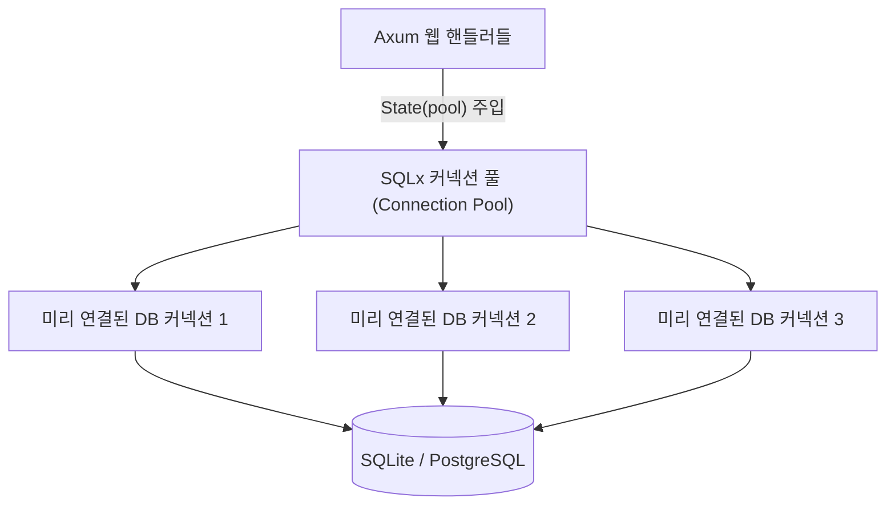

# 03. 컴파일 타임 안전성을 보장하는 SQLx 데이터베이스 🗄️⚡

> *"SQL 오타 때문에 새벽에 운영 서버가 터진 적이 있으신가요? SQLx는 컴파일 타임에 DB 스키마와 SQL 문법을 검증하여 런타임 에러를 100% 방지합니다."*

---

## 3.1 ORM vs 순수 SQL의 딜레마를 끝낸 SQLx

웹 개발(Node.js, Python, Java)을 할 때 데이터베이스를 다루는 방식은 크게 두 가지였습니다:

| 접근 방식 | 장점 | 치명적인 단점 |
| :--- | :--- | :--- |
| **무거운 ORM**<br/>*(TypeORM, JPA, Hibernate)* | • 객체 지향적이고 편리함<br/>• 타입 자동 완성 | • 쿼리 최적화가 어려움<br/>• **악명 높은 N+1 쿼리 문제**<br/>• 무거운 런타임 오버헤드 |
| **원시 SQL 드라이버**<br/>*(pg, mysql2)* | • 손수 최적화한 순수 SQL 사용<br/>• 극상의 성능 | • **컬럼명 오타 하나만 나도 런타임에 서버 다운!**<br/>• DB 결과를 객체로 일일이 매핑하는 고통 |

### Rust의 해답: SQLx
**SQLx**는 가비지 컬렉터 없는 Rust의 철학에 맞춰 탄생한 차세대 비동기 SQL 라이브러리입니다.



1. **컴파일 타임 타입 검사**: Rust의 구조체 필드 타입(`i64`, `String`, `bool`)과 SQL 테이블의 컬럼 타입(`INTEGER`, `TEXT`, `BOOLEAN`)이 일치하지 않으면 **빌드 자체가 되지 않습니다!**
2. **완전 비동기(Pure Async)**: Tokio 런타임 위에서 단 하나의 스레드도 블로킹하지 않고 수만 개의 쿼리를 논블로킹으로 동시 처리합니다.
3. **제로 코스트 객체 매핑 (`FromRow`)**: 복잡한 리플렉션 없이 컴파일 타임에 생성된 초고속 바이트 복사 코드로 쿼리 결과를 구조체로 즉시 변환합니다.

---

## 3.2 비동기 커넥션 풀(Connection Pool)의 원리

매 HTTP 요청마다 데이터베이스와 TCP 악수(Handshake) 및 인증을 거쳐 연결을 새로 맺으면 엄청난 지연 시간(Latency)이 발생합니다.

SQLx는 **`SqlitePool` (또는 `PgPool`)**이라는 고성능 비동기 커넥션 풀을 제공합니다:



- 서버가 시작될 때 미리 일정 개수의 커넥션을 맺어두고 풀에 담아둡니다.
- 쿼리가 필요할 때 잠깐 빌려 쓰고(`acquire`), 작업이 끝나면 자동으로 풀에 반납합니다.
- `SqlitePool`은 내부적으로 `Arc`로 감싸져 있어, **`.clone()` 비용이 포인터 복사 수준(극소)**이므로 Axum의 `State`에 바로 넣어 전체 핸들러에서 안전하게 공유할 수 있습니다!

---

## 3.3 코드 안에서 안전하게 실행하는 마이그레이션 (`sqlx::migrate!`)

별도의 CLI 도구를 수동으로 실행할 필요 없이, **서버가 구동될 때 자동으로 최신 SQL 스키마를 적용**하도록 만들 수 있습니다.

```
sample-03-sqlx-database/
├── migrations/
│   └── 20261101_init.sql   # 테이블 생성 DDL 스크립트
```

```rust
// 서버 구동 시 단 한 줄로 마이그레이션 자동 수행!
sqlx::migrate!("./migrations")
    .run(&pool)
    .await
    .expect("DB 마이그레이션 실패");
```

---

## 3.4 Phase 3 샘플 프로젝트: `sample-03-sqlx-database`

이번 실습 프로젝트에서는 파일 기반 SQLite 데이터베이스를 사용하여 영구적으로 데이터를 저장하고 관리하는 REST API를 구축합니다.

### 핵심 기능
- `SqlitePool` 기반의 안전한 비동기 커넥션 풀 관리
- `sqlx::migrate!`를 통한 자동 테이블 생성
- `FromRow` 트레이트를 활용한 타입 안전한 SELECT 쿼리
- 4대 CRUD SQL 문법:
  - `INSERT INTO todos (...) VALUES (...)`
  - `SELECT * FROM todos`
  - `UPDATE todos SET ... WHERE id = ?`
  - `DELETE FROM todos WHERE id = ?`
- **인메모리 SQLite(`sqlite::memory:`) 기반의 0.01초 격리 통합 테스트**

이제 코드로 직접 구현해 보겠습니다! 🏃‍♂️💨

