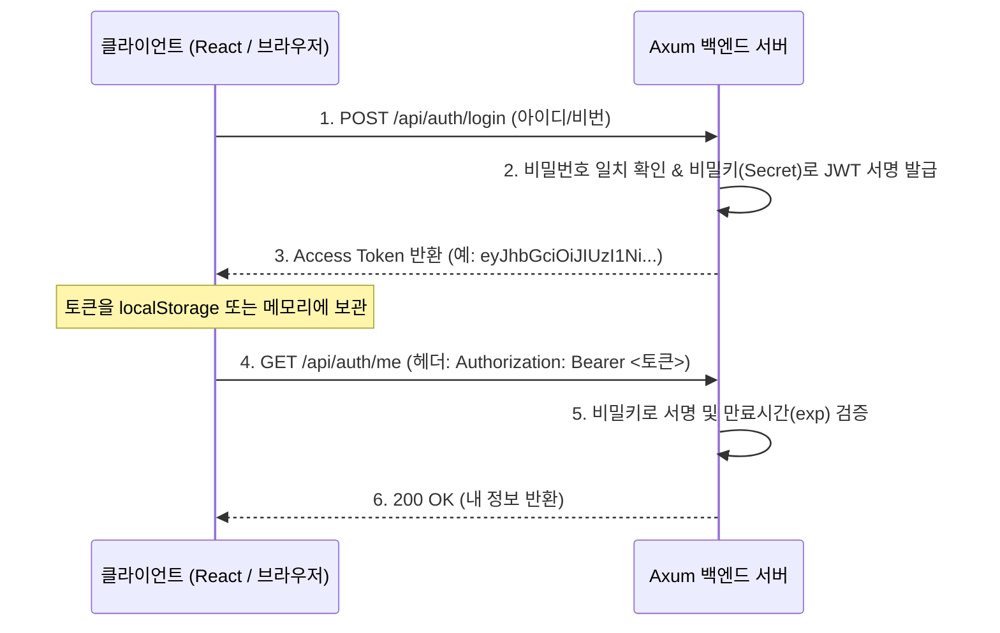

# 04. JWT 인증, 비밀번호 암호화, 그리고 미들웨어 🔐

> *"보안은 타협할 수 없는 백엔드의 핵심입니다. 현대적인 웹 보안의 표준인 Argon2 비밀번호 해싱, JWT 발급/검증, 그리고 Axum의 커스텀 익스트랙터(Auth Guard)를 마스터합니다."*

---

## 4.1 비밀번호 암호화의 황제: 왜 Argon2id인가?

많은 개발자들이 아직도 예전 방식인 `MD5`, `SHA-256`, 또는 `Bcrypt`를 비밀번호 암호화에 사용하곤 합니다. 하지만 이는 현대 GPU 연산력 앞에서 무차별 대입 공격(Brute-force Attack)에 취약합니다.

- **Argon2id**: 2015년 세계 암호학회 패스워드 해싱 대회(Password Hashing Competition)에서 최종 우승을 차지한 **현존 최고 보안 등급의 알고리즘**입니다.
- **메모리 강제(Memory-Hard)**: CPU 연산뿐만 아니라 대량의 RAM 메모리를 강제로 사용하게 만들어, 수천 대의 GPU나 ASIC 채굴기를 동원한 병렬 크래킹 공격을 원천적으로 무력화합니다.

Rust에서는 **`argon2`** 크레이트를 사용하여 단 3줄로 강력한 솔트(Salt) 생성과 해싱, 검증을 수행합니다.

```rust
use argon2::{
    password_hash::{rand_core::OsRng, PasswordHash, PasswordHasher, PasswordVerifier, SaltString},
    Argon2,
};

// 1. 비밀번호 해싱 (회원가입 시)
let salt = SaltString::generate(&mut OsRng);
let password_hash = Argon2::default()
    .hash_password("my_secret_password".as_bytes(), &salt)
    .unwrap()
    .to_string();

// 2. 비밀번호 검증 (로그인 시)
let parsed_hash = PasswordHash::new(&password_hash).unwrap();
let is_valid = Argon2::default()
    .verify_password("user_input_password".as_bytes(), &parsed_hash)
    .is_ok();
```

---

## 4.2 무상태(Stateless) 인증의 표준: JWT (JSON Web Token)

서버가 세션(Session)을 메모리에 들고 있지 않고도, 사용자가 로그인된 상태인지를 안전하게 검증하는 기술이 바로 **JWT**입니다.



### JWT 클레임(Claims) 구조
```rust
#[derive(Debug, Serialize, Deserialize, Clone)]
pub struct Claims {
    pub sub: String,  // 사용자 ID (Subject)
    pub username: String,
    pub exp: usize,   // 만료 타임스탬프 (Expiration Time)
}
```

---

## 4.3 Axum의 백미: 커스텀 익스트랙터로 인증 가드(Auth Guard) 만들기!

스프링의 `@PreAuthorize`나 NestJS의 `@UseGuards(JwtAuthGuard)`처럼, Axum에서는 **`FromRequestParts` 트레이트**를 구현하여 세상에서 가장 우아한 인증 가드를 만듭니다.

### 작동 방식
핸들러 매개변수에 **`claims: Claims`**를 적어두기만 하면:
1. Axum이 요청 헤더의 `Authorization: Bearer <token>`을 자동으로 추출합니다.
2. 토큰이 없거나, 위조되었거나, 유효기간이 지났다면? ➡️ **핸들러를 아예 실행하지도 않고 즉시 `401 Unauthorized` 에러를 반환**합니다!
3. 토큰이 완벽하게 유효할 때만 핸들러의 매개변수에 검증된 `Claims` 객체를 쏙 꽂아줍니다!

```rust
// 🛡️ 완벽하게 보호된 라우트 핸들러!
async fn get_me(claims: Claims) -> Json<UserResponse> {
    // 여기에 도달했다는 것은 100% 토큰 검증이 끝났음을 보장함!
    Json(UserResponse {
        id: claims.sub,
        username: claims.username,
    })
}
```

---

## 4.4 Tower-HTTP 미들웨어: CORS & 요청 추적 로깅

현대 웹 애플리케이션(React, Next.js, Vue 등)과 연동할 때 필수적인 **CORS(교차 출처 리소스 공유)** 설정도 `tower-http` 미들웨어를 통해 라우터에 단 몇 줄로 얹을 수 있습니다:

```rust
use tower_http::cors::{Any, CorsLayer};

let cors = CorsLayer::new()
    .allow_origin(Any)
    .allow_methods(Any)
    .allow_headers(Any);

let app = Router::new()
    .route(...)
    .layer(cors); // 전체 라우터에 CORS 미들웨어 적용!
```

---

## 4.5 Phase 4 실습 프로젝트: `sample-04-auth-jwt`

이번 실습 프로젝트에서는 보안이 완벽하게 적용된 회원가입, 로그인, 그리고 보호된 회원 정보 조회 API를 완성합니다.

### 엔드포인트 목록
| HTTP 메서드 | 경로 | 권한 | 설명 |
| :--- | :--- | :--- | :--- |
| `POST` | `/api/auth/register` | 누구나 | 신규 회원가입 (Argon2id 패스워드 암호화) |
| `POST` | `/api/auth/login` | 누구나 | 로그인 (비밀번호 일치 확인 ➡️ JWT 토큰 반환) |
| `GET` | `/api/auth/me` | **인증 필수** 🔒 | 내 정보 조회 (`Authorization: Bearer <토큰>`) |
| `GET` | `/api/public/hello` | 누구나 | 공개 테스트 엔드포인트 |

코드로 직접 구현해 보러 갑시다! 🏃‍♂️💨

