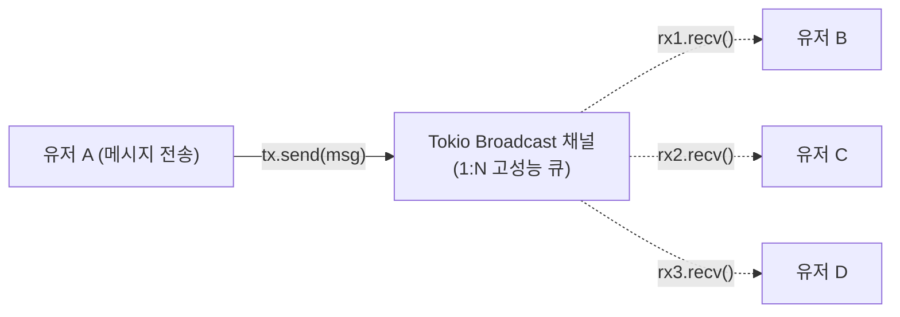

# 05. 10만 동시 접속을 버티는 실시간 웹소켓(WebSocket) ⚡💬

> *"폴링(Polling)의 비효율을 끝내는 양방향 실시간 통신. Tokio의 논블로킹 브로드캐스트 채널로 수만 명의 유저에게 단 1밀리초 만에 메시지를 전달합니다."*

---

## 5.1 HTTP 요청/응답 vs WebSocket 양방향 스트리밍

기존의 HTTP는 클라이언트가 물어봐야만 서버가 대답하는 **단방향 요청-응답(Request-Response)** 모델입니다.  
실시간 채팅이나 주식 호가창을 구현하려고 1초마다 HTTP 요청을 날리는 **폴링(Polling)**을 쓰면 헤더 오버헤드와 서버 부하가 기하급수적으로 폭증합니다.

```mermaid
graph TD
    subgraph HTTP의 한계 (Polling)
        C1["브라우저"] -->|"1초마다 GET 요청 (무거운 헤더)"| S1["서버"]
        S1 -->|"새 메시지 없음"| C1
    end
    subgraph WebSocket (Full-Duplex)
        C2["브라우저"] <=="단 1회 TCP 연결 후 끊김 없이 양방향 통신 (수 바이트 오버헤드)"==> S2["Axum 서버"]
    end
```

- **WebSocket**: 단 한 번의 HTTP 핸드셰이크를 거친 후, **동일한 TCP 커넥션을 영구적으로 유지**하며 양쪽에서 원할 때 언제든 실시간 메시지를 주고받는 **전이중(Full-Duplex) 통신** 규격입니다.

---

## 5.2 Tokio의 비밀 무기: `broadcast` 채널 📢

수천 명의 유저가 한 채팅방에 있을 때, 한 명이 보낸 메시지를 나머지 모두에게 어떻게 전달해야 할까요?  
각 소켓마다 순차적으로 루프를 돌며 보내면 뒤쪽 유저는 메시지를 늦게 받게 됩니다.

이때 사용하는 것이 바로 **`tokio::sync::broadcast`** 채널입니다!



- **1:N 팬아웃(Fan-out) 아키텍처**: 메시지를 채널에 딱 한 번 던지면(`tx.send`), 연결된 모든 수신자(`rx`)의 큐로 초고속 논블로킹 복제 전송됩니다.
- **락프리(Lock-Free) 버퍼링**: 스레드를 블로킹하지 않고 링 버퍼(Ring Buffer)를 활용해 메모리 복사 오버헤드를 극도로 아낍니다.

---

## 5.3 Axum에서 WebSocket 다루기 (`WebSocketUpgrade`)

Axum은 웹소켓 처리를 위한 `WebSocketUpgrade` 추출기를 기본 제공합니다:

```rust
use axum::extract::ws::{WebSocketUpgrade, WebSocket, Message};

// 1. HTTP 요청을 WebSocket으로 업그레이드
async fn ws_handler(
    ws: WebSocketUpgrade,
    State(state): State<AppState>,
) -> impl IntoResponse {
    ws.on_upgrade(|socket| handle_socket(socket, state))
}

// 2. 소켓 스트림 분리 (송신용 / 수신용)
async fn handle_socket(socket: WebSocket, state: AppState) {
    let (mut sender, mut receiver) = socket.split();

    // 송신 태스크와 수신 태스크를 분리하여 동시에 논블로킹 처리!
    // tokio::select! 또는 tokio::spawn 활용
}
```

---

## 5.4 Phase 5 샘플 프로젝트: `sample-05-realtime-chat`

이번 실습 프로젝트에서는 브라우저에서 바로 열람할 수 있는 **반응형 웹 채팅 UI가 내장된 완전한 실시간 단체 채팅 서버**를 구현합니다.

### 주요 기능
- **웹소켓 업그레이드 (`GET /ws?username=<닉네임>`)**: 닉네임을 받아 실시간 채팅방 입장
- **입장/퇴장 자동 브로드캐스트**: 유저가 접속하거나 창을 닫으면 방 전체에 알림 전송
- **채팅 메시지 실시간 팬아웃**: 누가 글을 쓰면 모든 접속자 화면에 즉시 표시
- **내장 웹 클라이언트 (`GET /`)**: 브라우저 탭을 여러 개 띄워 실시간 대화를 바로 테스트할 수 있는 예쁜 모던 UI
- **접속 통계 API (`GET /api/stats`)**: 현재 동시 접속자 수 및 방 상태 JSON 반환

코드로 직접 구현하러 갑시다! 🏃‍♂️💨

