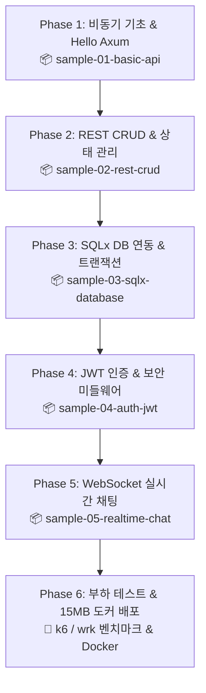

# 🚀 Rust 고성능 백엔드 마스터 작업계획서

> **"초당 수십만 요청(RPS)과 단 수십 MB 메모리의 기적!"**  
> 본 계획서는 기존 웹 개발자(Node.js/Python/Java 등)가 Rust의 비동기 런타임과 웹 생태계를 정복하여, 실무 수준의 초고속·초경량·무장애 백엔드 시스템을 직접 구축할 수 있도록 돕는 실습 중심의 마스터 플랜입니다.

---

## 1. 프로젝트 개요 & 학습 목표

| 항목 | 내용 |
| :--- | :--- |
| **목표** | Node.js/Python의 한계를 뛰어넘는 초고성능 백엔드 아키텍처 구축 역량 확보 |
| **주 기술 스택** | • 웹 프레임워크: **Axum** (Tokio 팀 공식 차세대 프레임워크)<br>• 비동기 런타임: **Tokio** (글로벌 표준 고성능 비동기 엔진)<br>• 데이터베이스: **SQLx** (컴파일 타임 SQL 검증, 완전 비동기)<br>• 미들웨어 & 관측성: **Tower**, **tracing**<br>• 인증 및 보안: **JWT**, **Argon2**<br>• 실시간 통신 & 캐시: **WebSocket**, **Redis** |
| **문서 저장 위치** | `c:\workdir\space-cap\rust-sandbox\docs\backend` |
| **실습 프로젝트 위치** | `c:\workdir\space-cap\rust-sandbox\projects` (Cargo Workspace 체계) |

---

## 2. 단계별 커리큘럼 및 샘플 프로젝트 로드맵



---

### [Phase 1] 비동기 Rust의 원리와 Axum 시작하기
- **이론 & 핵심 개념**:
  - `async / await`의 동작 원리와 미래 객체(`Future`)
  - Tokio 비동기 런타임의 작업 훔치기(Work-Stealing) 멀티스레드 스케줄러
  - 왜 Axum인가? (Actix-web 대비 Tokio/Tower와의 완벽한 일체감)
- **만들 샘플 프로젝트**: `sample-01-basic-api`
  - 라우팅(`Router`), 핸들러(`Handler`) 작성
  - Path 파라미터, Query 스트링, JSON 바디 파싱
  - Graceful Shutdown (서버 안전 종료) 구현

### [Phase 2] 견고한 RESTful API 아키텍처와 상태 공유
- **이론 & 핵심 개념**:
  - `AppState`와 `Arc<T>`를 이용한 스레드 안전한 인메모리 상태 공유
  - 계층형 아키텍처 설계 (Router ➡️ Handler ➡️ Service ➡️ Repository)
  - 관용적인(Idiomatic) 에러 핸들링: 커스텀 `AppError`와 `IntoResponse` 트레이트 구현
- **만들 샘플 프로젝트**: `sample-02-rest-crud`
  - 인메모리 게시판/할일 CRUD API
  - 체계적인 HTTP 상태 코드(200, 201, 400, 404, 500) 매핑

### [Phase 3] 컴파일 타임 안전성을 보장하는 SQLx 데이터베이스
- **이론 & 핵심 개념**:
  - 컴파일 타임에 SQL 오타와 타입을 잡아내는 `query!` 매크로의 기적
  - 비동기 커넥션 풀(`PgPool` / `SqlitePool`) 최적화
  - 안전한 데이터베이스 트랜잭션 처리
- **만들 샘플 프로젝트**: `sample-03-sqlx-database`
  - SQLite/PostgreSQL 기반 영구 데이터 저장소 연동
  - 마이그레이션(Migration) 스크립트 작성 및 자동 실행

### [Phase 4] JWT 인증, 비밀번호 암호화, 그리고 미들웨어
- **이론 & 핵심 개념**:
  - `Argon2id`를 이용한 최고 보안 등급의 단방향 패스워드 해싱
  - JWT 토큰 발급 및 서명 검증
  - Tower 미들웨어: CORS 설정, 요청 추적(`tracing`), 인증 가드(Auth Guard)
- **만들 샘플 프로젝트**: `sample-04-auth-jwt`
  - 회원가입, 로그인, 내 정보 조회(보호된 라우트)
  - 요청 시 자동으로 유저 정보를 파싱해주는 커스텀 익스트랙터(`AuthUser`) 구현

### [Phase 5] 10만 동시 접속을 버티는 실시간 웹소켓(WebSocket)
- **이론 & 핵심 개념**:
  - HTTP에서 WebSocket으로 프로토콜 업그레이드
  - Tokio 채널(`broadcast`, `mpsc`)을 활용한 논블로킹 메시지 브로드캐스팅
  - 분산 환경 확장을 위한 Redis Pub/Sub 구조
- **만들 샘플 프로젝트**: `sample-05-realtime-chat`
  - 고성능 실시간 단체 채팅방 서버
  - 접속자 목록 관리 및 핑퐁(Heartbeat) 헬스체크

### [Phase 6] 부하 테스트(Benchmark) & 초경량 Docker 배포
- **이론 & 핵심 개념**:
  - `k6` 또는 `wrk`를 사용한 초당 요청 수(RPS) 및 레이턴시(p99) 실측
  - Rust 멀티스테이지 Docker 빌드 (Alpine / Scratch 베이스)
- **산출물**:
  - 단 **15MB 미만의 초경량 프로덕션 Docker 이미지** 제작
  - 실전 벤치마크 리포트 작성

---

## 3. 추천 프로젝트 구조 (Cargo Workspace)

앞으로 단계별로 만들 샘플 프로젝트들을 깔끔하게 관리하기 위해 단일 루트 아래에 **Cargo Workspace**를 구축할 것을 제안합니다:

```
rust-sandbox/
├── Cargo.toml               # Workspace 루트 설정
├── docs/
│   ├── ...                  # 기존 입문 E-Book
│   └── backend/             # 📂 백엔드 마스터 가이드 & 튜토리얼
│       ├── backend_learning_plan.md   # 본 작업계획서
│       ├── 01_tokio_and_axum_intro.md
│       ├── 02_rest_api_architecture.md
│       ├── 03_sqlx_database_guide.md
│       ├── 04_auth_and_middleware.md
│       └── 05_realtime_websocket.md
└── projects/                # 📂 실전 샘플 프로젝트 모음
    ├── sample-01-basic-api/
    ├── sample-02-rest-crud/
    ├── sample-03-sqlx-database/
    ├── sample-04-auth-jwt/
    └── sample-05-realtime-chat/
```

---

## 4. 진행 절차 및 확인 요청사항

1. **[1단계] 계획서 검토 및 첫 단계 승인 (현재 단계)**
   - 본 계획서의 커리큘럼과 프로젝트 로드맵이 마음에 드시나요?
   - 데이터베이스 실습 시 기본으로 로컬 설정이 가장 쉬운 **SQLite**로 시작하여 **PostgreSQL**로 확장하는 방향이 괜찮으신지요?
2. **[2단계] Workspace 환경 구성 및 Phase 1 (sample-01-basic-api) 착수**
   - 확인을 주시면 `projects/` 폴더를 준비하고, Axum의 기초 문서 작성 및 첫 번째 샘플 프로젝트 구현을 곧바로 시작하겠습니다!
