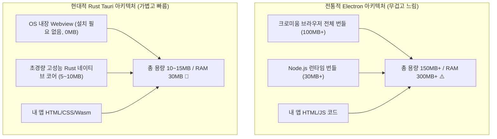

# 01장. Rust 데스크톱 GUI 생태계 지도 & 4대 패러다임 심층 분석 🗺️

> **"슬랙이나 VS Code를 띄웠을 뿐인데 왜 컴퓨터 팬이 돌고 RAM이 1GB씩 사라질까?  
> 일렉트론(Electron)의 한계를 깨부수는 Rust 데스크톱 혁명의 모든 것."**

---

## 1. 데스크톱 앱의 현실: 왜 지금 Rust인가?

현대 데스크톱 앱 시장은 지난 10년간 **Electron(일렉트론)**이 완전히 장악해 왔습니다.  
VS Code, Discord, Slack, Notion, Figma 등 우리가 매일 쓰는 수많은 앱들이 Electron으로 만들어졌습니다.

### ⚠️ Electron의 3대 치명적 한계
1. **극심한 메모리 낭비 (RAM Hog)**:
   - 앱 1개를 띄울 때마다 **완전한 구글 크로미움(Chromium) 브라우저 전체 + Node.js 런타임**이 메모리에 통째로 로드됩니다.
   - 빈 창 하나만 띄워도 기본 **150MB ~ 300MB**의 RAM을 집어삼킵니다.
2. **거대한 설치 파일 용량 (Fat Bundle)**:
   - 간단한 계산기 앱을 만들어도 최소 **80MB ~ 150MB** 이상의 설치 파일(`.exe` / `.dmg`)이 생성됩니다.
3. **보안 취약점 (Security Holes)**:
   - 웹 콘텐츠와 시스템 API(Node.js)가 느슨하게 연결되어 있어, XSS 공격 하나로 사용자 컴퓨터의 로컬 파일이 탈취되거나 악성 셸 스크립트가 실행될 위험이 상존합니다.

---

## 2. Rust 데스크톱 GUI의 4대 아키텍처 패러다임

Rust로 데스크톱 앱을 만들 때 개발자가 선택할 수 있는 길은 크게 4가지입니다. 각각의 철학과 적합한 상황이 완전히 다릅니다.

### 패러다임 1: Webview 하이브리드 진영 (Tauri 2.0) 🏆
- **동작 원리**:
  - UI 화면은 브라우저 기술(HTML, CSS, JavaScript, React, Svelte, Vue 또는 Leptos/Yew)로 그립니다.
  - 하지만 크로미움을 앱 안에 번들링하지 않고, **사용자 운영체제에 이미 깔려 있는 내장 웹뷰(Windows 10/11의 Edge WebView2, macOS의 WebKit, Linux의 WebKitGTK)**를 빌려 씁니다.
  - 파일 시스템 접근, 시스템 트레이, 네이티브 하드웨어 제어 등 무겁고 민감한 작업은 **Rust 네이티브 코어**가 처리하며, 초고속 바이너리 IPC를 통해 UI와 통신합니다.
- **장점**:
  - 웹 생태계의 수억 개에 달하는 기성 UI 라이브러리(Tailwind, Shadcn, MUI, Chart.js 등)를 100% 그대로 활용할 수 있습니다.
  - 앱 용량이 **10MB 안팎**으로 매우 작고, 메모리 사용량도 **30~50MB** 수준으로 매우 가볍습니다.
  - **Tauri 2.0**부터는 동일한 코드로 **iOS, Android 모바일 앱까지 동시 빌드**가 가능합니다.
- **단점**:
  - 사용자 PC의 웹뷰 버전 차이에 따라 사소한 CSS 렌더링 차이가 발생할 수 있습니다 (단, 최신 Windows 10/11은 WebView2 Evergreen이 자동 업데이트되므로 현재는 거의 문제없음).

---

### 패러다임 2: 즉시 모드 (Immediate Mode) GUI 진영 (egui) ⚡
- **동작 원리**:
  - 전통적인 GUI(버튼을 객체로 만들고 메모리에 보관)와 달리, **게임 엔진처럼 매 프레임(1초에 60번)마다 UI 전체를 코드로 다시 평가하여 그립니다**.
  - `if ui.button("클릭").clicked() { count += 1; }` 처럼 선언적이고 직관적인 문법을 띱니다.
- **장점**:
  - **상태 동기화 버그가 원천적으로 불가능합니다**. UI가 상태의 거울처럼 매 프레임 그려지므로 "화면의 값과 백엔드 변수 값이 따로 노는 버그"가 없습니다.
  - 웹뷰가 전혀 필요 없고, Rust가 GPU(`wgpu`, OpenGL)에 직접 드로우 콜(Draw Call)을 보냅니다.
  - 외부 의존성이 거의 없어 빌드가 빛의 속도로 끝나며, WebAssembly로도 컴파일되어 웹에서도 똑같이 돌아갑니다.
- **단점**:
  - 복잡한 반응형 CSS 레이아웃, 미려한 애니메이션, 화려한 웹 스타일 디자인을 적용하기 어렵습니다.
- **최고의 사용처**:
  - 게임 엔진 에디터, 3D 뷰어, 개발자용 디버깅 툴, 시스템 모니터링 대시보드, 음악 신시사이저 소프트웨어.

---

### 패러다임 3: 보유 모드 (Retained Mode) 순수 Rust 진영 (Iced / Slint) 🌲
- **동작 원리**:
  - UI 요소(위젯)들이 계층적 트리 구조(Widget Tree)로 메모리에 유지(Retained)되며, 상태가 변경될 때 영향을 받는 부분만 다시 그립니다.
  - **Iced**: Elm 아키텍처(Model-View-Update)를 따르며, 순수 Rust 함수형 스타일로 작성됩니다.
  - **Slint**: Qt/QML 출신의 개발자들이 만든 프레임워크로, 직관적인 UI 전용 마크업 언어(`.slint`)를 제공하며 MCU(마이크로컨트롤러, 임베디드)부터 고성능 데스크톱까지 지원합니다.
- **장점**:
  - 100% Rust 네이티브이므로 웹 기술에 의존하지 않고 강력한 컴파일 타임 타입 검사를 누릴 수 있습니다.
  - Slint의 경우 바이너리 크기가 **3~8MB** 수준으로 극단적으로 작습니다.
- **단점**:
  - 웹 생태계(React/Tailwind)에 비해 준비된 오픈소스 UI 테마나 플러그인의 수가 아직 적습니다.

---

### 패러다임 4: 크로스플랫폼 통합 진영 (Dioxus Desktop) 🌐
- **동작 원리**:
  - React/Leptos 스타일의 가상 DOM 및 Signal 문법을 사용하되, Wry(웹뷰)와 Tao(윈도우 제어)를 내부에서 감싸 데스크톱 창으로 띄웁니다.
  - 프론트엔드 UI 로직과 백엔드 시스템 로직을 모두 **100% Rust**로 작성합니다.
- **장점**:
  - 자바스크립트를 단 1줄도 쓰지 않고도 CSS와 HTML 태그 문법을 활용해 미려한 UI를 제작할 수 있습니다.
  - 웹, 데스크톱, 모바일, 서버 SSR까지 단일 코드베이스로 공유할 수 있습니다.

---

## 3. 프레임워크 종합 비교표

| 비교 기준 | **Tauri 2.0** | **egui** | **Iced** | **Slint** | **Dioxus** |
| :--- | :--- | :--- | :--- | :--- | :--- |
| **패러다임** | Webview + Native Core | 즉시 모드 (Immediate) | 보유 모드 (Elm MVU) | 반응형 속성 바인딩 | VDOM / Signal Webview |
| **UI 구현 언어** | HTML/CSS/JS (또는 Wasm) | 순수 Rust | 순수 Rust | Slint DSL + Rust | Rust (HTML 매크로) |
| **디자인 자유도** | ⭐⭐⭐⭐⭐ (무제한) | ⭐⭐⭐ (기본 테마 위주) | ⭐⭐⭐ (커스텀 가능) | ⭐⭐⭐⭐ (모던 기본 테마) | ⭐⭐⭐⭐⭐ (CSS 사용) |
| **실행 속도 / 성능** | 매우 빠름 (Native Webview) | 초고속 (GPU 직접 연산) | 초고속 (GPU 직접 연산) | 초고속 (하드웨어 가속) | 매우 빠름 |
| **메모리 점유율** | 30 ~ 50 MB | 20 ~ 40 MB | 25 ~ 50 MB | **15 ~ 30 MB** (최저) | 35 ~ 60 MB |
| **바이너리 용량** | 10 ~ 18 MB | 6 ~ 12 MB | 8 ~ 15 MB | **3 ~ 8 MB** (최소) | 12 ~ 20 MB |
| **모바일 지원** | ✅ (iOS, Android) | ⚠️ (실험적 Wasm 래퍼) | ⚠️ (개발 진행 중) | ✅ (Android, iOS) | ✅ (iOS, Android) |
| **생태계 성숙도** | ⭐⭐⭐⭐⭐ (업계 표준) | ⭐⭐⭐⭐⭐ (게임/툴 표준) | ⭐⭐⭐⭐ (커뮤니티 탄탄) | ⭐⭐⭐⭐ (상용화 수준) | ⭐⭐⭐⭐ (급성장 중) |

---

## 4. 상황별 실패 없는 선택 가이드 (Cheat Sheet)

1. **"일반 사용자를 위한 상용 서비스, 예쁜 반응형 UI가 필요하다"**  
   $\rightarrow$ 망설이지 말고 **`Tauri 2.0`**을 선택하세요. 웹의 방대한 UI 라이브러리를 그대로 쓰면서 초경량 바이너리를 얻을 수 있습니다.
2. **"개발자용 내부 도구, 데이터 시각화 도구, 복잡한 파라미터 튜닝 패널이 필요하다"**  
   $\rightarrow$ **`egui`**가 정답입니다. 디자인 고민 없이 코드 몇 줄로 버튼, 슬라이더, 플롯 그래프를 10분 만에 조립할 수 있습니다.
3. **"웹 기술을 절대 쓰고 싶지 않고, 100% 순수 Rust만으로 단단하게 만들고 싶다"**  
   $\rightarrow$ 아키텍처의 우아함을 중시한다면 **`Iced`**, 가볍고 세련된 임베디드급 앱을 원한다면 **`Slint`**를 선택하세요.
4. **"웹사이트로 배포했던 코드를 그대로 윈도우용 `.exe`로도 함께 빌드하고 싶다"**  
   $\rightarrow$ **`Tauri + Leptos/Yew`** 또는 **`Dioxus Desktop`**이 완벽한 선택입니다.

