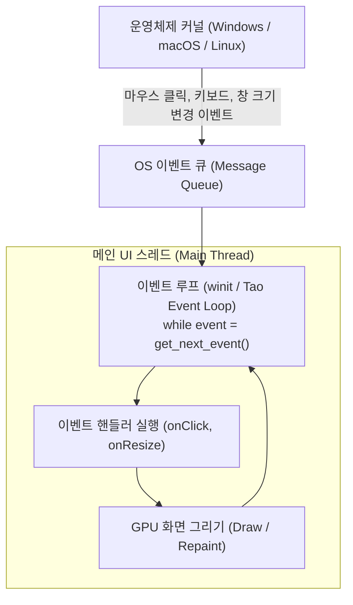
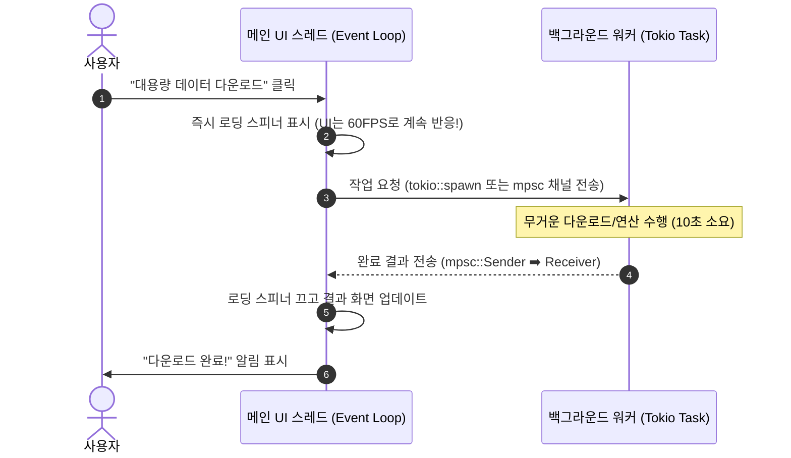
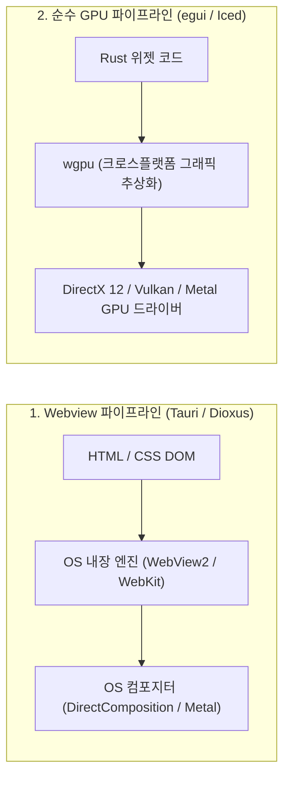

# 02장. 데스크톱 앱 개발 필수 메커니즘과 동작 원리 ⚙️

> **"웹 개발에서는 브라우저가 다 알아서 해주던 창(Window) 관리, 마우스 이벤트 루프, GPU 렌더링, 스레드 제어를 데스크톱 앱에서는 개발자가 직접 다뤄야 합니다."**

웹 브라우저 안에서 코드를 짤 때는 "창이 닫힐 때", "창 크기가 조절될 때", "화면 주사율(60Hz/144Hz)에 맞춰 GPU에 그릴 때" 일어나는 일들을 브라우저가 대신 숨겨주었습니다.

하지만 데스크톱 네이티브 앱을 개발할 때는 **운영체제(OS)가 창을 관리하는 근본적인 메커니즘**을 이해하지 못하면 앱이 멈추거나(Freezing), 메모리 릭이 생기거나, 윈도우 창이 덜덜 떨리는 문제를 겪게 됩니다.

---

## 1. 이벤트 루프(Event Loop)와 OS 윈도우 생명주기

윈도우, 맥, 리눅스 등 모든 GUI 운영체제는 **이벤트 기반 메시지 펌프(Message Pump)**로 동작합니다:



### 1) Rust 진영의 창 관리 표준: `winit`
Rust 데스크톱 생태계의 거의 모든 GUI 프레임워크(egui, Iced, Slint, Tauri의 Tao 등)는 내부적으로 **`winit`**이라는 크레이트를 기반으로 운영체제와 대화합니다.
- Windows의 `Win32 API` (`CreateWindowEx`, `PeekMessage`, `DispatchMessage`)
- macOS의 `Cocoa / AppKit` (`NSApplication`, `NSWindow`)
- Linux의 `X11 / Wayland`

이 서로 다른 플랫폼의 창 생성 로직을 Rust 타입 시스템으로 통일해 주는 것이 바로 `winit`입니다.

---

## 2. 데스크톱 개발의 황금률: "메인 UI 스레드를 절대 멈추지 마라!"

모든 데스크톱 OS는 **"창을 생성한 메인 스레드만이 창을 그리고 사용자 입력을 처리할 수 있다"**는 엄격한 단일 스레드 규칙을 강제합니다.

### ⚠️ 최악의 안티 패턴 (화면 멈춤, "응답 없음")
```rust
// ❌ 절대 메인 스레드에서 이런 코드를 실행하면 안 됩니다!
fn on_click_button() {
    // 5초 걸리는 대용량 파일 다운로드 or 무거운 DB 쿼리
    let response = reqwest::blocking::get("https://huge-file.zip"); // ⚠️ UI 프리징 발생!
}
```
버튼 클릭 핸들러 안에서 5초 동안 블로킹 I/O를 수행하면, **이벤트 루프가 멈춰서 OS의 마우스 클릭이나 화면 갱신 메시지를 처리하지 못합니다.**  
윈도우 OS는 즉시 해당 창을 하얗게 칠하고 제목 표시줄에 **"응답 없음 (Not Responding)"**을 띄웁니다!

---

### ✅ 정석 패턴: 백그라운드 비동기 워커 스레드와 채널 분리

무거운 작업은 반드시 **Tokio 비동기 런타임**이나 **백그라운드 스레드**로 던지고, 결과를 **채널(Channel)**을 통해 메인 UI 스레드로 보고해야 합니다:



---

## 3. 렌더링 파이프라인: 화면의 픽셀은 어떻게 그려지는가?

데스크톱 앱이 화면에 버튼, 텍스트, 이미지를 그리는 방식은 크게 두 가지로 나뉩니다:



### 1) Webview 파이프라인 (Tauri, Dioxus)
- 개발자는 익숙한 CSS Flexbox, Grid로 레이아웃을 작성합니다.
- OS 내장 브라우저 엔진이 레이아웃을 계산하고, OS 윈도우 컴포지터(DirectComposition, CoreAnimation)와 합성하여 출력합니다.
- 장점: 반응형 레이아웃, 복잡한 폰트 타이포그래피, CSS 애니메이션 처리가 매우 편리함.

### 2) 순수 GPU 파이프라인 (`wgpu` 기반: egui, Iced)
- 브라우저를 전혀 거치지 않고, Rust 코드가 점(Vertex), 삼각형(Triangle), 셰이더(Shader) 데이터를 구성합니다.
- **`wgpu`** 라이브러리가 이 데이터를 Windows에서는 **DirectX 12**, macOS에서는 **Metal**, Linux에서는 **Vulkan** 명령어로 변환하여 그래픽 카드로 쏩니다.
- 장점: 지연 시간(Latency)이 0에 가깝고, 초당 수백만 개의 점이나 고성능 3D 데이터를 화면에 직접 렌더링할 수 있음.

---

## 4. 데스크톱 앱만의 강력한 무기: 네이티브 OS API 연동

웹 브라우저는 보안 샌드박스(Sandbox)에 갇혀 있어 로컬 컴퓨터의 리소스에 마음대로 접근할 수 없습니다.  
하지만 데스크톱 네이티브 앱은 운영체제의 모든 권한을 누릴 수 있습니다:

### 1) 시스템 트레이(System Tray) & 백그라운드 상주
- 창의 `X`(닫기) 버튼을 눌러도 앱이 완전히 종료되지 않고, 작업표시줄 우측 시계 옆(트레이 영역)으로 최소화되어 계속 실행됩니다.
- 카카오톡, 슬랙, 디스코드처럼 트레이 아이콘을 우클릭하면 "열기", "상태 변경", "완전 종료" 메뉴를 띄웁니다.

### 2) 네이티브 파일 다이얼로그 (`rfd` 크레이트)
- 웹의 허접한 `<input type="file">`이 아니라, 윈도우 탐색기 스타일의 정품 파일 열기/저장 다이얼로그 창을 띄웁니다:
```rust
// rfd (Rusty File Dialogs) 크레이트 예시
let file_path = rfd::FileDialog::new()
    .add_filter("텍스트 문서", &["txt", "md"])
    .set_directory("/")
    .pick_file();

if let Some(path) = file_path {
    println!("사용자가 선택한 파일: {:?}", path);
}
```

### 3) 전역 단축키 (Global Hotkey)
- 앱 창이 최소화되어 있거나 다른 게임을 플레이 중이더라도, 키보드의 `Ctrl + Shift + Space`를 누르면 즉시 화면 중앙에 팝업 검색창(Spotlight/Raycast 스타일)을 띄울 수 있습니다.

### 4) 중복 실행 방지 (Single Instance Lock)
- 사용자가 바탕화면의 아이콘을 10번 연속 더블클릭해도 창이 10개 뜨지 않고, **이미 실행 중인 창을 맨 앞으로 활성화**시켜 주는 윈도우 네임드 뮤텍스(Named Mutex) 기법이 필수적입니다.

