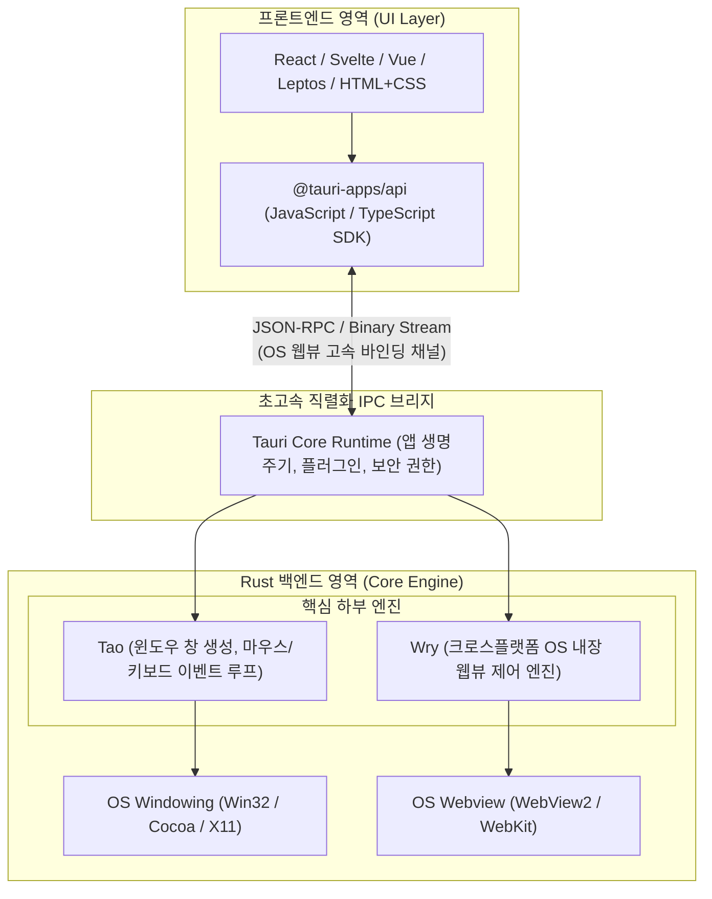
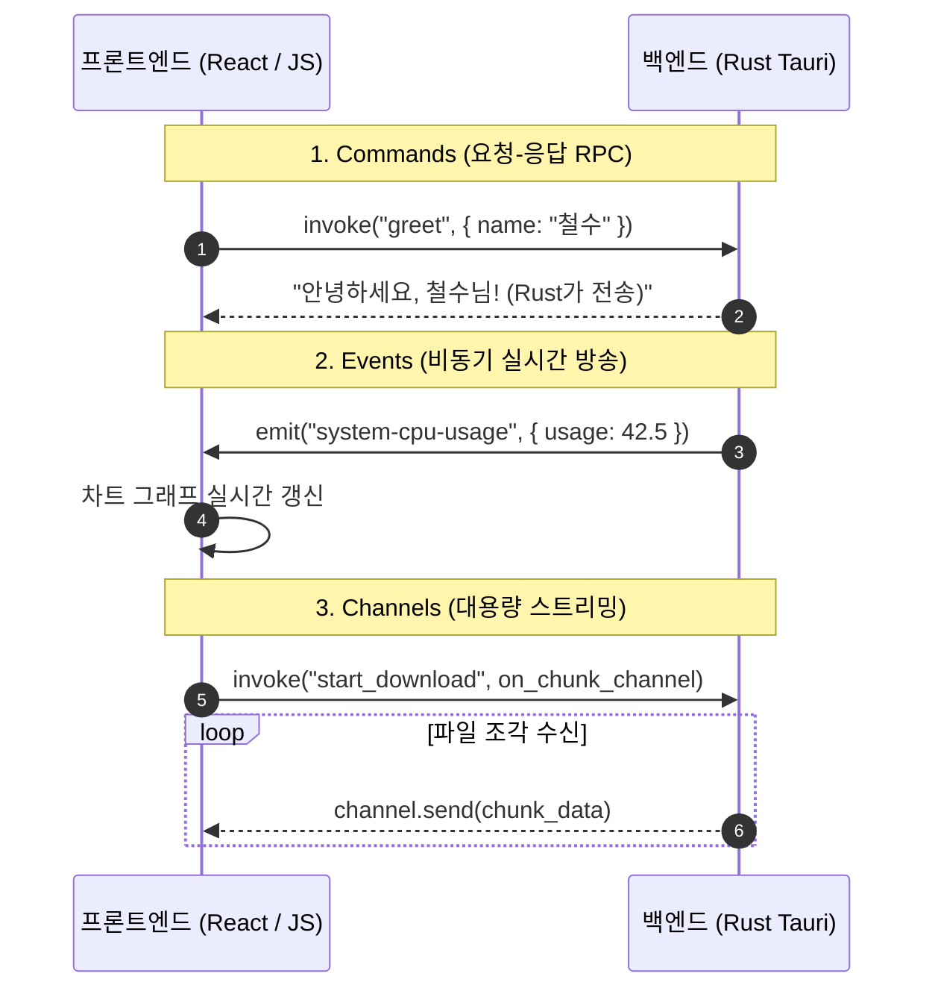

# 03장. 실무 1순위: Tauri 2.0 아키텍처 & IPC 심층 분석 ⚡

> **"Tauri는 단순히 '가벼운 일렉트론'이 아닙니다.  
> 최고의 보안 모델과 네이티브 Rust 성능 위에 어떤 웹 프론트엔드든 자유롭게 얹을 수 있는 모던 데스크톱·모바일 통합 플랫폼입니다."**

---

## 1. Tauri 2.0의 내부 해부도 (Under the Hood)

Tauri는 거대한 모놀리식 라이브러리가 아니라, 철저하게 분리된 **모듈식 Rust 크레이트 생태계** 위에 구축되어 있습니다:



### 핵심 구성요소 3인방
1. **`Tao` (타오)**:
   - 윈도우 생성, 메뉴바, 트레이 아이콘, 시스템 단축키, 창 최소화/최대화를 담당하는 크로스플랫폼 윈도우 라이브러리입니다 (`winit` 포크).
2. **`Wry` (라이)**:
   - 각 운영체제의 내장 웹뷰(Windows의 Edge Chromium WebView2, macOS의 WebKit, Linux의 WebKitGTK)를 동일한 Rust API로 감싸는 초경량 웹뷰 래퍼입니다.
3. **`Tauri Core`**:
   - 프론트엔드와 백엔드를 잇는 IPC 라우터, 상태 관리(`manage`), 보안 권한 검증(Capabilities)을 총괄합니다.

---

## 2. 프론트엔드와 Rust의 대화법: 3대 IPC 메커니즘

프론트엔드(웹)와 백엔드(Rust)는 서로 다른 샌드박스에서 실행되므로 **프로세스 간 통신(IPC, Inter-Process Communication)**을 통해 대화합니다.



### 1) Commands (명령 호출 - RPC 패턴)
가장 많이 사용되는 패턴으로, 자바스크립트에서 백엔드 Rust 함수를 마치 로컬 `async` 함수 부르듯이 호출합니다:

```rust
// [src-tauri/src/main.rs] Rust 백엔드
#[tauri::command]
async fn calculate_hash(file_path: String) -> Result<String, String> {
    // Rust의 강력한 암호화/파일 연산 수행
    let hash = sha256_file(&file_path).map_err(|e| e.to_string())?;
    Ok(hash)
}

fn main() {
    tauri::Builder::default()
        .invoke_handler(tauri::generate_handler![calculate_hash])
        .run(tauri::generate_context!())
        .expect("Tauri 앱 실행 실패");
}
```

```javascript
// [src/App.js] 프론트엔드 JavaScript/TypeScript
import { invoke } from '@tauri-apps/api/core';

async function handleFile() {
    try {
        const hash = await invoke('calculate_hash', { filePath: 'C:/data.iso' });
        console.log('계산된 해시:', hash);
    } catch (err) {
        console.error('해시 계산 실패:', err);
    }
}
```

---

### 2) Events (이벤트 브로드캐스팅)
백엔드에서 하드웨어 모니터링 값이나 진행률처럼 **"언제 발생할지 모르는 비동기 데이터"**를 프론트엔드로 일방향 방송할 때 사용합니다:

```rust
// Rust에서 이벤트 발행
app_handle.emit("download-progress", 85.5)?;
```

```javascript
// 프론트엔드에서 리스닝
import { listen } from '@tauri-apps/api/event';

const unlisten = await listen('download-progress', (event) => {
    console.log(`다운로드 진행도: ${event.payload}%`);
});
```

---

## 3. Tauri 2.0의 혁신적인 보안 모델: "Capabilities & Permissions"

Electron에서는 해커가 XSS 취약점을 이용해 악성 스크립트를 삽입하면 `require('child_process').exec('rm -rf /')` 처럼 전체 시스템을 파괴할 수 있었습니다.

Tauri 2.0은 스마트폰 OS(iOS/Android) 스타일의 **세분화된 기능 선언(Capabilities) 시스템**을 도입하여 이를 원천 차단합니다:

```json
// src-tauri/capabilities/default.json (권한 명세서)
{
  "$schema": "../gen/schemas/desktop-schema.json",
  "identifier": "main-capability",
  "windows": ["main"],
  "permissions": [
    "core:default",
    "fs:allow-read-text-file",
    {
      "identifier": "fs:scope",
      "allow": ["$APPDATA/my-app/**"]
    }
  ]
}
```

- 프론트엔드는 위 명세서에 **허용(Allow)된 경로(`$APPDATA/my-app/`) 외의 어떤 파일도 절대 읽을 수 없습니다**.
- 셸 실행, 카메라/마이크, 클립보드, HTTP 요청 등 모든 OS 권한이 명시적으로 허가되어야만 동작합니다.

---

## 4. Tauri 2.0 모바일(Android / iOS) 동시 지원

Tauri 2.0의 가장 놀라운 발전은 **단 하나의 코드베이스로 데스크톱(Windows, Mac, Linux)과 모바일(Android, iOS)을 동시에 빌드**할 수 있다는 점입니다:

- **Windows/Mac**: 데스크톱 윈도우 창으로 패키징
- **Android**: 안드로이드 스튜디오 프로젝트 및 `.apk` / `.aab` 자동 생성 (Kotlin 브리지)
- **iOS**: Xcode 프로젝트 및 `.ipa` 자동 생성 (Swift 브리지)
- Rust의 `#[cfg(desktop)]`, `#[cfg(mobile)]` 조건부 컴파일을 통해 플랫폼별 전용 로직을 깔끔하게 분기할 수 있습니다.

