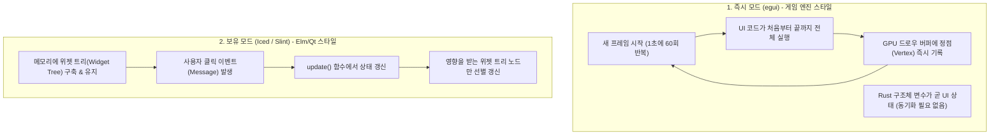
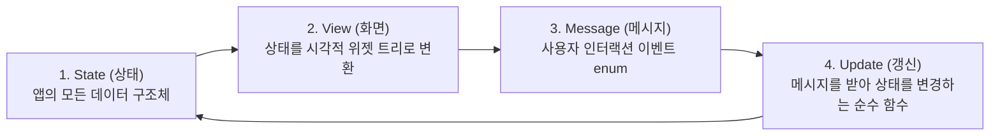

# 04장. 순수 Rust GUI의 세계: egui (즉시 모드) & Iced (보유 모드) 실전 패턴 🌲⚡

> **"웹뷰(HTML/CSS/JS)가 단 1줄도 들어가지 않는다!  
> 순수한 Rust 코드와 그래픽 카드(GPU)만으로 빚어내는 초경량 60FPS 네이티브 데스크톱의 세계."**

Tauri가 "웹 프론트엔드의 방대한 디자인 생태계"를 무기로 삼는다면,  
**egui**와 **Iced**는 **"웹 기술을 완전히 배제하고 오직 100% 순수 Rust 타입 안정성과 GPU 직접 렌더링으로 승부하는 진영"**입니다.

---

## 1. 두 거인의 패러다임 비교: Immediate Mode vs Retained Mode



---

## 2. egui 심층 분석: "상태 동기화 버그가 불가능한 즉시 모드"

`egui`는 Rust 생태계에서 가장 인기 있고 널리 쓰이는 즉시 모드(Immediate Mode) GUI 라이브러리입니다.

### 1) 핵심 멘탈 모델 (Mental Model)
전통적인 GUI에서는 "버튼 객체를 생성하고", "텍스트를 세팅하고", "리스너를 붙이고", "변수가 바뀌면 버튼 텍스트를 업데이트하는" 번거로운 작업이 필요했습니다.

`egui`에서는 그냥 **매 프레임 함수를 실행하면서 화면에 버튼을 배치하고, 클릭되었는지를 그 자리에서 즉시 체크**합니다:

```rust
// egui + eframe 기본 예제 구조
use eframe::egui;

struct MyApp {
    name: String,
    age: u32,
    is_active: bool,
}

impl eframe::App for MyApp {
    // 💡 이 update 함수는 매 프레임(1초에 60번) 호출됩니다!
    fn update(&mut self, ctx: &egui::Context, _frame: &mut eframe::Frame) {
        egui::CentralPanel::default().show(ctx, |ui| {
            ui.heading("⚡ egui 초간단 설정 패널");

            // 1. 텍스트 입력: &mut self.name 변수를 직접 바인딩
            ui.horizontal(|ui| {
                ui.label("이름:");
                ui.text_edit_singleline(&mut self.name);
            });

            // 2. 슬라이더: &mut self.age 값을 드래그로 조절
            ui.add(egui::Slider::new(&mut self.age, 0..=120).text("나이"));

            // 3. 체크박스
            ui.checkbox(&mut self.is_active, "활성화 여부");

            // 4. 버튼 클릭 검사: 클릭된 순간 if 블록 실행!
            if ui.button("데이터 리셋").clicked() {
                self.name.clear();
                self.age = 20;
            }

            ui.separator();
            ui.label(format!("결과: {} ({}세) - 활성: {}", self.name, self.age, self.is_active));
        });
    }
}
```

### 2) 왜 개발 도구와 시각화에서 egui가 독점적인가?
- **상태 동기화 오버헤드 0**: 변수 `self.age`의 값을 바꾸면 다음 프레임에 슬라이더와 라벨이 알아서 그 값을 그립니다.
- **Wasm 원클릭 지원**: `eframe`은 동일한 코드를 데스크톱 창뿐만 아니라 WebAssembly로도 컴파일하여 웹 브라우저에서도 토씨 하나 안 틀리고 똑같이 실행시킵니다.
- **Rerun, Bevy, Tracy 등 수많은 전문 소프트웨어가 채택**: 3D 데이터 로깅 도구인 Rerun이나 대규모 게임 엔진 에디터들이 메인 UI로 egui를 사용합니다.

---

## 3. Iced 심층 분석: "Elm 아키텍처의 우아한 함수형 보유 모드"

`Iced`는 함수형 프론트엔드 언어인 **Elm의 아키텍처(Model - View - Update)**를 Rust로 가장 아름답게 구현한 보유 모드(Retained Mode) GUI 프레임워크입니다.

### 1) Iced의 4대 핵심 기둥 (The Elm Architecture)



### 2) Iced 실전 코드 패턴

```rust
use iced::widget::{button, column, text};
use iced::{Element, Sandbox, Settings};

// 1. 상태 (State)
struct Counter {
    value: i32,
}

// 2. 이벤트 메시지 (Message)
#[derive(Debug, Clone, Copy)]
enum Message {
    Increment,
    Decrement,
}

impl Sandbox for Counter {
    type Message = Message;

    fn new() -> Self {
        Self { value: 0 }
    }

    fn title(&self) -> String {
        String::from("Iced Counter")
    }

    // 3. 상태 갱신 함수 (Update)
    fn update(&mut self, message: Message) {
        match message {
            Message::Increment => self.value += 1,
            Message::Decrement => self.value -= 1,
        }
    }

    // 4. 선언적 뷰 렌더링 (View)
    fn view(&self) -> Element<Message> {
        column![
            button("증가 (+1)").on_press(Message::Increment),
            text(format!("카운트: {}", self.value)).size(30),
            button("감소 (-1)").on_press(Message::Decrement),
        ]
        .padding(20)
        .into()
    }
}
```

- 모든 상태 변경이 오직 `update()` 함수의 `match message` 패턴 하나로 집중되므로, **앱이 아무리 거대해져도 상태의 흐름을 100% 추적할 수 있는 놀라운 예측 가능성**을 보장합니다.

---

## 4. Slint: "임베디드부터 데스크톱까지 단일 UI"

Qt 핵심 개발진이 설립한 **Slint**는 다음과 같은 독특한 구조를 가집니다:

1. **`.slint` 전용 마크업**: 화면 배치와 스타일, 반응형 속성 바인딩을 Flutter나 QML과 유사한 전용 선언적 문법으로 작성합니다.
2. **Rust 비즈니스 로직 연동**: 컴파일 시 Slint 컴파일러가 Rust 구조체와 콜백 함수로 자동 변환해 줍니다.
3. **극단적인 하드웨어 적응력**:
   - 수 기가바이트 RAM의 Windows/macOS 데스크톱뿐만 아니라,
   - **RAM이 300KB밖에 안 되는 소형 마이크로컨트롤러(MCU)나 자동차 디스플레이, 스마트 가전 화면**에서도 동작합니다!

