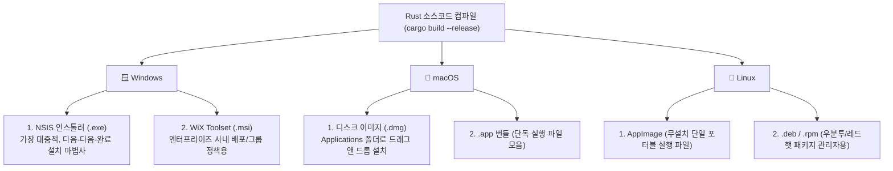
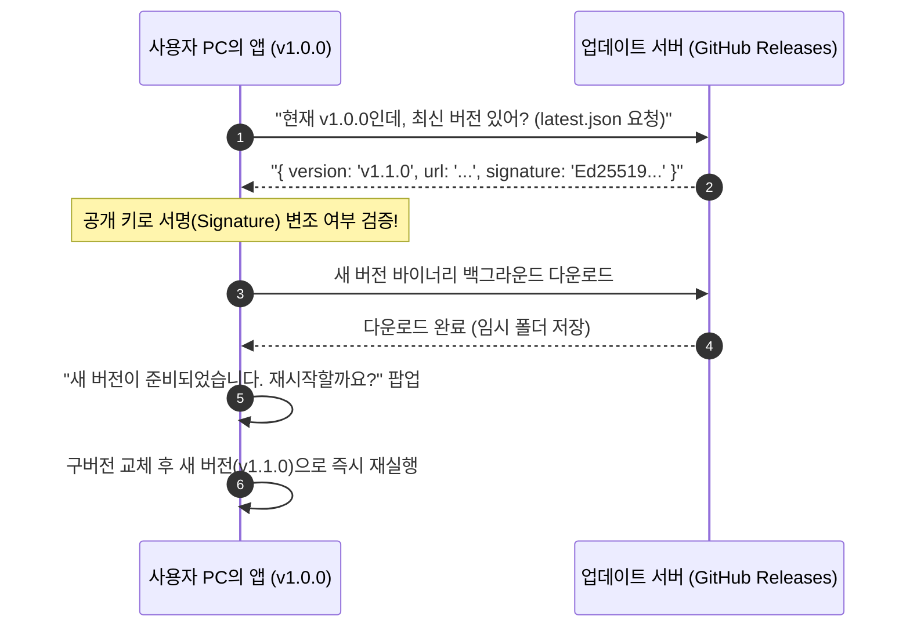

# 05장. 배포 및 프로덕션 완벽 가이드 (설치 파일, 자동 업데이트, 코드 서명) 📦🚀

> **"웹 개발은 서버에 파일만 올리면 끝이지만,  
> 데스크톱 개발은 사용자의 실제 PC에 안전하게 설치되고 스스로 업데이트되는 파이프라인까지 완성해야 진짜 끝입니다."**

데스크톱 앱 개발의 마지막 관문은 **"내 컴퓨터에서 잘 돌아가는 바이너리를 전 세계 수천만 명의 사용자 컴퓨터에 배포하는 일"**입니다.  
운영체제별 설치 파일 포맷, 악성코드로 오인받지 않기 위한 코드 서명, 그리고 새 버전이 나왔을 때 자동으로 패치되는 자동 업데이트(Auto-Updater) 구조를 완벽하게 정복해 봅시다.

---

## 1. 운영체제(OS)별 표준 패키징 포맷

데스크톱 플랫폼마다 사용자가 기대하는 설치 방식이 다릅니다:



---

## 2. Windows & macOS 보안 관문: 코드 서명 (Code Signing)

개발한 프로그램을 처음 배포할 때 가장 당황스러운 현상은 **운영체제가 내 프로그램을 바이러스 취급하며 차단하는 것**입니다!

### 1) Windows의 악명 높은 "SmartScreen" 경고창
- **현상**: 다운로드한 `.exe`를 실행하면 파란 화면에 **"Windows의 PC 보호 - 인식할 수 없는 앱의 시작을 차단했습니다"**라는 경고창이 뜹니다.
- **원인**: 마이크로소프트에 등록된 **코드 서명 인증서(Code Signing Certificate)**로 서명되지 않았거나, 전 세계 다운로드 횟수(평판, Reputation)가 아직 쌓이지 않았기 때문입니다.
- **해결책**:
  - 개인 개발자/소규모 프로젝트: 사용자가 `추가 정보` $\rightarrow$ `실행`을 누르면 실행되므로 안내 문구 제공.
  - 상용 서비스: Certum, Sectigo 등 공인 인증기관에서 **코드 서명 인증서(OV/EV 인증서)**를 구매하여 빌드 시 바이너리에 디지털 서명을 적용.

### 2) macOS의 철벽 보안: Gatekeeper & 공증(Notarization)
- **현상**: 맥에서는 서명되지 않은 앱을 열면 **"개발자를 확인할 수 없기 때문에 열 수 없습니다"**라며 아예 실행을 거부합니다.
- **해결책**:
  1. **Apple Developer Program** 계정(연 \$99) 가입
  2. 애플이 발급한 `Developer ID Application` 인증서로 `.app` 서명
  3. 애플 공증 서버로 앱을 업로드하여 악성코드 검사를 통과하는 **공증(Notarization, `xcrun notarytool`)** 및 스탬프(`stapler`) 부착

---

## 3. 무중단 자동 업데이트 (Auto-Updater) 파이프라인

사용자에게 "홈페이지에 가서 v2.0 새 버전을 다시 다운받으세요"라고 하는 것은 사용자 경험에 치명적입니다.  
현대 데스크톱 앱은 **백그라운드에서 조용히 업데이트를 다운받고 재시작 시 자동 적용**되어야 합니다.



### 암호화 서명 검증 (Ed25519)
- Tauri나 최신 업데이트 프레임워크는 해커가 DNS 스푸핑이나 중간자 공격(MITM)으로 가짜 업데이트 파일을 내려보내는 것을 방지하기 위해 **Ed25519 비대칭 암호화 서명**을 사용합니다.
- 개발자는 비밀 키(Private Key)로 릴리즈 파일을 서명하고, 앱은 내장된 공개 키(Public Key)로 무결성을 100% 검증합니다.

---

## 4. GitHub Actions를 통한 전 플랫폼 자동 빌드 CI/CD 예제

개발자가 `git tag v1.0.0`을 푸시하면, 클라우드 가상 머신(Windows, macOS, Ubuntu)이 동시에 돌아가면서 설치 파일을 자동으로 만들어 GitHub Releases에 올려주는 워크플로우입니다:

```yaml
# .github/workflows/release.yml
name: Release Desktop App

on:
  push:
    tags:
      - 'v*'

jobs:
  release:
    permissions:
      contents: write
    strategy:
      fail-fast: false
      matrix:
        include:
          - platform: 'windows-latest'
            args: '--target x86_64-pc-windows-msvc'
          - platform: 'macos-latest'
            args: '--target aarch64-apple-darwin'
          - platform: 'ubuntu-22.04'
            args: ''

    runs-on: ${{ matrix.platform }}
    steps:
      - uses: actions/checkout@v4

      - name: Install Rust
        uses: dtolnay/rust-toolchain@stable

      - name: Install Linux Dependencies (Ubuntu only)
        if: matrix.platform == 'ubuntu-22.04'
        run: |
          sudo apt-get update
          sudo apt-get install -y libwebkit2gtk-4.1-dev libappindicator3-dev librsvg2-dev patchelf

      - name: Build Desktop Bundles (Tauri Action)
        uses: tauri-apps/tauri-action@v0
        env:
          GITHUB_TOKEN: ${{ secrets.GITHUB_TOKEN }}
          TAURI_SIGNING_PRIVATE_KEY: ${{ secrets.TAURI_SIGNING_PRIVATE_KEY }}
        with:
          tagName: ${{ github.ref_name }}
          releaseName: 'App Release ${{ github.ref_name }}'
          releaseBody: '자동 생성된 릴리즈 빌드입니다.'
          releaseDraft: false
          prerelease: false
          args: ${{ matrix.args }}
```

- 이 워크플로우 하나만 세팅해 두면, 로컬에서 운영체제별로 빌드할 필요 없이 태그 푸시 한 번으로 **Windows 인스톨러, macOS `.dmg`, Linux AppImage가 동시에 깃허브 릴리즈 페이지에 등록**됩니다!
