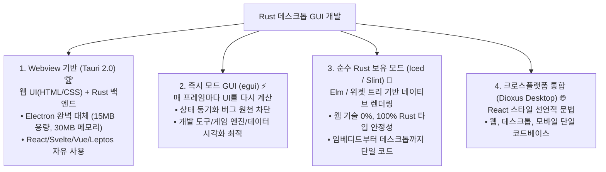

# 🖥️ Rust 데스크톱 GUI 앱 개발 마스터 로드맵 & 가이드

> **"Electron의 무거운 메모리(300MB+)와 수백 MB 용량을 15MB 초경량과 네이티브 속도로 대체한다!"**  
> 본 문서는 Rust를 활용하여 현대적이고 안정적인 데스크톱 GUI(Graphical User Interface) 애플리케이션을 개발하기 위해 반드시 알아야 할 **핵심 지식, 프레임워크 선택 기준, 렌더링 아키텍처, 프로덕션 배포 파이프라인**을 체계적으로 정리한 마스터 플랜입니다.

---

## 1. 데스크톱 GUI 아키텍처 4대 진영 한눈에 보기

Rust 데스크톱 생태계는 접근 방식에 따라 크게 **4가지 아키텍처 패러다임**으로 나뉩니다:

---

## 2. 프레임워크 선택 의사결정 매트릭스 (Decision Matrix)

| 구분 | **Tauri 2.0** (대세 1순위) | **egui** (개발도구 1순위) | **Iced** (순수 Rust 1순위) | **Slint** (임베디드/모던) |
| :--- | :--- | :--- | :--- | :--- |
| **렌더링 방식** | OS 내장 Webview (WebView2/WebKit) | GPU 직접 렌더링 (`wgpu` / OpenGL) | GPU 직접 렌더링 (`wgpu` / tiny-skia) | GPU 및 소프트웨어 렌더러 |
| **패러다임** | Web UI + Rust IPC | 즉시 모드 (Immediate Mode) | 보유 모드 (Elm 아키텍처) | 반응형 속성 바인딩 DSL |
| **UI 작성 언어** | HTML / CSS / JS / TS / Leptos | 순수 Rust 코드 | 순수 Rust 코드 | Slint 전용 마크업 DSL + Rust |
| **바이너리 크기** | 약 **10 ~ 20 MB** | 약 **5 ~ 10 MB** | 약 **10 ~ 15 MB** | 약 **3 ~ 8 MB** (초경량) |
| **메모리 점유율** | 약 **30 ~ 50 MB** | 약 **20 ~ 40 MB** | 약 **25 ~ 50 MB** | 약 **15 ~ 30 MB** |
| **풍부한 UI 생태계** | ⭐⭐⭐⭐⭐ (웹 생태계 100% 활용) | ⭐⭐⭐ (기본 위젯 중심) | ⭐⭐⭐ (성장 중) | ⭐⭐⭐⭐ (세련된 기본 디자인) |
| **학습 곡선** | 낮음 (웹 개발 경험자 즉시 적응) | 낮음 (직관적인 함수 호출) | 중간 (Elm MVU 패턴 이해 필요) | 중간 (새로운 DSL 학습 필요) |
| **추천 용도** | • 상용 데스크톱 SaaS 앱 • 노션/슬랙 스타일 협업 도구 • 모바일(iOS/Android) 동시 출시 | • 사내 개발 도구/인스펙터 • 게임 엔진 에디터 • 실시간 3D/차트 시각화 | • 순수 Rust 고집 프로젝트 • 크립토 지갑/보안 유틸리티 • 가볍고 깔끔한 네이티브 앱 | • 산업용 HMI / 임베디드 디바이스 • 의료기기/소형 디스플레이 • 데스크톱 경량 유틸리티 |

---

## 3. 데스크톱 앱 개발 시 반드시 알아야 할 5대 핵심 개념

1. **이벤트 루프(Event Loop)와 메인 UI 스레드**:
   - 윈도우 OS는 모든 창 생성, 마우스/키보드 입력, 화면 그리기를 오직 **메인 스레드**에서만 처리합니다.
   - 무거운 연산(파일 입출력, 네트워크 통신, DB 쿼리)을 메인 스레드에서 실행하면 즉시 **"응답 없음(Freezing)"**이 발생합니다.
   - $\rightarrow$ 해결책: Tokio 비동기 런타임 또는 백그라운드 스레드로 작업을 분리하고 채널(`mpsc`)을 통해 UI로 결과를 전달합니다.
2. **렌더링 파이프라인 (Webview vs GPU Direct)**:
   - **Tauri/Dioxus**: OS 내장 브라우저 엔진(Windows는 Edge WebView2, macOS는 WebKit)을 재사용하여 Chromium 번들링 없는 15MB 앱을 만듭니다.
   - **egui/Iced/Slint**: OS 브라우저 엔진 없이, Rust가 `wgpu`를 통해 DirectX 12 / Vulkan / Metal GPU 파이프라인과 직접 대화합니다.
3. **스레드 간 통신과 상태 공유 (`Send + Sync`)**:
   - `Arc<Mutex<T>>`, `Arc<RwLock<T>>`를 이용한 멀티스레드 안전한 데이터 관리.
   - UI 이벤트 발생 시 비동기 명령(Command) 디스패치 및 상태 갱신.
4. **네이티브 OS API 연동**:
   - **파일 다이얼로그**: OS 파일 선택기 (`rfd` 크레이트)
   - **시스템 트레이(System Tray)**: 작업표시줄 우측 트레이 아이콘 및 컨텍스트 메뉴
   - **전역 단축키(Global Shortcut)**: 앱이 최소화되어 있어도 동작하는 키 바인딩
   - **자동 업데이트(Auto-Updater)**: 새 버전 릴리즈 시 자동 다운로드 및 패치
5. **프로덕션 패키징 & 코드 서명 (Code Signing)**:
   - Windows: NSIS 설치 파일(`.exe`) 및 `.msi` 생성, SmartScreen 방지용 코드 서명
   - macOS: `.dmg` 생성, Apple 공증(Notarization)
   - Linux: AppImage, `.deb` 패키징

---

## 4. 학습 문서 가이드 인덱스

| 문서 번호 | 파일명 | 핵심 주제 |
| :---: | :--- | :--- |
| **01장** | [01_desktop_gui_landscape.md](01_desktop_gui_landscape.md) | **Rust 데스크톱 생태계 지도 & 4대 패러다임 심층 분석** (Tauri, egui, Iced, Slint) |
| **02장** | [02_gui_core_mechanisms.md](02_gui_core_mechanisms.md) | **데스크톱 앱 개발 필수 메커니즘** (이벤트 루프, 스레딩, GPU 렌더링, OS 연동) |
| **03장** | [03_tauri_deep_dive.md](03_tauri_deep_dive.md) | **실무 1순위 Tauri 2.0 심층 가이드** (IPC 통신, 보안 권한, Rust-프론트엔드 연동) |
| **04장** | [04_pure_rust_gui_egui_iced.md](04_pure_rust_gui_egui_iced.md) | **순수 Rust GUI: egui (즉시 모드) & Iced (보유 모드) 실전 패턴** |
| **05장** | [05_packaging_and_distribution.md](05_packaging_and_distribution.md) | **배포 및 프로덕션 완벽 가이드** (설치 파일 빌드, 자동 업데이트, 코드 서명) |
