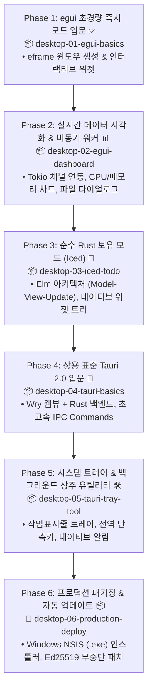

# 🖥️ Rust 데스크톱 GUI 앱 개발 마스터 작업계획서

> **"Electron의 무거운 메모리(300MB+)와 수백 MB 용량을 15MB 초경량과 네이티브 속도로 대체한다!"**  
> 본 계획서는 백엔드와 프론트엔드를 마스터한 개발자가 Rust의 강력한 시스템 프로그래밍 역량을 데스크톱 GUI로 확장하여, **즉시 모드(egui), 보유 모드(Iced), 그리고 상용 표준(Tauri 2.0)**까지 실전 데스크톱 프로그램을 직접 구축할 수 있도록 설계된 **단계별(Phase 1 ~ Phase 6) 실습 중심 마스터 로드맵**입니다.

---

## 1. 프로젝트 개요 & 학습 목표

| 항목 | 내용 |
| :--- | :--- |
| **목표** | 가볍고 빠른 크로스플랫폼(Windows/macOS/Linux) 네이티브 데스크톱 GUI 앱 개발 역량 확보 |
| **주요 기술 스택** | • 즉시 모드 GUI: **egui / eframe** (GPU 하드웨어 가속, 상태 동기화 제로)<br>• 보유 모드 GUI: **Iced** (Elm 아키텍처, 100% 순수 Rust 네이티브 위젯 트리)<br>• 하이브리드 표준: **Tauri 2.0** (OS 내장 Webview + Rust 코어, 15MB 초경량)<br>• 윈도우 & 이벤트 루프: **winit**, **Tao**<br>• 비동기 & 스레딩: **Tokio**, `std::sync::mpsc` (UI 프리징 차단)<br>• 네이티브 OS 연동: **rfd** (파일 다이얼로그), **시스템 트레이**, **전역 단축키**<br>• 프로덕션 배포: **NSIS (.exe)**, **WiX (.msi)**, **Ed25519 자동 업데이트** |
| **문서 저장 위치** | `docs/desktop` |
| **실습 프로젝트 위치** | `projects/desktop` (Cargo Workspace 연동) |

---

## 2. 단계별 커리큘럼 및 실습 프로젝트 로드맵



---

## 3. 단계별 상세 실습 가이드

### [Phase 1] egui 초경량 즉시 모드(Immediate Mode) GUI 입문 ✅
- 📄 **이론 가이드**: [01_desktop_gui_landscape.md](01_desktop_gui_landscape.md)
- 📦 **실습 프로젝트**: [`projects/desktop/desktop-01-egui-basics`](../../projects/desktop/desktop-01-egui-basics)
- **주요 학습 내용**:
  - `eframe` (egui framework) 기반 크로스플랫폼 윈도우 창 생성
  - 즉시 모드(Immediate Mode) 멘탈 모델: 매 프레임 UI를 평가하는 루프 원리
  - 필수 인터랙티브 위젯: 버튼, 슬라이더, 체크박스, 텍스트 에디터, 콤보박스
  - 컴포넌트 레이아웃: `CentralPanel`, `TopBottomPanel`, `SidePanel`, 수평/수직 정렬
  - 실시간 다크/라이트 테마 스위처 및 폰트 커스터마이징
  - 순수 비즈니스 로직 단위 테스트 5종 통과 & `cargo run` 윈도우 실행 검증 완료

### [Phase 2] egui 실시간 모니터링 대시보드 & 비동기 워커 연동
- 📄 **이론 가이드**: [02_gui_core_mechanisms.md](02_gui_core_mechanisms.md)
- 📦 **실습 프로젝트**: `projects/desktop/desktop-02-egui-dashboard`
- **주요 학습 내용**:
  - **메인 UI 스레드 프리징 차단**: Tokio 비동기 런타임과 백그라운드 워커 스레드 분리
  - 채널 통신: `std::sync::mpsc`를 통한 워커 $\rightarrow$ UI 논블로킹 데이터 전달
  - `egui_plot`을 활용한 실시간 CPU / 메모리 점유율 동적 라인 차트
  - 네이티브 파일 다이얼로그(`rfd`): 시스템 파일 탐색기 열기 및 CSV 데이터 로드/저장
  - 다중 탭 및 사이드바 분할 레이아웃 구성

### [Phase 3] Iced 순수 Rust 보유 모드(Retained Mode) & Elm 아키텍처
- 📄 **이론 가이드**: [04_pure_rust_gui_egui_iced.md](04_pure_rust_gui_egui_iced.md)
- 📦 **실습 프로젝트**: `projects/desktop/desktop-03-iced-todo`
- **주요 학습 내용**:
  - 함수형 Elm 아키텍처: `State`, `Message`, `Update`, `View`의 단방향 데이터 흐름
  - 위젯 트리(Widget Tree) 기반 보유 모드 렌더링 원리
  - 선언적 레이아웃 매크로: `column![]`, `row![]`, 스크롤 영역, 커스텀 스타일링
  - 키보드 엔터/ESC 이벤트 핸들링 및 인라인 수정 모드
  - 로컬 파일(JSON) 영구 저장 및 단위 테스트

### [Phase 4] 상용 표준 Tauri 2.0 입문 (Rust 백엔드 + 모던 웹 UI)
- 📄 **이론 가이드**: [03_tauri_deep_dive.md](03_tauri_deep_dive.md)
- 📦 **실습 프로젝트**: `projects/desktop/desktop-04-tauri-basics`
- **주요 학습 내용**:
  - Tauri 2.0 아키텍처: `Tao`(윈도우 제어) + `Wry`(OS 내장 웹뷰) + Rust Core
  - 초고속 IPC: `#[tauri::command]`와 프론트엔드 `invoke()` 간의 타입 안전한 직렬화 통신
  - 상태 주입: `tauri::State`를 통한 멀티스레드 안전한 인메모리 데이터 공유
  - 무프레임 창(Frameless Window), 커스텀 타이틀바, 마우스 드래그 창 이동
  - 프론트엔드 UI(HTML/CSS/JS 또는 앞서 배운 Leptos/Yew) 결합

### [Phase 5] Tauri 2.0 시스템 트레이 & 백그라운드 상주 유틸리티
- 📄 **이론 가이드**: [03_tauri_deep_dive.md](03_tauri_deep_dive.md), [02_gui_core_mechanisms.md](02_gui_core_mechanisms.md)
- 📦 **실습 프로젝트**: `projects/desktop/desktop-05-tauri-tray-tool`
- **주요 학습 내용**:
  - 윈도우 작업표시줄 우측 시스템 트레이(Tray Icon) 생성 및 커스텀 컨텍스트 메뉴
  - 창 닫기(`X`) 클릭 시 종료 대신 트레이로 최소화(Hide/Show)
  - 전역 단축키(`Global Shortcut`): 앱이 백그라운드에 있어도 단축키로 즉시 호출
  - OS 네이티브 토스트 알림(Notification) 발송
  - 중복 실행 방지(Single Instance Lock): 중복 실행 시 기존 창을 맨 앞으로 활성화

### [Phase 6] 프로덕션 패키징 & 자동 업데이트 파이프라인
- 📄 **이론 가이드**: [05_packaging_and_distribution.md](05_packaging_and_distribution.md)
- 📦 **실습 프로젝트**: 배포 패키징 파이프라인
- **주요 학습 내용**:
  - Windows 설치 파일 자동 번들링: NSIS 기반 원클릭 인스톨러(`.exe`) 및 WiX(`.msi`)
  - 고해상도 앱 아이콘 세팅 (`.ico`, `.png`, `.icns`)
  - Windows SmartScreen 경고와 코드 서명(Code Signing) 메커니즘
  - Ed25519 비대칭 암호화 서명 기반 무중단 자동 업데이트(Auto-Updater) 구축
  - GitHub Actions를 통한 전 플랫폼(Windows/macOS/Linux) 크로스 컴파일 자동 릴리즈

---

## 4. 추천 디렉토리 구조

```
rust-sandbox/
├── docs/
│   ├── backend/             # 📂 완성된 백엔드 마스터 가이드 (Phase 1 ~ 6)
│   ├── frontend/            # 📂 완성된 프론트엔드 마스터 가이드 (Phase 1 ~ 6)
│   └── desktop/             # 📂 데스크톱 GUI 마스터 가이드 (본 로드맵 & 01~05장)
│       ├── desktop_learning_plan.md
│       ├── 01_desktop_gui_landscape.md
│       ├── 02_gui_core_mechanisms.md
│       ├── 03_tauri_deep_dive.md
│       ├── 04_pure_rust_gui_egui_iced.md
│       └── 05_packaging_and_distribution.md
└── projects/
    ├── backend/             # 📂 완성된 백엔드 5대 실습 프로젝트
    ├── frontend/            # 📂 완성된 프론트엔드 6대 실습 프로젝트
    └── desktop/             # 📂 [NEW] 데스크톱 GUI 실습 프로젝트 모음
        ├── desktop-01-egui-basics/       # 🚀 Phase 1 예정
        ├── desktop-02-egui-dashboard/    # 🚀 Phase 2 예정
        ├── desktop-03-iced-todo/         # 🚀 Phase 3 예정
        ├── desktop-04-tauri-basics/      # 🚀 Phase 4 예정
        └── desktop-05-tauri-tray-tool/   # 🚀 Phase 5 예정
```
