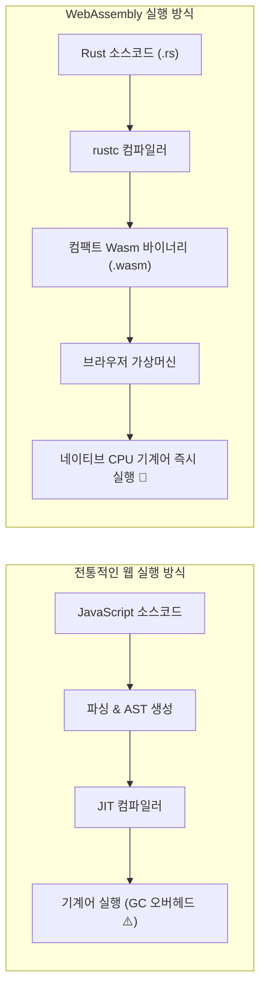

# 01장. WebAssembly(Wasm) 기초와 Trunk 번들러 완벽 입문 🦀

> **"자바스크립트의 독점 시대는 끝났다! 브라우저 위에서 펼쳐지는 러스트의 네이티브 마법"**

웹의 역사는 곧 자바스크립트(JavaScript)의 역사였습니다. 1995년 브렌던 아이크(Brendan Eich)가 단 10일 만에 설계한 자바스크립트는 단순한 폼 검증 스크립트에서 시작해 구글 지도, 노션, 피그마와 같은 거대한 웹 앱을 구동하는 핵심 언어가 되었습니다.

하지만 3D 그래픽, 물리 엔진, 대규모 데이터 처리, 동영상 인코딩 같은 고성능 작업에서는 **동적 타입 언어의 한계와 가비지 컬렉터(GC)로 인한 끊김(Stop-The-World)**이 늘 발목을 잡았습니다.

이 한계를 부수고 탄생한 웹의 차세대 혁명이 바로 **WebAssembly(웹어셈블리, 약칭 Wasm)**입니다.

---

## 1. WebAssembly(Wasm)란 무엇인가?

WebAssembly는 브라우저 엔진 위에서 **네이티브 기계어에 가까운 초고속 바이너리 포맷**으로 실행되도록 W3C가 표준화한 저수준 바이트코드 규격입니다.



### 자바스크립트 대비 Wasm의 압도적인 강점 3가지

1. **바이너리 전송의 초경량성**:
   - 텍스트 파일인 JS와 달리 최적화된 컴팩트 바이너리(`.wasm`) 형태로 네트워크를 통해 다운로드되므로 파싱 속도가 압도적으로 빠릅니다.
2. **예측 가능한 고성능 (No Garbage Collection)**:
   - Rust의 소유권 모델 덕분에 런타임 가비지 컬렉터가 아예 존재하지 않습니다. 애니메이션이나 게임 루프에서 예기치 않은 프레임 드롭(Stuttering)이 원천 차단됩니다.
3. **메모리 안전성 & 샌드박스**:
   - 운영체제 직접 접근이 차단된 완벽한 브라우저 가상 메모리(선형 메모리, Linear Memory) 내부에서만 작동하므로 보안이 매우 강력합니다.

---

## 2. Rust Wasm 생태계의 3대 핵심 도구

러스트를 브라우저 환경에서 자유자재로 다루기 위해서는 아래 3개의 크레이트(Crate)를 필수적으로 이해해야 합니다:

| 크레이트 이름 | 역할 | 비유 |
| :--- | :--- | :--- |
| **`wasm-bindgen`** | Rust 타입과 JS 객체 간의 데이터 변환 브릿지 | **통역관** (Rust 구조체를 JS가 읽을 수 있게 직렬화/역직렬화) |
| **`web-sys`** | 브라우저 DOM, Window, Canvas 등 표준 Web API 래퍼 | **원격 조종기** (Rust 코드에서 `document.getElementById` 호출) |
| **`js-sys`** | JS 표준 내장 객체(`Array`, `Promise`, `Date` 등) 바인딩 | **사전** (JS 표준 라이브러리를 Rust 타입으로 제공) |

### 1) `wasm-bindgen`의 마법
Rust 함수 위에 `#[wasm_bindgen]` 어노테이션을 붙이기만 하면, JS에서 호출할 수 있는 브릿지 코드가 자동 생성됩니다:

```rust
use wasm_bindgen::prelude::*;

// JavaScript에서 window.rust_greet("홍길동") 처럼 호출 가능!
#[wasm_bindgen]
pub fn rust_greet(name: &str) -> String {
    format!("{name}님, Rust WebAssembly의 세계에 오신 것을 환영합니다! 🦀")
}
```

### 2) `web-sys`로 브라우저 DOM 조작하기
브라우저의 `window`나 `document` 객체를 얻어와 요소를 탐색하고 조작합니다:

```rust
use web_sys::{window, Document, HtmlElement};
use wasm_bindgen::JsCast;

let window = window().expect("전역 window 객체 없음");
let document = window.document().expect("document 객체 없음");

// HTML 요소 탐색 및 텍스트 변경
if let Some(element) = document.get_element_by_id("counter") {
    element.set_text_content(Some("현재 카운트: 42"));
}
```

---

## 3. 프론트엔드의 게임 체인저: Trunk 번들러

Node.js 환경에서는 React나 Vue를 빌드하기 위해 Webpack, Vite, esbuild 같은 번들러를 사용합니다.  
Rust Wasm 세계에서는 **`Trunk`**가 바로 Vite의 역할을 완벽하게 대신합니다!

### Trunk의 특징
- **No Node.js / No npm**: Node.js 런타임이나 `package.json` 없이 순수 Rust 바이너리 하나로 동작합니다.
- **`index.html` 기반 에셋 파이프라인**: `<link data-trunk rel="rust" />` 태그 하나만 적어두면 알아서 Rust 코드를 빌드하고 Wasm 로더 스크립트를 주입해 줍니다.
- **실시간 핫 리로딩(Live Reloading)**: Rust 코드나 CSS, HTML을 저장하는 즉시 브라우저가 자동으로 새로고침되어 프론트엔드 개발 경험이 극도로 쾌적합니다.

### 주요 명령어

```bash
# 로컬 개발 서버 구동 (기본 포트: 8080, 자동 핫 리로딩)
trunk serve

# 프로덕션 배포용 최적화 빌드 (dist/ 디렉터리에 번들 생성)
trunk build --release
```

---

## 4. 실전 코드 분석: `wasm-01-dom-basics`

우리가 구현한 첫 번째 실습 프로젝트 [`wasm-01-dom-basics`](../../projects/frontend/wasm-01-dom-basics)의 핵심 메커니즘을 살펴봅니다.

### 1) 디버깅의 생명줄: `console_error_panic_hook`
Wasm 내부에서 `panic!`이 발생하면 기본적으로 브라우저는 정체를 알 수 없는 `RuntimeError: unreachable` 에러만 띄웁니다.  
하지만 아래 한 줄을 진입점에 넣어두면, **브라우저 F12 개발자 도구 콘솔에 Rust 소스 파일의 파일명과 라인 수까지 친절하게 출력**됩니다:

```rust
console_error_panic_hook::set_once();
```

### 2) Rust에서 이벤트 리스너 등록하기 (`Closure`)
JavaScript는 함수가 일급 객체이지만, Rust는 소유권과 수명(Lifetime)이 엄격합니다.  
이벤트 콜백 함수를 브라우저에 등록할 때는 `wasm_bindgen::closure::Closure`를 사용합니다:

```rust
let count = counter_state.clone();
let val_span = val_span.clone();

// 1. Rust 클로저를 Wasm이 이해하는 Closure 객체로 감쌉니다.
let closure = Closure::<dyn FnMut()>::new(move || {
    *count.borrow_mut() += 1;
    let current = *count.borrow();
    val_span.set_text_content(Some(&current.to_string()));
});

// 2. DOM 요소에 클릭 이벤트 리스너로 바인딩합니다.
btn_inc.add_event_listener_with_callback("click", closure.as_ref().unchecked_ref())?;

// 3. 페이지가 열려있는 동안 클로저 메모리가 해제되지 않도록 유지합니다.
closure.forget();
```

### 3) 양방향 FFI (Rust ↔ JavaScript)
- **Rust ➡️ JS 호출**: `window.alert_with_message("알림 메시지")` 또는 `web_sys::console::log_1(...)`
- **JS ➡️ Rust 호출**: `#[wasm_bindgen]`으로 노출된 함수는 브라우저 전역 스크립트에서 네이티브 함수처럼 즉시 호출할 수 있습니다.

---

## 5. 실습 프로젝트 구조

```text
projects/frontend/wasm-01-dom-basics/
├── Cargo.toml          # web-sys, wasm-bindgen 의존성 정의
├── index.html          # Trunk 엔트리포인트 및 마크업
├── styles.css          # 모던 글래스모피즘 & 다크모드 테마
├── README.md           # 실행 및 빌드 안내서
└── src/
    ├── lib.rs          # DOM 조작 로직, 이벤트 핸들러, 단위 테스트
    └── main.rs         # Wasm 애플리케이션 시작점
```

---

## 6. 요약 & 다음 단계

이제 우리는 자바스크립트의 도움 없이도 순수 Rust로 브라우저 DOM을 제어하고, 이벤트를 청취하며, 고성능 연산을 수행할 수 있게 되었습니다! 👏

하지만 매번 `document.get_element_by_id`를 손수 작성하고 `closure.forget()`을 관리하는 것은 DOM이 복잡해질수록 번거로워집니다.  
그래서 다음 **Phase 2**에서는 React 개발자에게 가장 친숙한 가상 DOM 기반의 현대적 UI 프레임워크인 **`Yew`**를 배웁니다! 🚀

