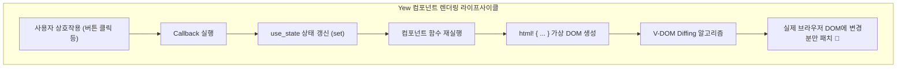

# 02장. React 개발자를 위한 Yew 프레임워크 & 상태 관리 완벽 입문 🦀⚛️

> **"JSX가 익숙하다면 이미 80%는 안 것입니다. Rust의 타입 안정성 위에서 펼쳐지는 가상 DOM(Virtual DOM)의 신세계!"**

앞서 **Phase 1**에서는 `web-sys`와 `wasm-bindgen`을 이용해 브라우저 DOM을 직접 조작하고 이벤트를 바인딩해보았습니다. 하지만 실무 웹 애플리케이션에서 수십~수백 개의 DOM 요소를 `document.get_element_by_id`로 일일이 찾고, `closure.forget()`으로 수명을 관리하는 것은 유지보수 관점에서 비효율적입니다.

React, Vue가 발전해온 이유가 바로 **"선언적 UI(Declarative UI)"**와 **"가상 DOM(Virtual DOM)"**이었습니다.  
Rust Wasm 진영에서 React와 가장 유사한 개발 경험(DX)을 제공하는 대표 주자가 바로 **`Yew`** 프레임워크입니다.

---

## 1. Yew의 핵심 아키텍처 & 동작 원리

Yew는 React 16.8+의 **함수형 컴포넌트(Functional Component)** 및 **훅(Hooks)** 아키텍처를 Rust의 강력한 정적 타입 시스템과 소유권(Ownership) 모델 위에 그대로 구현했습니다.



### React vs Yew 1:1 비교표

| 개념 | React (TypeScript/JavaScript) | Yew (Rust WebAssembly) | 설명 |
| :--- | :--- | :--- | :--- |
| **선언적 마크업** | JSX (`<div className="box">...</div>`) | `html! { <div class="box">...</div> }` | 컴파일 타임에 태그 유효성과 속성을 타입 검증 |
| **함수형 컴포넌트** | `function MyComp(props: Props) { ... }` | `#[function_component(MyComp)]`<br>`fn my_comp(props: &Props) -> Html` | 매크로를 통해 Yew 런타임 컴포넌트로 자동 등록 |
| **상태 관리 훅** | `const [count, setCount] = useState(0)` | `let count = use_state(|| 0);` | 클로저로 초기값을 공급하며, `UseStateHandle` 반환 |
| **상태 갱신** | `setCount(count + 1)` | `count.set(*count + 1);` | 역참조(`*`)로 현재값을 읽고 `set()`으로 불변 갱신 |
| **이벤트 콜백** | `onClick={() => doSomething()}` | `onclick={Callback::from(move |_| { ... })}` | Rust 소유권을 안전하게 캡처하는 `Callback` 객체 |
| **컴포넌트 Props** | `interface Props { name: string; }` | `#[derive(Properties, PartialEq)]`<br>`pub struct Props { pub name: String }` | `PartialEq`로 불필요한 리렌더링 자동 스킵(Memoization) |

---

## 2. Yew의 4대 핵심 문법 마스터하기

### 1) `html!` 매크로: 컴파일 타임에 오류를 잡는 마크업
Yew의 `html!` 매크로는 단순한 문자열 치환이 아닙니다. 컴파일 타임에 HTML 태그의 유효성, 닫는 태그 누락, 오타 등을 엄격하게 검증합니다:

```rust
use yew::prelude::*;

// 1. 단순 텍스트 렌더링
html! {
    <h1>{ "안녕, Rust Wasm!" }</h1>
}

// 2. 동적 클래스 바인딩 (classes! 매크로)
let is_active = true;
html! {
    <button class={classes!("btn", is_active.then_some("active"))}>
        { "상태 버튼" }
    </button>
}

// 3. 조건부 렌더링
html! {
    if is_active {
        <p>{ "활성화 상태입니다." }</p>
    } else {
        <p>{ "비활성 상태입니다." }</p>
    }
}

// 4. 리스트 반복 렌더링
let items = vec!["사과", "바나나", "체리"];
html! {
    <ul>
        { for items.iter().map(|item| html! { <li>{ item }</li> }) }
    </ul>
}
```

### 2) `use_state` 훅: 불변성과 메모리 안전성
React의 `useState`처럼, Yew의 `use_state`는 컴포넌트가 다시 렌더링되어도 상태를 기억합니다:

```rust
let counter = use_state(|| 0);

// 값 읽기: 역참조 연산자(*) 사용
let current_value: i32 = *counter;

// 값 수정: set() 호출
counter.set(current_value + 1);
```

> 💡 **클론(Clone) 패턴에 익숙해지기**:  
> Rust는 변수의 소유권이 이동(Move)하므로, 이벤트 핸들러 클로저 내부로 상태 핸들을 넘기려면 이벤트 등록 전에 `.clone()`을 호출해야 합니다.  
> `UseStateHandle`의 클론은 내부적으로 `Rc`(참조 카운팅 포인터)를 복사하므로 **매우 가볍고 비용이 거의 들지 않습니다.**

### 3) 이벤트 처리: `Callback::from`
브라우저의 `click`, `input`, `change` 이벤트를 Rust 클로저로 캡처합니다:

```rust
let counter = counter.clone();
let on_click = Callback::from(move |_e: MouseEvent| {
    counter.set(*counter + 1);
});

html! {
    <button onclick={on_click}>{ "1 증가" }</button>
}
```

### 4) Props와 컴포넌트 분리 (`Properties`)
부모 컴포넌트에서 자식 컴포넌트로 데이터를 전달할 때는 `Properties` 트레이트를 유도(derive)합니다:

```rust
#[derive(Properties, PartialEq)]
pub struct ChildProps {
    pub title: String,
    pub count: i32,
    pub on_action: Callback<()>,
}

#[function_component(ChildComponent)]
pub fn child_component(props: &ChildProps) -> Html {
    let cb = props.on_action.clone();
    html! {
        <div>
            <h3>{ &props.title }</h3>
            <p>{ format!("카운트: {}", props.count) }</p>
            <button onclick={Callback::from(move |_| cb.emit(()))}>{ "실행" }</button>
        </div>
    }
}
```

> ⚠️ **중요: `PartialEq`가 필수인 이유**:  
> Yew의 가상 DOM은 부모 컴포넌트가 리렌더링될 때, 자식의 이전 Props와 새 Props를 `props == new_props`로 비교합니다.  
> 값이 바뀌지 않았다면 자식 컴포넌트의 렌더링을 건너뛰어(React의 `React.memo` 효과) 브라우저 렌더링 비용을 극적으로 절감합니다.

---

## 3. 실전 프로젝트 분석: `wasm-02-yew-counter`

[`projects/frontend/wasm-02-yew-counter`](../../projects/frontend/wasm-02-yew-counter) 프로젝트의 구조와 핵심 구현입니다.

### 디렉터리 아키텍처

```
projects/frontend/wasm-02-yew-counter/
├── Cargo.toml                  # yew 0.21 (features=["csr"]) 의존성
├── index.html                  # Trunk 엔트리포인트 & 웹 폰트
├── styles.css                  # 다크/라이트 모드 CSS 커스텀 속성
├── README.md                   # 실행 안내서
└── src/
    ├── main.rs                 # Renderer::<App>::new().render() 진입점
    ├── lib.rs                  # 컴포넌트 및 로직 re-export
    ├── logic.rs                # 🧪 순수 Rust 비즈니스 로직 및 단위 테스트
    ├── app.rs                  # 최상위 루트 App 컴포넌트
    └── components/
        ├── mod.rs
        ├── counter.rs          # 카운터 표시 및 조작 패널
        ├── history.rs          # 조작 히스토리 뷰
        └── theme_toggle.rs     # 다크/라이트 테마 스위처
```

### 1) UI와 완전히 분리된 순수 로직 계층 (`logic.rs`)
웹 UI 프레임워크를 작성할 때 비즈니스 상태 변화 로직을 Yew 컴포넌트 안에 강하게 결합하면 브라우저 없이는 단위 테스트를 돌리기 어렵습니다.  
본 프로젝트에서는 상태 변화(`increment`, `decrement`, `reset`, `record_history`)를 순수 Rust 구조체로 분리하여 **`cargo test`로 즉시 검증 가능**하도록 설계했습니다:

```rust
#[derive(Debug, Clone, PartialEq, Eq)]
pub struct CounterState {
    pub count: i32,
    pub step: i32,
    pub history: Vec<HistoryItem>,
    pub next_id: usize,
}

impl CounterState {
    pub fn increment(&mut self) {
        let before = self.count;
        self.count += self.step;
        self.record_history(format!("+{step}", step = self.step), before, self.count);
    }
    // ...
}
```

### 2) CSS 변수 기반 다크/라이트 테마 스위처 (`theme_toggle.rs`)
`Theme::Light`와 `Theme::Dark`를 Rust Enum으로 정의하고, 최상위 컨테이너에 `.theme-dark` / `.theme-light` 클래스를 바인딩하여 CSS Custom Properties를 동적으로 전환합니다.

---

## 4. 로컬 실행 및 테스트 검증

### 1) 순수 Rust 로직 단위 테스트 (브라우저 없이 초고속 실행)
```bash
cargo test -p wasm-02-yew-counter
```
```text
running 4 tests
test logic::tests::test_counter_initial_state ... ok
test logic::tests::test_increment_and_decrement ... ok
test logic::tests::test_theme_toggle ... ok
test logic::tests::test_reset_behavior ... ok

test result: ok. 4 passed; 0 failed; 0 ignored; 0 measured; 0 filtered out
```

### 2) 로컬 개발 서버 구동 (핫 리로딩 지원)
```bash
cd projects/frontend/wasm-02-yew-counter
trunk serve --port 9091
```
- 브라우저에서 `http://127.0.0.1:9091` 접속
- 소스 코드 수정 시 브라우저가 자동으로 새로고침됩니다.

---

## 5. 요약 & 다음 단계 미리보기

| Phase | 단계명 | 핵심 기술 |
| :---: | :--- | :--- |
| **Phase 1** ✅ | Wasm 기초 & Trunk 빌드 환경 | `wasm-bindgen`, `web-sys`, Trunk 번들러 |
| **Phase 2** ✅ | React 스타일의 Yew 프레임워크 | `yew 0.21`, `html!`, `use_state`, `Callback`, Props, 테마 전환 |
| **Phase 3** 🔜 | Yew Todo 앱 & 컴포넌트 분리 | 폼 입력 제어, `gloo-storage`(LocalStorage 영구 저장), 필터링 |

다음 **Phase 3**에서는 사용자 텍스트 입력 처리(Controlled Components), 키보드 Enter 이벤트 청취, 그리고 브라우저를 닫아도 데이터가 유지되는 `LocalStorage` 연동을 결합한 본격적인 웹 애플리케이션인 **`wasm-03-yew-todo`**를 구축합니다! 🚀
