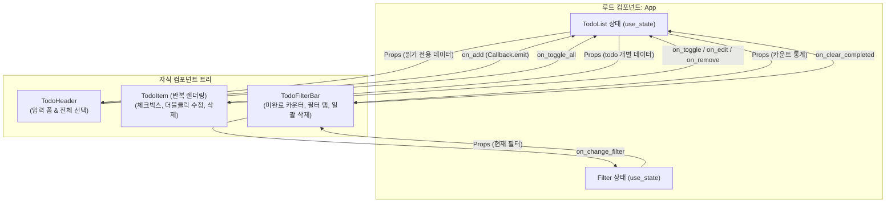

# 03장. Yew로 완성하는 모던 웹 애플리케이션: 양방향 컴포넌트 통신 & LocalStorage 영구 보존 🦀📋

> **"카운터 예제를 넘어 실무 수준의 웹 애플리케이션으로! 제어 컴포넌트 폼, 인라인 수정, 그리고 브라우저 로컬 저장소 연동까지"**

앞선 **Phase 2**에서는 Yew의 가상 DOM 원리와 `use_state` 훅, `html!` 매크로를 학습했습니다.  
이번 **Phase 3**에서는 실무 웹 프론트엔드의 3대 핵심 영역인 **① 부모-자식 간의 양방향 이벤트 통신**, **② 키보드 및 폼 입력 제어(Controlled Component)**, **③ 브라우저 저장소(`LocalStorage`)를 통한 영구 상태 보존**을 다룹니다.

---

## 1. 컴포넌트 아키텍처 & 단방향 데이터 흐름

현대적인 프론트엔드 아키텍처의 황금률은 **"데이터는 위에서 아래로(Props Down), 이벤트는 아래에서 위로(Events Up)"** 흐르는 단방향 데이터 흐름(Unidirectional Data Flow)입니다.



### 컴포넌트 분리의 장점
- **관심사의 분리(SoC)**: `TodoHeader`는 입력 검증에 집중하고, `TodoItem`은 개별 아이템의 렌더링 및 편집 상태에 집중합니다.
- **렌더링 최적화**: Props에 `PartialEq`가 구현되어 있어 내용이 변경되지 않은 다른 `TodoItem`들은 재렌더링되지 않습니다.

---

## 2. 핵심 구현 패턴 4가지

### 1) 제어 컴포넌트(Controlled Component)와 DOM 이벤트 추출
사용자의 키보드 입력을 Rust 상태에 실시간 동기화할 때, `web-sys`의 `HtmlInputElement`로 안전하게 다운캐스팅합니다:

```rust
use web_sys::HtmlInputElement;
use yew::prelude::*;

let input_value = use_state(String::new);

let on_input = {
    let input_value = input_value.clone();
    Callback::from(move |e: InputEvent| {
        // e.target을 HtmlInputElement로 동적 변환
        if let Some(target) = e.target_dyn_into::<HtmlInputElement>() {
            input_value.set(target.value());
        }
    })
};

let on_keydown = {
    let input_value = input_value.clone();
    let on_add = props.on_add.clone();
    Callback::from(move |e: KeyboardEvent| {
        if e.key() == "Enter" {
            e.prevent_default(); // 폼 기본 새로고침 방지
            let val = (*input_value).trim().to_string();
            if !val.is_empty() {
                on_add.emit(val);
                input_value.set(String::new()); // 입력창 비우기
            }
        }
    })
};
```

---

### 2) 자식에서 부모로 이벤트 발송 (`Callback::emit`)
자식 컴포넌트는 부모의 상태를 직접 수정할 수 없으며, 부모가 전달해 준 `Callback<T>`을 통해 메시지를 보냅니다:

```rust
#[derive(Properties, PartialEq)]
pub struct TodoItemProps {
    pub id: u64,
    pub title: String,
    pub on_toggle: Callback<u64>,
}

// 자식 내부:
let on_click = {
    let cb = props.on_toggle.clone();
    let id = props.id;
    Callback::from(move |_| cb.emit(id)) // 부모에게 id 전달!
};
```

---

### 3) 로컬 상태를 활용한 인라인 편집 모드
`is_editing`과 `edit_value`는 앱 전체가 알 필요 없는 **각 항목만의 로컬 상태**입니다.  
더블클릭 시 편집 인풋으로 전환되고, Enter나 Blur(포커스 해제) 시 부모에게 수정 이벤트를 전달합니다:

```rust
let is_editing = use_state(|| false);
let edit_value = use_state(|| props.title.clone());

// 더블클릭 핸들러
let on_double_click = {
    let is_editing = is_editing.clone();
    Callback::from(move |_| is_editing.set(true))
};

// 키보드 엔터/Esc 핸들러
let on_keydown = {
    let is_editing = is_editing.clone();
    let on_edit = props.on_edit.clone();
    let id = props.id;
    Callback::from(move |e: KeyboardEvent| {
        if e.key() == "Enter" {
            on_edit.emit((id, (*edit_value).clone()));
            is_editing.set(false);
        } else if e.key() == "Escape" {
            is_editing.set(false); // 취소
        }
    })
};
```

---

### 4) `gloo-storage`와 `use_effect_with`: 브라우저 LocalStorage 자동 동기화
사용자가 할 일을 추가하거나 수정할 때마다 새로고침해도 데이터가 유지되도록 브라우저의 `window.localStorage`에 JSON 형태로 저장합니다.

Yew에서는 React의 `useEffect`와 1:1로 대응되는 **`use_effect_with`**를 제공합니다:

```rust
use gloo_storage::{LocalStorage, Storage};

// 1. 상태 선언 (초기값은 LocalStorage에서 로드)
let todos = use_state(load_todos);

// 2. todos 상태가 변경될 때마다 자동 실행되는 Side-Effect
{
    let todos = todos.clone();
    use_effect_with((*todos).clone(), move |todos_data| {
        // Serde를 통해 자동으로 JSON 직렬화되어 브라우저에 저장됨
        let _ = LocalStorage::set("rust_wasm_todos_v1", todos_data);
    });
}
```

> 💡 **`gloo` 라이브러리란?**  
> `web-sys`의 저수준 Web API를 Rust 개발자가 편하게 사용할 수 있도록 고수준(High-level) 안전한 래퍼를 제공하는 러스트 Wasm 공식 생태계 도구 모음입니다 (`gloo-storage`, `gloo-net`, `gloo-timers` 등).

---

## 3. 실전 프로젝트 분석: `wasm-03-yew-todo`

[`projects/frontend/wasm-03-yew-todo`](../../projects/frontend/wasm-03-yew-todo) 프로젝트의 구조입니다.

```
projects/frontend/wasm-03-yew-todo/
├── Cargo.toml                  # yew 0.21, gloo-storage 0.3, serde 1.0
├── index.html                  # Trunk 마크업 및 Pretendard/Fira 웹폰트
├── styles.css                  # 글래스모피즘, 커스텀 체크박스, 취소선 스타일
├── README.md                   # 실행 가이드
└── src/
    ├── main.rs                 # Yew 진입점 (Renderer)
    ├── lib.rs                  # 모듈 정의 및 App 컴포넌트 export
    ├── model.rs                # 🧪 TodoList 도메인 모델 & 순수 단위 테스트
    ├── storage.rs              # LocalStorage load/save 로직
    ├── app.rs                  # 최상위 루트 컴포넌트 & 상태/이펙트 관리
    └── components/
        ├── mod.rs
        ├── header.rs           # 할 일 입력창 & 전체 선택 토글 버튼
        ├── todo_item.rs        # 개별 아이템 뷰 & 인라인 더블클릭 편집
        └── todo_filter.rs      # 카운터, 탭 필터(전체/진행/완료), 일괄 삭제
```

---

## 4. 로컬 실행 및 테스트 검증

### 1) 순수 비즈니스 로직 단위 테스트
브라우저 렌더링과 독립적으로 할 일 추가(공백 예외 처리), 토글, 수정, 일괄 완료, 필터링 로직을 테스트합니다:

```bash
cargo test -p wasm-03-yew-todo
```

```text
running 4 tests
test model::tests::test_todo_add_and_validation ... ok
test model::tests::test_todo_toggle_and_remove ... ok
test model::tests::test_todo_edit ... ok
test model::tests::test_todo_filtering_and_batch_actions ... ok

test result: ok. 4 passed; 0 failed; 0 ignored; 0 measured; 0 filtered out
```

### 2) 로컬 개발 서버 구동 (자동 핫 리로딩)
```bash
cd projects/frontend/wasm-03-yew-todo
trunk serve --port 9092
```

- 브라우저에서 `http://127.0.0.1:9092` 접속
- 할 일을 추가/완료 처리한 뒤 **브라우저 새로고침(F5)을 해도 목록이 그대로 유지**되는 것을 확인하세요!

---

## 5. 요약 & 다음 단계 미리보기

| Phase | 단계명 | 핵심 기술 | 상태 |
| :---: | :--- | :--- | :---: |
| **Phase 1** | Wasm 기초 & Trunk 빌드 환경 | `wasm-bindgen`, `web-sys`, Trunk | ✅ 완료 |
| **Phase 2** | React 스타일의 Yew 프레임워크 | `yew 0.21`, `html!`, `use_state`, Callback | ✅ 완료 |
| **Phase 3** | Yew Todo 앱 & 컴포넌트 분리 | 제어 컴포넌트, Props 양방향 통신, `gloo-storage` | ✅ 완료 |
| **Phase 4** | Axum 백엔드 연동 풀스택 통신 | `gloo-net` (비동기 HTTP Fetch), 단일 DTO 모델 공유 | 🔜 대기 |

다음 **Phase 4**에서는 앞서 백엔드 과정에서 제작했던 **Axum REST API 서버**와 이 Yew 프론트엔드를 연결합니다!  
TypeScript/Swagger 없이 **프론트엔드와 백엔드가 100% 동일한 Rust 구조체(DTO)를 공유**하는 진정한 "풀스택 Rust"의 마법을 경험하게 됩니다! 🚀
