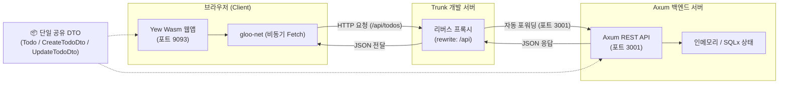

# 04장. Axum 백엔드와 Yew 프론트엔드의 풀스택 연동 (End-to-End) 🦀🌐

> **"TypeScript, Swagger 변환은 이제 그만! 단 하나의 Rust 구조체로 백엔드와 프론트엔드가 100% 동기화되는 기적"**

웹 풀스택 개발의 가장 고질적인 문제는 **"백엔드와 프론트엔드의 타입 불일치"**였습니다.  
백엔드(Go/Java/Python)에서 모델 필드명을 하나 바꾸면, 프론트엔드(TypeScript)의 인터페이스도 일일이 고쳐야 했고, 깜빡하면 런타임에 `undefined` 오류가 발생하곤 했습니다.

하지만 백엔드(Axum)와 프론트엔드(Yew WebAssembly)를 모두 **Rust**로 작성하면, **동일한 Rust 구조체(DTO)를 양쪽에서 그대로 사용**할 수 있습니다!

---

## 1. 풀스택 Rust 아키텍처 개요



### 전통적인 방식 vs 풀스택 Rust 비교

| 항목 | 전통적인 웹 스택 (Node/Spring + React) | 풀스택 Rust (Axum + Yew Wasm) |
| :--- | :--- | :--- |
| **타입 정의** | 백엔드(Java/Go) 모델 ➡️ OpenAPI ➡️ TS 인터페이스 변환 | **단 하나의 Rust `struct`로 양쪽 완전 공유** |
| **타입 안정성** | 런타임 검증 필요 (Zod, class-validator) | **컴파일 타임에 100% 보장 (필드 불일치 시 빌드 불가)** |
| **직렬화 성능** | JS 런타임 `JSON.parse` (가비지 컬렉터 부담) | **`serde-json`을 통한 초고속 네이티브 역직렬화** |
| **CORS 처리** | 백엔드에 매번 허용 도메인 수동 설정 | **Trunk 내장 리버스 프록시로 개발 단계에서 CORS 원천 차단** |

---

## 2. 브라우저 비동기 HTTP 통신: `gloo-net` & `spawn_local`

### 1) 싱글 스레드 브라우저와 `spawn_local`
Node.js나 Axum 백엔드에서는 `tokio::spawn`을 이용해 멀티스레드 비동기 작업을 처리합니다.  
하지만 웹 브라우저의 자바스크립트/Wasm 메인 스레드는 **단일 스레드 이벤트 루프**입니다.

따라서 Yew에서는 `tokio::spawn` 대신 **`wasm_bindgen_futures::spawn_local`**을 사용합니다:

```rust
use wasm_bindgen_futures::spawn_local;
use gloo_net::http::Request;

// 버튼 클릭 이벤트 내부:
let on_click = Callback::from(move |_| {
    spawn_local(async move {
        // 브라우저 Fetch API를 안전하게 호출
        let resp = Request::get("/api/todos").send().await;
        // 결과 처리...
    });
});
```

### 2) `gloo-net`의 우아한 메서드 체이닝
`gloo-net`은 브라우저의 저수준 `fetch()` API를 Rust의 `Result` 기반 타입 시스템으로 감싼 고수준 라이브러리입니다:

```rust
// 1. GET 요청 (목록 조회)
let todos: Vec<Todo> = Request::get("/api/todos")
    .send()
    .await?
    .json()
    .await?;

// 2. POST 요청 (생성)
let new_todo: Todo = Request::post("/api/todos")
    .json(&create_dto)?  // Serde로 JSON 자동 변환
    .send()
    .await?
    .json()
    .await?;

// 3. PUT 요청 (수정)
Request::put(&format!("/api/todos/{id}"))
    .json(&update_dto)?
    .send()
    .await?;

// 4. DELETE 요청 (삭제)
Request::delete(&format!("/api/todos/{id}"))
    .send()
    .await?;
```

---

## 3. 브라우저 CORS 문제와 Trunk 리버스 프록시

웹 브라우저는 보안상 **프론트엔드 출처(`http://127.0.0.1:9093`)**와 **백엔드 출처(`http://127.0.0.1:3001`)**의 포트가 다르면 기본적으로 요청을 차단(CORS 정책 위반)합니다.

Trunk 번들러의 **리버스 프록시(Reverse Proxy)** 기능을 활용하면 백엔드 코드 수정 없이도 CORS 문제를 완벽하게 우회할 수 있습니다.

### `Trunk.toml` 설정

```toml
[watch]
ignore = ["dist"]

[serve]
port = 9093

# 브라우저가 /api/...로 요청을 보내면 Trunk가 백엔드(3001)로 자동 전달!
[[proxy]]
rewrite = "/api"
backend = "http://127.0.0.1:3001/api"
```

> 💡 프론트엔드 코드에서는 상대 경로인 `/api/todos`로만 요청하면 되므로, 배포 시(Nginx/Caddy 환경)에도 별도의 도메인 하드코딩이 필요 없습니다!

---

## 4. 실전 프로젝트 분석: `wasm-04-fullstack-integration`

[`projects/frontend/wasm-04-fullstack-integration`](../../projects/frontend/wasm-04-fullstack-integration) 프로젝트의 아키텍처입니다.

```
projects/frontend/wasm-04-fullstack-integration/
├── Trunk.toml                  # 3001번 포트 Axum 백엔드 리버스 프록시
├── Cargo.toml                  # yew, gloo-net, serde, wasm-bindgen-futures
├── index.html                  # Trunk 진입점
├── styles.css                  # 연결 상태 인디케이터, 스피너, 대시보드 레이아웃
├── README.md                   # 실행 가이드
└── src/
    ├── main.rs                 # Yew Renderer 진입점
    ├── lib.rs                  # 모듈 노출
    ├── dto.rs                  # 🧪 Axum 백엔드와 동일한 공유 모델 (Todo, DTO)
    ├── api.rs                  # gloo-net 기반 RESTful CRUD 클라이언트 함수 모음
    ├── app.rs                  # 최상위 비동기 상태 머신 (로딩, 에러, 실시간 동기화)
    └── components/
        ├── mod.rs
        ├── status_bar.rs       # 🟢 연결됨/🔴 오프라인 상태바 및 새로고침 버튼
        ├── create_form.rs      # POST 요청 폼 (제목, 설명) & 서브밋 스피너
        ├── todo_card.rs        # 개별 카드 뷰 (PUT 상태 토글, PUT 수정, DELETE 삭제)
        └── error_banner.rs     # 네트워크 실패 시 친절한 안내 배너
```

---

## 5. 풀스택 로컬 구동 및 테스트

### 1단계: DTO 직렬화 단위 테스트
```bash
cargo test -p wasm-04-fullstack-integration
```
```text
running 3 tests
test dto::tests::test_create_dto_json ... ok
test dto::tests::test_todo_json_roundtrip ... ok
test dto::tests::test_update_dto_selective_serialization ... ok

test result: ok. 3 passed; 0 failed; 0 ignored; 0 measured; 0 filtered out
```

### 2단계: 백엔드 Axum REST API 실행 (터미널 1)
```powershell
cd H:\lee\rust-sandbox\projects\backend\sample-02-rest-crud
cargo run
```
- `http://127.0.0.1:3001`에서 REST API 구동

### 3단계: 프론트엔드 Yew Wasm 개발 서버 실행 (터미널 2)
```powershell
cd H:\lee\rust-sandbox\projects\frontend\wasm-04-fullstack-integration
trunk serve --port 9093
```
- 브라우저에서 `http://127.0.0.1:9093` 접속
- 상단에 **`🟢 Axum 서버 연결됨 (3001)`** 인디케이터 확인
- 웹 화면에서 Todo를 등록/수정/삭제하면 Axum 백엔드의 인메모리 저장소에 실시간 반영!

---

## 6. 요약 & 다음 단계 미리보기

| Phase | 단계명 | 핵심 기술 | 상태 |
| :---: | :--- | :--- | :---: |
| **Phase 1** | Wasm 기초 & Trunk 빌드 환경 | `wasm-bindgen`, `web-sys`, Trunk | ✅ 완료 |
| **Phase 2** | React 스타일의 Yew 프레임워크 | `yew 0.21`, `html!`, `use_state` | ✅ 완료 |
| **Phase 3** | Yew Todo 앱 & 컴포넌트 분리 | 제어 컴포넌트, `gloo-storage` | ✅ 완료 |
| **Phase 4** | Axum 백엔드 연동 풀스택 통신 | `gloo-net`, 단일 DTO 모델 공유, 리버스 프록시 | ✅ 완료 |
| **Phase 5** | Canvas 2D 고성능 그래픽 연산 | HTML5 Canvas 직접 제어, 60FPS 파티클 시뮬레이터 | 🔜 대기 |

다음 **Phase 5**에서는 자바스크립트가 가장 취약한 **"대규모 수학 연산과 60FPS 실시간 그래픽 렌더링"** 영역으로 들어갑니다!  
Rust WebAssembly의 네이티브 연산 파워를 이용해 수천 개의 파티클을 마우스와 상호작용시키는 고성능 Canvas 2D 시뮬레이터 **`wasm-05-performance-canvas`**를 구축합니다! 🎨⚡
