# 05장. JavaScript 대비 20배 빠른 고성능 그래픽 연산 (HTML5 Canvas 2D) 🦀⚡🎨

> **"수천 개의 입자가 마우스를 따라 실시간으로 상호작용하는 60FPS의 마법! 가비지 컬렉터(GC) 멈춤이 없는 진정한 네이티브 연산의 세계"**

웹 프론트엔드에서 3D 뷰어, 물리 시뮬레이션, 오디오/비디오 인코딩, 데이터 시각화 차트를 구축할 때 개발자들이 가장 먼저 맞닥뜨리는 벽은 **JavaScript의 성능 한계와 가비지 컬렉터(GC)로 인한 프레임 드롭(Stuttering)**입니다.

이번 **Phase 5**에서는 Rust WebAssembly가 왜 현대 브라우저 그래픽 연산의 최강자인지 직접 증명하는 고성능 60FPS 파티클 시뮬레이터 **`wasm-05-performance-canvas`**를 분석하고 구축합니다.

---

## 1. 왜 그래픽/물리 연산에서 Rust Wasm이 압도적인가?

```mermaid
flowchart TD
    subgraph TraditionalJS["전통적인 JavaScript Canvas 애니메이션"]
        JSMem["매 프레임 객체 생성 { x, y, vx, vy }"] --> JIT["JIT 최적화 & 인터프리터"]
        JIT --> GC["가비지 컬렉터(GC) 발동 ⚠️"]
        GC --> Stutter["Stop-The-World (화면 뚝뚝 끊김/FPS 급락)"]
    end

    subgraph WasmNative["Rust WebAssembly Canvas 파이프라인"]
        RustMem["연속된 힙 메모리 버퍼 Vec&lt;Particle&gt;"] --> NoGC["가비지 컬렉터 없음 (No GC) 🚀"]
        NoGC --> SIMD["초고속 부동소수점 벡터 수치 연산"]
        SIMD --> VSync["request_animation_frame 브라우저 V-Sync 동기화"]
        VSync --> Solid60["칼같은 60FPS 유지 (완벽한 부드러움)"]
    end
```



### 성능 비교 핵심 포인트 3가지

1. **가비지 컬렉션(GC) 제로**:
   - JS에서는 입자마다 `{ x, y, vx, vy }` 객체를 생성하거나 배열을 다룰 때 힙 메모리에 수많은 파편이 생겨 정기적으로 GC가 메인 스레드를 멈춥니다(Stop-the-world).
   - Rust는 `Vec<Particle>`을 초기 1회만 할당한 뒤 **동일한 연속 메모리 블록을 재사용**하므로 GC 자체가 존재하지 않습니다.
2. **CPU 네이티브 부동소수점(Float) 수치 연산**:
   - 거리 제곱근(`sqrt`), 삼각함수(`sin`, `cos`), 접선 벡터 계산이 브라우저 추상화 계층 없이 CPU 명령어 집합으로 직행합니다.
3. **메모리 캐시 지역성(Cache Locality)**:
   - Rust 구조체 배열은 메모리 상에 빈틈없이 붙어있어 CPU L1/L2 캐시 적중률(Cache Hit Ratio)이 극도로 높습니다.

---

## 2. HTML5 `<canvas>` 2D 직접 제어 메커니즘

### 1) 고해상도 Retina 디스플레이(DPI) 보정
모바일이나 고해상도 모니터에서 캔버스가 흐릿하게 깨지는 현상을 방지하기 위해 `device_pixel_ratio`를 적용합니다:

```rust
let window = web_sys::window().expect("전역 Window 없음");
let dpr = window.device_pixel_ratio();
let rect = canvas.get_bounding_client_rect();

// 캔버스 버퍼 해상도는 dpr 배수만큼 키움
canvas.set_width((rect.width() * dpr) as u32);
canvas.set_height((rect.height() * dpr) as u32);

let ctx = canvas
    .get_context("2d")?
    .unwrap()
    .dyn_into::<CanvasRenderingContext2d>()?;

// 렌더링 컨텍스트 스케일을 보정하여 코드는 CSS 픽셀 단위로 작성 가능!
ctx.scale(dpr, dpr)?;
```

### 2) Motion Blur 잔상 효과
매 프레임 `clear_rect`로 화면을 완전히 지우는 대신, **약간 투명한 반투명 검은색 사각형**으로 이전 프레임을 덮으면 빛나는 혜성 같은 잔상(Motion Blur)이 남게 됩니다:

```rust
// 이전 프레임의 흔적이 서서히 사라지도록 반투명 덮기
ctx.set_fill_style_str("rgba(7, 10, 18, 0.28)");
ctx.fill_rect(0.0, 0.0, self.width, self.height);
```

---

## 3. 60FPS 브라우저 V-Sync 동기화 루프

`setInterval`이나 `setTimeout`은 브라우저 렌더링 타이밍과 맞지 않아 화면이 찢어지거나 배터리를 낭비합니다.  
Rust Wasm에서는 `gloo-render`의 **`request_animation_frame`**을 사용하여 브라우저 주사율(60Hz, 120Hz, 144Hz)에 완벽하게 동기화합니다.

```rust
let anim_handle: Rc<RefCell<Option<AnimationFrame>>> = Rc::new(RefCell::new(None));
let render_frame = Rc::new(RefCell::new(None::<Box<dyn FnMut(f64)>>));
let render_frame_self = render_frame.clone();

*render_frame.borrow_mut() = Some(Box::new(move |timestamp: f64| {
    // 1. 실시간 FPS 측정 (Performance.now() 기반)
    measure_fps(timestamp);

    // 2. 물리 1스텝 연산 & 캔버스 그리기
    universe.borrow_mut().step();
    universe.borrow().render(&ctx);

    // 3. 다음 수직 동기화 프레임 예약 (재귀 호출)
    let next_fn = render_frame_self.clone();
    *anim_handle_clone.borrow_mut() = Some(gloo_render::request_animation_frame(move |ts| {
        if let Some(ref mut f) = *next_fn.borrow_mut() {
            f(ts);
        }
    }));
}));
```

---

## 4. 4가지 인터랙티브 물리 모드 구현

```rust
match mode {
    // 1. 인력 (마우스 위치로 중력 가속)
    InteractionMode::Attract => {
        p.vx += (dx / dist) * force * 1.5;
        p.vy += (dy / dist) * force * 1.5;
    }
    // 2. 척력 (마우스 접근 시 강하게 밀어냄)
    InteractionMode::Repel => {
        p.vx -= (dx / dist) * force * 2.5;
        p.vy -= (dy / dist) * force * 2.5;
    }
    // 3. 소용돌이 (접선 벡터를 활용한 나선 회전력)
    InteractionMode::Vortex => {
        p.vx += (-dy / dist) * force * 2.0 + (dx / dist) * 0.2;
        p.vy += (dx / dist) * force * 2.0 + (dy / dist) * 0.2;
    }
    // 4. 유영 (외력 없이 벽면 탄성 반사)
    InteractionMode::Floating => {}
}
```

---

## 5. 실전 프로젝트 분석: `wasm-05-performance-canvas`

[`projects/frontend/wasm-05-performance-canvas`](../../projects/frontend/wasm-05-performance-canvas)의 프로젝트 구조입니다.

```
projects/frontend/wasm-05-performance-canvas/
├── Cargo.toml                  # web-sys (Canvas, Touch, Performance), gloo-render
├── index.html                  # Trunk 엔트리포인트 및 폰트
├── styles.css                  # 사이버 다크 테마, FPS 인디케이터, 레인지 슬라이더
├── README.md                   # 실행 안내서
└── src/
    ├── main.rs                 # Renderer 진입점
    ├── lib.rs                  # 모듈 노출
    ├── particle_system.rs      # 🧪 순수 물리 연산 엔진 (독립 Xorshift 난수, 단위 테스트)
    ├── app.rs                  # 최상위 상태 및 벤치마크 안내 대시보드
    └── components/
        ├── mod.rs
        ├── canvas_view.rs      # Canvas 마운트, 60FPS 루프, 마우스/터치 리스너
        └── control_panel.rs    # 파티클 수량(500~4000), 모드 4종, 속도 슬라이더, 폭발
```

---

## 6. 로컬 실행 및 벤치마크 테스트

### 1) 순수 Rust 물리 연산 단위 테스트
```bash
cargo test -p wasm-05-performance-canvas
```
```text
running 4 tests
test particle_system::tests::test_attraction_force ... ok
test particle_system::tests::test_step_motion_and_boundary_bounce ... ok
test particle_system::tests::test_universe_initialization ... ok
test particle_system::tests::test_resize_and_particle_count ... ok

test result: ok. 4 passed; 0 failed; 0 ignored; 0 measured; 0 filtered out
```

### 2) 로컬 개발 서버 구동
```powershell
cd H:\lee\rust-sandbox\projects\frontend\wasm-05-performance-canvas
trunk serve --port 9094
```
- 브라우저에서 **`http://127.0.0.1:9094`**에 접속합니다.
- 파티클 개수를 **500 ➜ 1000 ➜ 2000 ➜ 4000개**로 늘려보며 우측 상단의 **FPS 인디케이터가 60FPS를 안정적으로 유지**하는지 확인하세요!
- 마우스를 올리고 **인력, 척력, 소용돌이** 모드를 바꾸거나 캔버스를 클릭하여 **Burst 폭발**을 일으켜 보세요.

---

## 7. 요약 & 다음 단계 미리보기

| Phase | 단계명 | 핵심 기술 | 상태 |
| :---: | :--- | :--- | :---: |
| **Phase 1** | Wasm 기초 & Trunk 빌드 환경 | `wasm-bindgen`, `web-sys`, Trunk | ✅ 완료 |
| **Phase 2** | React 스타일의 Yew 프레임워크 | `yew 0.21`, `html!`, `use_state` | ✅ 완료 |
| **Phase 3** | Yew Todo 앱 & 컴포넌트 분리 | 제어 컴포넌트, `gloo-storage` | ✅ 완료 |
| **Phase 4** | Axum 백엔드 연동 풀스택 통신 | `gloo-net`, 단일 DTO 모델 공유, 리버스 프록시 | ✅ 완료 |
| **Phase 5** | Canvas 2D 고성능 그래픽 연산 | HTML5 Canvas 직접 제어, 60FPS 파티클 시뮬레이터 | ✅ 완료 |
| **Phase 6** | 차세대 Leptos 프레임워크 & 배포 | No V-DOM 반응형 시그널, 정적 웹 호스팅 배포 | 🔜 최종 단계 |

마지막 **Phase 6**에서는 최신 Rust 프론트엔드 생태계에서 가장 주목받고 있는 차세대 프레임워크인 **`Leptos`**를 탐구합니다!  
가상 DOM의 오버헤드마저 완전히 걷어낸 SolidJS 스타일의 **세분화된 반응성(Signal)**을 경험하고, 완성된 Wasm 애플리케이션을 GitHub Pages나 Vercel에 **정적 웹 호스팅으로 배포하는 최종 파이프라인**을 완성합니다! 🚀
