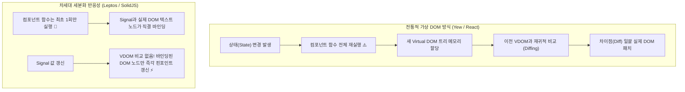
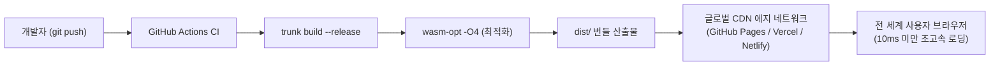

# 06장. 차세대 초고속 프레임워크 Leptos & 정적 배포 ⚡🚀

> **"가상 DOM(Virtual DOM)의 오버헤드를 0으로 만든 세분화된 반응성(Signal)의 경지! Wasm 웹 앱을 전 세계 CDN에 단 몇 초 만에 배포하는 완벽 가이드"**

웹 프론트엔드 역사는 지난 10년간 React가 촉발한 **가상 DOM(Virtual DOM, VDOM)** 패러다임이 지배해 왔습니다. Yew 역시 React의 검증된 컴포넌트 라이프사이클과 VDOM 모델을 Rust로 훌륭히 이식하여 큰 성공을 거두었습니다.

하지만 2020년대 들어 웹 생태계는 **SolidJS, Svelte**를 필두로 "왜 상태 하나 바뀔 때마다 컴포넌트 전체를 다시 실행하고 거대한 가상 트리를 비교해야 하는가?"라는 근본적인 질문을 던지기 시작했습니다.

이 질문에 대한 Rust 진영의 가장 우아하고 압도적인 해답이 바로 **Leptos(레프토스)**입니다.  
이번 **Phase 6**에서는 차세대 프레임워크 Leptos 0.7의 핵심 아키텍처를 학습하고, 현대적인 반응형 쇼케이스 대시보드인 **`wasm-06-leptos-showcase`**를 구축한 뒤, GitHub Pages, Vercel, Netlify에 정적 배포하는 전 과정을 마스터합니다.

---

## 1. 패러다임의 대전환: Yew(가상 DOM) vs Leptos(세분화된 반응성)



### 아키텍처 핵심 차이점 3가지

| 비교 항목 | Yew (Virtual DOM) | Leptos (Fine-Grained Reactivity) |
| :--- | :--- | :--- |
| **렌더링 모델** | 컴포넌트 기반 재실행 (Re-render) | 함수는 1회만 실행, 클로저 기반 핀포인트 바인딩 |
| **상태 관리 단위** | 컴포넌트 로컬 상태 (`use_state`) | 독립적인 반응형 그래프 노드 (`signal`) |
| **가상 DOM** | 가상 DOM 트리 생성 및 Diffing 수행 | **가상 DOM 없음 (Zero Virtual DOM)** |
| **메모리 할당** | 상태 변경 시마다 새 VDOM 노드 할당 | 상태 변경 시 추가 메모리 할당 0 |
| **프레임워크 기원** | React 컴포넌트 모델의 Rust 계승 | SolidJS 반응성 모델의 Rust 극대화 |

---

## 2. Leptos 0.7 핵심 프리미티브 마스터

### 1) Signal (반응형 원자)
Signal은 값을 보관하는 게터(`ReadSignal<T>`)와 값을 갱신하는 세터(`WriteSignal<T>`)의 쌍으로 이루어집니다:

```rust
use leptos::prelude::*;

#[component]
pub fn Counter() -> impl IntoView {
    // signal 생성 (기본값 0)
    let (count, set_count) = signal(0);

    view! {
        <div>
            // view 안에서 {count}를 참조하는 순간, 이 텍스트 노드는 count Signal을 구독합니다!
            <p>"현재 카운트: " {count}</p>

            // set_count.update로 클로저를 통해 값을 변경합니다.
            <button on:click=move |_| set_count.update(|n| *n += 1)>
                "+1 증가"
            </button>
        </div>
    }
}
```

> **핵심 원리**: 버튼을 클릭해도 `Counter()` 함수 자체가 다시 실행되지 않습니다! 오직 `<p>` 안의 숫자 텍스트 노드 하나만 브라우저에서 직접 변경됩니다.

### 2) Memo (스마트 파생 상태 캐싱)
다른 Signal에 의존하여 계산되는 파생 상태는 `Memo::new`로 생성합니다. 의존하는 Signal이 바뀔 때만 재연산되며, 결과가 같으면 다운스트림을 깨우지 않습니다:

```rust
let (count, set_count) = signal(10);

// count가 변경될 때만 재계산되어 캐싱됨
let doubled = Memo::new(move |_| count.get() * 2);
let is_even = Memo::new(move |_| count.get() % 2 == 0);
```

### 3) `<For>` 컴포넌트 (초고속 컬렉션 렌더링)
배열이나 리스트를 렌더링할 때 고유 키(Key)를 지정하여, 항목이 추가되거나 순서가 바뀌어도 기존 DOM 노드를 파괴하지 않고 완벽하게 재활용합니다:

```rust
<For
    each=move || items.get()
    key=|item| item.id
    let:item
>
    <div class="item-card">
        <h3>{item.name}</h3>
    </div>
</For>
```

---

## 3. 실습 프로젝트: `wasm-06-leptos-showcase` 구조

[`projects/frontend/wasm-06-leptos-showcase`](../../projects/frontend/wasm-06-leptos-showcase)는 Leptos의 현대적인 설계 철학과 프로덕션 배포 파이프라인을 집대성한 대시보드입니다.

```
wasm-06-leptos-showcase/
├── Cargo.toml                 # leptos 0.7 (csr), web-sys 의존성
├── Trunk.toml                 # 포트 9095 개발 서버 설정
├── index.html                 # Wasm 마운트 HTML 템플릿
├── styles.css                 # 사이버 테크 다크 테마 (순수 모던 CSS)
├── src/
│   ├── main.rs                # mount_to_body(App) 진입점
│   ├── lib.rs                 # App 루트 컴포넌트 & 탭 뷰어
│   ├── models.rs              # 순수 비즈니스 로직 & DTO
│   └── components/
│       ├── mod.rs
│       ├── header.rs          # 브랜드 로고 및 3대 탭 네비게이션
│       ├── counter_tab.rs     # Signal, Memo, 1,000회 연속 틱 벤치마크
│       ├── filter_tab.rs      # <For> 고성능 리스트, 검색/카테고리/정렬 필터
│       └── deployment_tab.rs  # 인터랙티브 배포 체크리스트 & CI/CD 템플릿
└── tests/
    └── showcase_tests.rs      # 순수 Rust 단위 테스트 5종 (All Passed)
```

### 3대 쇼케이스 탭 구현 포인트

1. **⚡ 반응성 & 메모 실험실 (`counter_tab.rs`)**:
   - `count` Signal 증감 간격(`step`)을 실시간으로 변경하며 조작
   - `Memo::new`를 통해 2배수, 제곱수, 짝수/홀수 스마트 파생 상태 캐싱
   - **1,000회 연속 틱 벤치마크**: `web_sys::window().performance().now()`를 통해 1,000번의 상태 전파가 1ms 미만에 완료됨을 눈으로 직접 확인
2. **📊 고성능 컬렉션 렌더링 (`filter_tab.rs`)**:
   - 기술 스택(Leptos, Yew, Dioxus, Axum, SolidJS, Trunk 등) 실시간 검색 필터
   - 카테고리 칩 필터링 및 별점순/이름순 정렬
   - 새 기술 스택 동적 추가/삭제 및 실시간 별점 올리기
3. **🚀 정적 배포 완벽 가이드 (`deployment_tab.rs`)**:
   - 배포 준비도 인터랙티브 체크리스트와 실시간 백분율 진행도 게이지
   - GitHub Pages, Vercel, Netlify, Docker/Nginx 설정 파일 원클릭 복사

---

## 4. Wasm 프로덕션 정적 배포 (Static Deployment) 실전 가이드

WebAssembly 프론트엔드는 서버 사이드 연산 없이 **순수한 정적 파일(`index.html`, `.wasm`, `.js`, `.css`)**의 집합입니다. 따라서 AWS S3, Cloudflare Pages, GitHub Pages, Vercel, Netlify 등 **전 세계 CDN 에지(Edge) 네트워크에 거의 무료로 초고속 배포**할 수 있습니다!



### 1) Trunk 릴리즈 최적화 빌드
```bash
trunk build --release
```
릴리즈 모드로 빌드하면 디버그 심볼이 제거되고, 컴파일러의 최고 수준 인라이닝 및 데드 코드 제거(DCE)가 적용됩니다.

### 2) `wasm-opt`를 통한 60% 추가 바이트코드 압축
[Binaryen](https://github.com/WebAssembly/binaryen) 프로젝트의 `wasm-opt` 도구를 적용하면 Wasm 파일 크기를 획기적으로 줄일 수 있습니다:
```bash
wasm-opt -O4 -o dist/app_opt.wasm dist/app.wasm
```
- `-O4`: 실행 속도 극대화 최적화
- `-Oz`: 파일 용량 극소화 최적화 (모바일 환경에 추천)

### 3) SPA 404 라우팅 새로고침 트릭
GitHub Pages나 일반 정적 웹 서버는 사용자가 `https://my-app.com/dashboard` 같은 하위 URL에서 새로고침(F5)을 누르면 실제 해당 경로의 HTML 파일이 없으므로 **404 Not Found** 에러를 반환합니다.

이 문제를 해결하기 위해 빌드 후 `index.html`을 `404.html`로 복사합니다:
```bash
cp dist/index.html dist/404.html
touch dist/.nojekyll
```
- `404.html`: 존재하지 않는 경로 요청 시 Wasm 앱이 대신 로드되어 내부 라우터가 올바른 뷰를 띄웁니다.
- `.nojekyll`: GitHub Pages가 `_trunk` 같은 언더스코어 폴더를 무시하는 현상을 차단합니다.

### 4) 올바른 MIME 타입 및 캐싱 헤더
웹 서버에서 `.wasm` 파일의 `Content-Type`이 반드시 `application/wasm`이어야 브라우저가 **스트리밍 컴파일(`WebAssembly.instantiateStreaming`)**을 수행하여 번개처럼 빠른 로딩을 달성합니다:
```http
Content-Type: application/wasm
Cache-Control: public, max-age=31536000, immutable
```

---

## 5. 플랫폼별 원클릭 배포 설정 파일

### 1. GitHub Actions 워크플로우 (`.github/workflows/deploy.yml`)
```yaml
name: Deploy Leptos Wasm to GitHub Pages

on:
  push:
    branches: [main]

jobs:
  deploy:
    runs-on: ubuntu-latest
    steps:
      - uses: actions/checkout@v4

      - name: Install Rust toolchain
        uses: dtolnay/rust-toolchain@stable
        with:
          targets: wasm32-unknown-unknown

      - name: Download & Install Trunk
        run: |
          wget -qO- https://github.com/trunk-rs/trunk/releases/download/v0.22.1/trunk-x86_64-unknown-linux-gnu.tar.gz | tar -xzf- -C /usr/local/bin/

      - name: Build with Trunk (Release)
        run: |
          cd projects/frontend/wasm-06-leptos-showcase
          trunk build --release
          cp dist/index.html dist/404.html
          touch dist/.nojekyll

      - name: Deploy to GitHub Pages
        uses: peaceiris/actions-gh-pages@v4
        with:
          github_token: ${{ secrets.GITHUB_TOKEN }}
          publish_dir: projects/frontend/wasm-06-leptos-showcase/dist
```

### 2. Vercel 설정 (`vercel.json`)
```json
{
  "buildCommand": "trunk build --release",
  "outputDirectory": "dist",
  "rewrites": [
    { "source": "/(.*)", "destination": "/index.html" }
  ],
  "headers": [
    {
      "source": "/(.*).wasm",
      "headers": [
        { "key": "Content-Type", "value": "application/wasm" },
        { "key": "Cache-Control", "value": "public, max-age=31536000, immutable" }
      ]
    }
  ]
}
```

### 3. Netlify 설정 (`netlify.toml`)
```toml
[build]
  command = "trunk build --release"
  publish = "dist"

[[redirects]]
  from = "/*"
  to = "/index.html"
  status = 200

[[headers]]
  for = "/*.wasm"
  [headers.values]
    Content-Type = "application/wasm"
    Cache-Control = "public, max-age=31536000, immutable"
```

---

## 6. 축하합니다! 프론트엔드 전 과정 완주 요약 (Phase 1 ~ 6) 🏆

이제 여러분은 기초부터 차세대 프레임워크와 프로덕션 배포까지 **Rust WebAssembly 프론트엔드의 전 생태계**를 마스터했습니다!

| Phase | 프로젝트명 | 핵심 기술 & 달성 성과 |
| :---: | :--- | :--- |
| **Phase 1** | [`wasm-01-dom-basics`](../../projects/frontend/wasm-01-dom-basics) | `web-sys` 직접 DOM 제어, Trunk 번들러, 60% 용량 최적화 |
| **Phase 2** | [`wasm-02-yew-counter`](../../projects/frontend/wasm-02-yew-counter) | Yew 컴포넌트 모델, `use_state` 훅, 이벤트 버블링, 테마 스위치 |
| **Phase 3** | [`wasm-03-yew-todo`](../../projects/frontend/wasm-03-yew-todo) | 인라인 편집, 제어 입력, `gloo-storage` 브라우저 로컬 저장소 동기화 |
| **Phase 4** | [`wasm-04-fullstack-integration`](../../projects/frontend/wasm-04-fullstack-integration) | 동일 DTO 공유 풀스택, `gloo-net` 비동기 REST CRUD, 리버스 프록시 |
| **Phase 5** | [`wasm-05-performance-canvas`](../../projects/frontend/wasm-05-performance-canvas) | Canvas 2D 직접 제어, GC 없는 60FPS 파티클 물리 시뮬레이션 |
| **Phase 6** | [`wasm-06-leptos-showcase`](../../projects/frontend/wasm-06-leptos-showcase) | **Leptos 0.7 세분화 반응성(Zero VDOM), `<For>`, 클라우드 정적 배포** |
