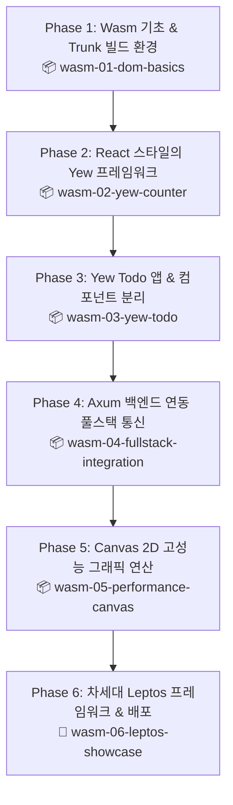

# 🎨 Rust 모던 프론트엔드 & WebAssembly(Wasm) 마스터 작업계획서

> **"자바스크립트의 한계를 넘어 브라우저에서 네이티브 C/Rust급 성능을!"**  
> 본 계획서는 웹 개발자가 Rust의 강력한 타입 시스템과 초고속 WebAssembly(Wasm) 기술을 습득하여, 브라우저 단에서 고성능 인터랙티브 웹 UI 및 무연산 모듈을 자유자재로 구축할 수 있도록 돕는 실습 중심의 마스터 플랜입니다.

---

## 1. 프로젝트 개요 & 학습 목표

| 항목 | 내용 |
| :--- | :--- |
| **목표** | React/Vue 개발자의 경험을 살려, Rust 기반 WebAssembly 웹 UI 프레임워크와 네이티브 연산 모듈 구축 역량 확보 |
| **주 기술 스택** | • 웹 기술: **WebAssembly (Wasm)** (브라우저 바이너리 실행 규격)<br>• Rust 브릿지: **wasm-bindgen**, **web-sys**, **js-sys**<br>• 프론트엔드 번들러: **Trunk** (Rust 전용 초고속 Wasm 번들러, 핫 리로딩 지원)<br>• UI 프레임워크: **Yew** (React 스타일 컴포넌트/Hooks), **Leptos** (SolidJS 스타일 초고속 반응성)<br>• 네트워크 & 상태: **gloo-net** (비동기 Fetch), **gloo-storage** (LocalStorage)<br>• 풀스택 연동: 앞서 완성한 **Axum 백엔드**와의 완벽한 엔드투엔드 결합 |
| **문서 저장 위치** | `c:\workdir\space-cap\rust-sandbox\docs\frontend` |
| **실습 프로젝트 위치** | `c:\workdir\space-cap\rust-sandbox\projects-frontend` |

---

## 2. 단계별 커리큘럼 및 샘플 프로젝트 로드맵



---

### [Phase 1] WebAssembly(Wasm) 기초와 Trunk 번들러 세팅
- **이론 & 핵심 개념**:
  - WebAssembly(Wasm)란 무엇이며 브라우저는 이를 어떻게 기계어처럼 실행하는가?
  - `wasm-bindgen`: Rust와 JavaScript 간의 메모리 복사 없는 고속 데이터 교환
  - `web-sys`: 브라우저의 DOM(`window`, `document`, HTML 요소)을 Rust 타입으로 조작하기
  - Vite/Webpack과 같은 Rust 전용 번들러 **`Trunk`** 설치 및 핫 리로딩 환경 구축
- **만들 샘플 프로젝트**: `wasm-01-dom-basics`
  - Rust로 버튼 클릭 이벤트 수신 및 브라우저 DOM 동적 렌더링
  - JavaScript 함수와 Rust 함수 상호 호출(FFI) 실습

### [Phase 2] React 개발자를 위한 Yew 프레임워크 입문
- **이론 & 핵심 개념**:
  - React의 JSX와 판박이인 Yew의 **`html! { <div class="card">{ "안녕하세요!" }</div> }`** 매크로 문법
  - 함수형 컴포넌트 정의: `#[function_component(MyComponent)]`
  - 상태 관리: React의 `useState`와 동일한 `use_state(|| 0)` 훅의 원리
  - 이벤트 핸들러: `Callback::from(...)`을 통한 불변성 이벤트 캡처
- **만들 샘플 프로젝트**: `wasm-02-yew-counter`
  - 증가, 감소, 초기화 및 다크/라이트 모드 테마 스위처 컴포넌트

### [Phase 3] Yew로 완성하는 모던 웹 애플리케이션 (Todo & 컴포넌트 분리)
- **이론 & 핵심 개념**:
  - 컴포넌트 Props 전달과 부모-자식 간의 양방향 이벤트 통신
  - 입력 폼 제어(Controlled Components)와 키보드 Enter 이벤트
  - 로컬스토리지 연동(`gloo-storage`)을 통한 영구 상태 보존
  - 모던 CSS 스타일링 적용 (Flexbox/Grid 반응형 레이아웃)
- **만들 샘플 프로젝트**: `wasm-03-yew-todo`
  - 할 일 추가, 필터링(전체/진행중/완료), 일괄 삭제, 로컬 브라우저 저장 기능을 갖춘 완성형 Todo 웹앱

### [Phase 4] Rust 백엔드(Axum)와의 풀스택 연동 (End-to-End)
- **이론 & 핵심 개념**:
  - 브라우저 비동기 HTTP 클라이언트: `gloo-net`의 `Request::get / post`
  - 백엔드와 프론트엔드가 **동일한 Rust 구조체(DTO)를 공유**하는 "풀스택 Rust의 기적"
    *(TypeScript/Swagger 변환 없이 단일 Rust 모델로 100% 타입 일치!)*
  - CORS 헤더 처리 및 로딩 스피너, 에러 바운더리 UI 처리
- **만들 샘플 프로젝트**: `wasm-04-fullstack-integration`
  - 앞서 제작한 [sample-02-rest-crud](file:///c:/workdir/space-cap/rust-sandbox/projects/sample-02-rest-crud) Axum API 서버와 실시간으로 통신하는 Yew 프론트엔드 연동

### [Phase 5] JavaScript 대비 20배 빠른 고성능 그래픽 연산 (Canvas 2D)
- **이론 & 핵심 개념**:
  - JS가 가장 취약한 영역: 수만 개의 객체 물리 연산, 이미지 픽셀 조작, 암호화
  - `web-sys`를 통한 HTML5 `<canvas>` 2D 컨텍스트 직접 제어
  - `request_animation_frame`을 이용한 60FPS 논블로킹 렌더링 루프
- **만들 샘플 프로젝트**: `wasm-05-performance-canvas`
  - 수천 개의 빛나는 파티클이 마우스를 따라 실시간으로 인터랙션하는 초고속 그래픽 시뮬레이터

### [Phase 6] 차세대 초고속 프레임워크 Leptos & 정적 배포
- **이론 & 핵심 개념**:
  - 가상 DOM(Virtual DOM)의 오버헤드를 없앤 SolidJS 스타일의 **세분화된 반응성(Signal)**
  - 왜 최신 웹 생태계는 Yew에서 Leptos로 진화하고 있는가?
  - 정적 웹 호스팅(GitHub Pages, Vercel, Netlify)에 Wasm 배포하기
- **만들 샘플 프로젝트**: `wasm-06-leptos-showcase`
  - 번개 같은 반응성을 자랑하는 Leptos 쇼케이스 대시보드

---

## 3. 추천 프로젝트 및 디렉토리 구조

```
rust-sandbox/
├── docs/
│   ├── backend/             # 📂 완성된 백엔드 마스터 가이드
│   └── frontend/            # 📂 [NEW] 프론트엔드 & Wasm 마스터 가이드
│       ├── frontend_learning_plan.md  # 본 작업계획서
│       ├── 01_wasm_and_trunk_intro.md
│       ├── 02_yew_component_and_state.md
│       ├── 03_yew_interactive_todo.md
│       ├── 04_fullstack_axum_integration.md
│       ├── 05_high_perf_canvas.md
│       └── 06_leptos_and_deployment.md
└── projects-frontend/       # 📂 프론트엔드 Wasm 샘플 프로젝트 모음
    ├── wasm-01-dom-basics/
    ├── wasm-02-yew-counter/
    ├── wasm-03-yew-todo/
    ├── wasm-04-fullstack-integration/
    ├── wasm-05-performance-canvas/
    └── wasm-06-leptos-showcase/
```

---

## 4. 확인 및 피드백 요청사항

1. **커리큘럼 구성**: Wasm 기초 ➡️ React 친화적인 Yew ➡️ 앞서 만든 Axum 백엔드와의 풀스택 연동 ➡️ Canvas 고성능 그래픽 ➡️ 차세대 Leptos 순서의 흐름이 마음에 드시나요?
2. **도구 준비**: Wasm 컴파일을 위해 `wasm32-unknown-unknown` 타깃과 `trunk` 번들러를 사용할 예정입니다. (필요 시 자동으로 명령어 안내)

확인 후 계획대로 시작해도 좋을지 말씀해 주시면, 즉시 **Phase 1: WebAssembly 기초 & Trunk 환경 세팅**에 착수하겠습니다! 🦀🎨✨
