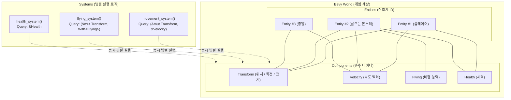

# 01장. Bevy 아키텍처 & 왜 객체지향(OOP)을 버리고 ECS로 가는가? ⚡

> **"객체지향(OOP)에서는 '플레이어가 몬스터를 공격한다'를 표현하기 위해 수많은 클래스를 상속받아야 했습니다.  
> 하지만 Bevy의 ECS에서는 데이터와 로직을 완전히 분리하여, 레고 블록을 조립하듯 유연하고 폭발적으로 빠른 게임을 만듭니다."**

---

## 1. 전통적인 게임 개발의 악몽: 객체지향(OOP) 상속의 한계

유니티(Unity), 언리얼(Unreal), 혹은 자바나 C++로 처음 게임을 만들 때 우리는 대부분 다음과 같이 클래스를 설계합니다:

```text
GameObject
 └── MovableObject
      └── Character
           ├── Player
           └── Monster
                ├── FlyingMonster (날아다니는 몬스터)
                └── SwimmingMonster (수영하는 몬스터)
```

이 고전적인 구조는 게임 개발이 진행될수록 3가지 거대한 재앙을 불러옵니다:

### 1) 다이아몬드 상속과 고릴라/바나나 문제
- 만약 기획자가 **"하늘도 날고 물속에서 수영도 하며, 보물상자처럼 아이템도 뱉는 몬스터"**를 만들어 달라고 하면 어떻게 될까요?
- C++에서는 다중 상속의 다이아몬드 충돌이 발생하고, C#이나 자바에서는 다중 상속이 불가능하여 코드를 복사-붙여넣기하거나 거대한 인터페이스를 덕지덕지 붙여야 합니다.
- > *"당신은 바나나 하나를 원했을 뿐인데, 바나나를 쥐고 있는 고릴라와 그 고릴라가 살고 있는 정글 전체가 딸려왔다."* — 조 암스트롱 (Erlang 창시자)

### 2) CPU 캐시 미스 (Cache Thrashing)
- 현대 CPU는 1초에 수십억 번 연산하지만, RAM에서 데이터를 가져오는 속도는 그에 비해 너무나 느립니다.
- 객체지향에서는 `Monster` 객체 안에 위치, 텍스처, 사운드, 체력, 인공지능이 한 덩어리로 묶여 힙 메모리 사방에 흩어져 있습니다.
- CPU가 1,000마리 몬스터의 "위치만 갱신"하고 싶어도, 쓸데없는 사운드나 AI 데이터까지 캐시로 읽어 들이느라 **엄청난 CPU 캐시 미스**가 발생하고 프레임이 떨어집니다.

### 3) 멀티스레드 락(Lock) 지옥과 Rust의 충돌
- 수천 개의 총알과 몬스터를 여러 CPU 코어에서 병렬로 업데이트하려면 온갖 `Mutex`와 `RwLock`을 걸어야 합니다.
- 이는 락 경합(Contention)으로 이어져 스레드가 많아져도 오히려 게임이 느려집니다.
- 특히 **Rust의 엄격한 차용 검사기(Borrow Checker)**는 한 객체를 여러 시스템에서 동시에 참조하는 기존 OOP 구조를 원천 차단합니다.

---

## 2. 패러다임의 대전환: 데이터 지향 설계 (Data-Oriented Design)

Bevy는 객체 중심이 아니라 **"데이터 중심(Data-Oriented)"**으로 완전히 방향을 틀었습니다:

| 구분 | 객체지향 프로그래밍 (OOP) | 데이터 지향 설계 (DOD / ECS) |
| :--- | :--- | :--- |
| **핵심 질문** | "이 객체는 **무엇(What)**이며 누구의 자식인가?" | "이 시스템이 처리해야 할 **데이터(Data)**는 무엇인가?" |
| **코드 구조** | 데이터와 메서드가 클래스 안에 한 덩어리로 묶임 | **데이터(Component)**와 **로직(System)**이 철저히 분리됨 |
| **확장 방식** | 상속 (Inheritance) | 조합 (Composition / 레고 블록 조립) |
| **메모리 배치** | 힙 메모리에 객체 단위로 파편화 배치 | 동일한 컴포넌트끼리 **연속된 배열(Array of Structs)**에 저장 |
| **CPU 효율** | 캐시 미스 잦음 | **L1/L2 CPU 캐시 히트율 극대화 (10배~50배 빠름)** |
| **병렬 처리** | 수동 락(Mutex) 필요, 데드락 위험 | **스케줄러가 시스템 간 충돌 여부 자동 판별 후 무락 병렬 실행** |

---

## 3. Bevy의 심장: ECS 3대 핵심 요소



### 1) Entity (엔티티)
- **엔티티는 클래스가 아닙니다.** 메서드도 없고 변수도 없는 **단순한 64비트 정수 ID**에 불과합니다.
- `commands.spawn((Transform::default(), Player, Health(100)));` 처럼 필요한 컴포넌트들을 묶어 세상에 탄생시킵니다.

### 2) Component (컴포넌트)
- **로직이 없는 순수한 데이터 Struct**입니다.
- `#[derive(Component)]` 매크로 하나만 붙이면 어떤 Rust 구조체든 컴포넌트가 됩니다:
```rust
#[derive(Component)]
struct Position { x: f32, y: f32 }

#[derive(Component)]
struct Velocity { dx: f32, dy: f32 }

#[derive(Component)]
struct Player; // 빈 태그 컴포넌트 (Marker Component)
```

### 3) System (시스템)
- 컴포넌트 데이터를 가져와 조작하는 **독립된 순수 Rust 함수**입니다.
- 함수 인자로 **`Query`**를 전달받아 원하는 컴포넌트를 가진 엔티티만 초고속으로 순회합니다:
```rust
fn movement_system(
    time: Res<Time>,
    mut query: Query<(&mut Transform, &Velocity)>
) {
    for (mut transform, velocity) in &mut query {
        transform.translation.x += velocity.dx * time.delta_secs();
        transform.translation.y += velocity.dy * time.delta_secs();
    }
}
```

---

## 4. 왜 Rust와 Bevy의 만남이 혁명적인가?

### "무료로 얻는 멀티스레드 병렬 처리 (Zero-Cost Parallelism)"
Rust의 차용 검사기(Borrow Checker)는 `&mut` (단일 가변 참조)와 `&` (다중 불변 참조)를 컴파일 타임에 완벽히 구분합니다.

Bevy의 스케줄러는 시스템의 파라미터를 읽어 다음과 같이 자동으로 판단합니다:
- `System A`가 `&mut Transform`을 수정하고,
- `System B`가 `&Health`를 읽고 있다면?
- $\rightarrow$ **두 시스템은 건드리는 메모리 영역이 전혀 겹치지 않으므로, 아무런 Mutex나 Lock 없이 2개의 서로 다른 CPU 코어에서 100% 동시에 실행됩니다!**

개발자가 복잡한 스레드 풀이나 락 코드를 단 한 줄도 작성하지 않아도, Bevy가 알아서 당신의 컴퓨터에 있는 8코어/16코어 CPU를 꽉 채워 병렬로 게임을 돌려줍니다.

---

## 5. Bevy 최소 실행 코드 맛보기

```rust
use bevy::prelude::*;

fn main() {
    App::new()
        // 창 생성, 렌더링, 오디오, 윈도우 이벤트 기본 플러그인 묶음
        .add_plugins(DefaultPlugins)
        // 게임 시작 시 단 한 번 실행되는 셋업 시스템
        .add_systems(Startup, setup_system)
        // 매 프레임마다 실행되는 게임 루프 시스템
        .add_systems(Update, print_hello_system)
        .run();
}

fn setup_system(mut commands: Commands) {
    // 2D 카메라 스폰
    commands.spawn(Camera2d);
    println!("🎮 Bevy 게임 월드가 초기화되었습니다!");
}

fn print_hello_system(time: Res<Time>) {
    // 1초 주기로 콘솔 출력
    // ...
}
```

이제 다음 장부터 이 매력적인 Bevy 엔진으로 창을 띄우고, 스프라이트를 조작하며, 나만의 2D 게임을 단계별로 완성해 나가겠습니다!

