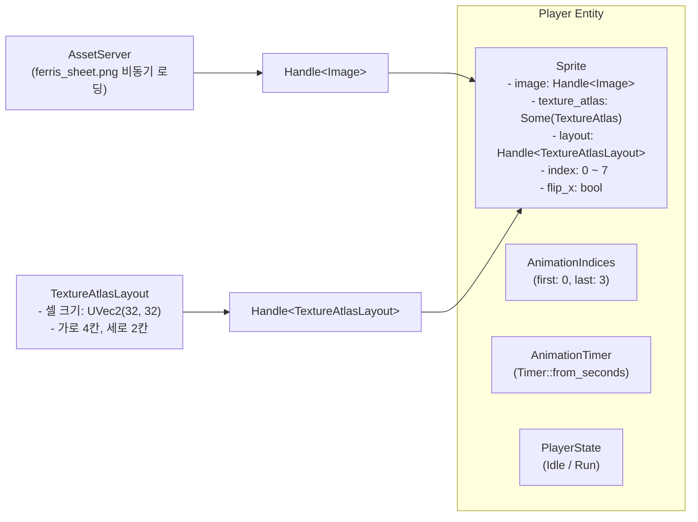

# 02. 2D 스프라이트 시트 & 프레임 애니메이션 🏃🎨

> **"수백 장의 낱개 이미지 파일 대신 단 하나의 스프라이트 시트(Sprite Sheet)로 드로우 콜(Draw Call)을 묶고,  
> Bevy의 `TextureAtlasLayout`과 타이머 컴포넌트로 살아 숨 쉬는 60fps 픽셀 애니메이션을 만듭니다."**

---

## 1. 스프라이트 시트(Sprite Sheet)와 GPU 최적화 원리

2D 게임에서 캐릭터가 걷고, 뛰고, 공격하는 동작은 여러 장의 정지 이미지(프레임)를 빠른 속도로 연속 재생(플립북 원리)하여 표현합니다.

### 낱개 이미지 로딩의 치명적 문제점
만약 캐릭터의 프레임마다 별도의 PNG 파일(`walk_01.png`, `walk_02.png`, `walk_03.png`...)을 사용한다면:
1. **GPU 텍스처 바인딩 오버헤드**: 매 프레임마다 그래픽 카드 메모리에 바인딩된 텍스처를 교체해야 하므로 CPU-GPU 간 통신 병목이 발생합니다.
2. **드로우 콜(Draw Call) 폭증**: 화면에 등장하는 몬스터 100마리가 각자 다른 낱개 텍스처를 쓰면 드로우 콜이 수백 번 발생하여 프레임 레이트가 급락합니다.

### 💡 텍스처 아틀라스(Texture Atlas)의 해법
하나의 커다란 텍스처 이미지에 캐릭터의 모든 애니메이션 프레임을 바둑판(Grid) 형태로 모아둔 것을 **스프라이트 시트(Sprite Sheet)** 또는 **텍스처 아틀라스**라고 부릅니다.

```
+-----------+-----------+-----------+-----------+
| Frame 0   | Frame 1   | Frame 2   | Frame 3   |  <- Idle (대기: 인덱스 0~3)
+-----------+-----------+-----------+-----------+
| Frame 4   | Frame 5   | Frame 6   | Frame 7   |  <- Run  (달리기: 인덱스 4~7)
+-----------+-----------+-----------+-----------+
```

* **배칭(Batching) 최적화**: GPU는 텍스처를 **단 1번만 VRAM에 로드**하고, 렌더링 시에는 UV 좌표(텍스처 내 영역)만 잘라서 그리므로 단 1회의 드로우 콜로 수백 개의 스프라이트를 일괄 렌더링할 수 있습니다!

---

## 2. Bevy의 텍스처 아틀라스 아키텍처

Bevy는 스프라이트 시트를 매우 우아하게 처리할 수 있도록 `TextureAtlasLayout`과 `Sprite` 컴포넌트의 결합 구조를 제공합니다.



---

## 3. 프레임 전환과 시간(Delta Time)의 독립성

애니메이션 속도를 하드웨어 성능(모니터 주사율 60Hz, 144Hz, 240Hz)에 의존하지 않고 항상 일관되게 유지하려면 **델타 타임(`time.delta()`)** 기반 타이머를 사용해야 합니다.

```rust
#[derive(Component, Deref, DerefMut)]
pub struct AnimationTimer(pub Timer);

// 시스템 내부에서 타이머 갱신
pub fn animate_sprite_system(
    time: Res<Time>,
    mut query: Query<(&AnimationIndices, &mut AnimationTimer, &mut Sprite)>,
) {
    for (indices, mut timer, mut sprite) in query.iter_mut() {
        // 프레임 경과 시간 누적
        timer.tick(time.delta());

        if timer.just_finished() {
            if let Some(ref mut atlas) = sprite.texture_atlas {
                // 다음 프레임으로 인덱스 이동 (범위 순환)
                atlas.index = if atlas.index >= indices.last {
                    indices.first
                } else {
                    atlas.index + 1
                };
            }
        }
    }
}
```

---

## 4. 상태 기반 애니메이션 전환 (Idle $\leftrightarrow$ Run)

플레이어가 키보드를 누르고 있을 때는 **달리기(Run)** 애니메이션(인덱스 4~7)을, 손을 뗐을 때는 **대기(Idle)** 애니메이션(인덱스 0~3)을 부드럽게 전환합니다.

```rust
#[derive(Component, Debug, Clone, Copy, PartialEq, Eq, Default)]
pub enum PlayerState {
    #[default]
    Idle,
    Run,
}

#[derive(Component, Debug, Clone, Copy)]
pub struct AnimationIndices {
    pub first: usize,
    pub last: usize,
}
```

* **좌우 반전 (`flip_x`)**:
  왼쪽으로 이동할 때 별도의 왼쪽 스프라이트 시트를 만들 필요 없이, `sprite.flip_x = true` 한 줄로 GPU가 수평 반전 렌더링을 즉시 수행합니다!

---

## 5. 요약: Phase 2에서 습득하는 핵심 기술

1. **`TextureAtlasLayout::from_grid()`**: 그리드 기반 스프라이트 시트 분할 및 핸들 등록
2. **`Sprite` 구조체의 `texture_atlas`**: `index` 조작을 통한 애니메이션 재생
3. **`TimerMode::Repeating`**: 프레임 레이트에 독립적인 주기적 타이머 틱
4. **상태 기반 인덱스 스위칭**: 정지 $\leftrightarrow$ 이동 시의 애니메이션 프레임 범위 및 재생 주기 동적 제어
5. **`flip_x` 수평 반전**: 단일 스프라이트 에셋으로 좌우 방향성 완벽 지원

