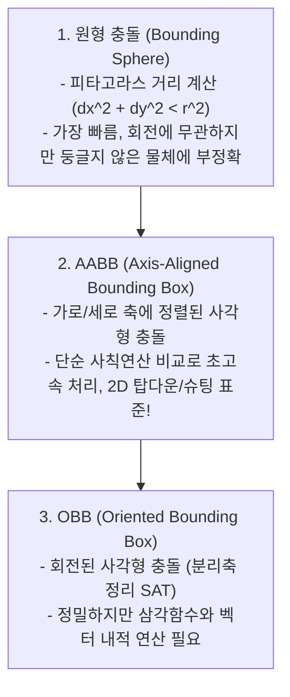
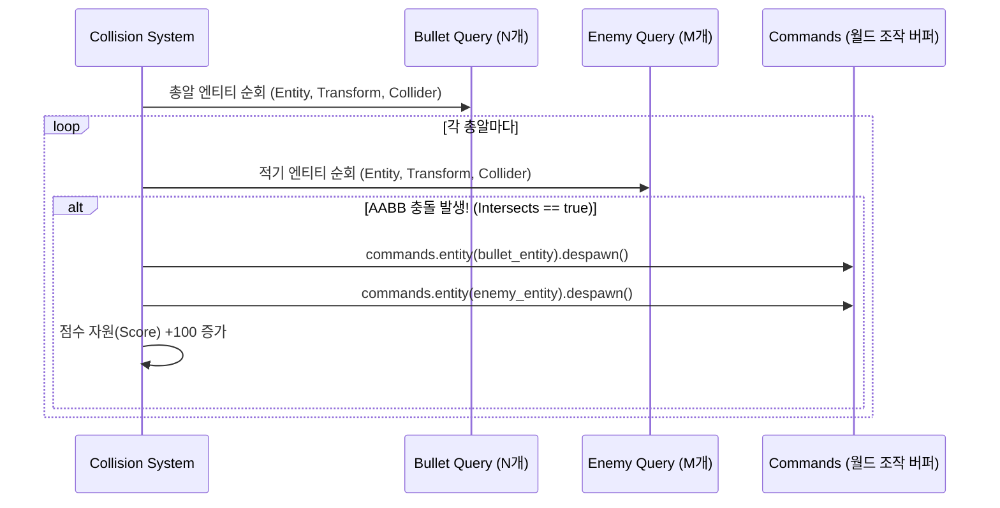

# 03. 탄막 슈팅 & AABB 충돌 감지 물리 💥🛸

> **"매 프레임 수십 개의 총알과 적기가 쏟아지는 아케이드 게임에서  
> 어떻게 안전하고 초고속으로 충돌을 판정하고 엔티티의 생명주기를 관리하는가?"**

---

## 1. 2D 충돌 감지의 기본 패러다임

게임 엔진에서 두 물체가 부딪혔는지를 계산하는 충돌 감지(Collision Detection) 알고리즘은 정밀도와 연산 비용에 따라 크게 3단계로 나뉩니다:



### 💡 2D 슈팅 게임의 표준: AABB (축 정렬 바운딩 박스)
AABB는 물체가 회전하지 않고 X, Y 축에 평행한 직사각형 형태를 유지한다고 가정합니다.  
두 사각형 $A$와 $B$가 겹쳤는지(Overlap) 여부는 **단 2개의 부등식 비교**만으로 판정됩니다:

$$\left| A_{\text{center.x}} - B_{\text{center.x}} \right| < \left( A_{\text{half\_width}} + B_{\text{half\_width}} \right)$$

$$\left| A_{\text{center.y}} - B_{\text{center.y}} \right| < \left( A_{\text{half\_height}} + B_{\text{half\_height}} \right)$$

* **연산 복잡도**: 곱셈이나 나눗셈 없이 단순 뺄셈과 절대값 비교 2번으로 끝나므로, 60fps/144fps 환경에서 수천 쌍의 충돌을 CPU 캐시 수준에서 즉각 처리할 수 있습니다!

---

## 2. AABB 충돌체 컴포넌트 설계

Bevy에서는 충돌 크기 데이터를 담는 순수 컴포넌트 `Collider2d`를 정의하여 엔티티에 부착합니다:

```rust
#[derive(Component, Debug, Clone, Copy)]
pub struct Collider2d {
    pub size: Vec2,
}

impl Collider2d {
    pub fn new(width: f32, height: f32) -> Self {
        Self { size: Vec2::new(width, height) }
    }

    /// 두 Transform 좌표와 크기를 기반으로 AABB 충돌 여부 판정
    pub fn intersects(&self, pos_a: Vec2, other: &Collider2d, pos_b: Vec2) -> bool {
        let half_a = self.size * 0.5;
        let half_b = other.size * 0.5;

        (pos_a.x - pos_b.x).abs() < (half_a.x + half_b.x)
            && (pos_a.y - pos_b.y).abs() < (half_a.y + half_b.y)
    }
}
```

---

## 3. Bevy ECS에서의 N:M 다대다 충돌 검사 패턴

화면에 총알 $N$개와 적기 $M$마리가 존재할 때, Bevy의 Query를 사용하여 충돌을 판정하는 핵심 패턴은 다음과 같습니다:



### ⚠️ 엔티티 중복 소멸 방지 (`HashSet<Entity>`)
한 프레임에서 거대한 적기에 2개의 총알이 동시에 맞거나, 이미 제거된 엔티티에 접근하면 패닉이 발생할 수 있습니다.  
따라서 충돌 시스템에서는 `despawned_entities: HashSet<Entity>` 집합을 두어 **이미 소멸된 엔티티를 안전하게 스킵**하는 것이 베스트 프랙티스입니다.

---

## 4. 엔티티 생명주기와 화면 밖 자동 소멸 (Despawn)

총알이나 몬스터가 화면 밖으로 벗어났는데도 계속 살아있다면, 메모리 누수(Memory Leak)가 발생하여 게임이 서서히 느려집니다.

```rust
pub fn despawn_offscreen_system(
    mut commands: Commands,
    query: Query<(Entity, &Transform), Or<(With<LaserBullet>, With<Enemy>)>>,
) {
    for (entity, transform) in query.iter() {
        // 화면 위/아래 경계(-320 ~ +320)를 벗어나면 즉각 소멸
        if transform.translation.y > 330.0 || transform.translation.y < -330.0 {
            commands.entity(entity).despawn();
        }
    }
}
```

---

## 5. 글로벌 게임 자원(Resource)과 점수 시스템

엔티티에 귀속되지 않는 전역 상태(점수, 처치 수, 플레이어 목숨)는 `Resource`로 정의합니다.

```rust
#[derive(Resource, Debug, Default)]
pub struct ScoreState {
    pub current_score: u32,
    pub enemies_destroyed: u32,
    pub player_lives: u32,
}
```

- 시스템에서 읽기만 할 때: `score: Res<ScoreState>`
- 시스템에서 값을 갱신할 때: `mut score: ResMut<ScoreState>`
- Bevy의 정적 스케줄러는 `Res`와 `ResMut`의 빌림 규칙(Borrow checker)을 분석하여 충돌이 없는 시스템들을 여러 CPU 코어에서 병렬로 안전하게 동시 실행합니다!

