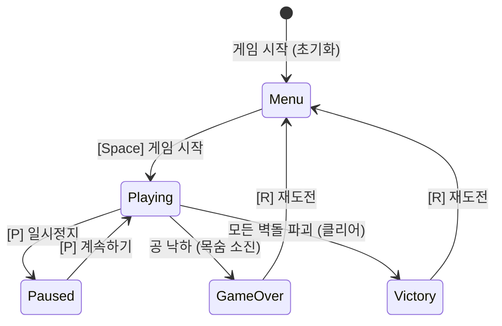
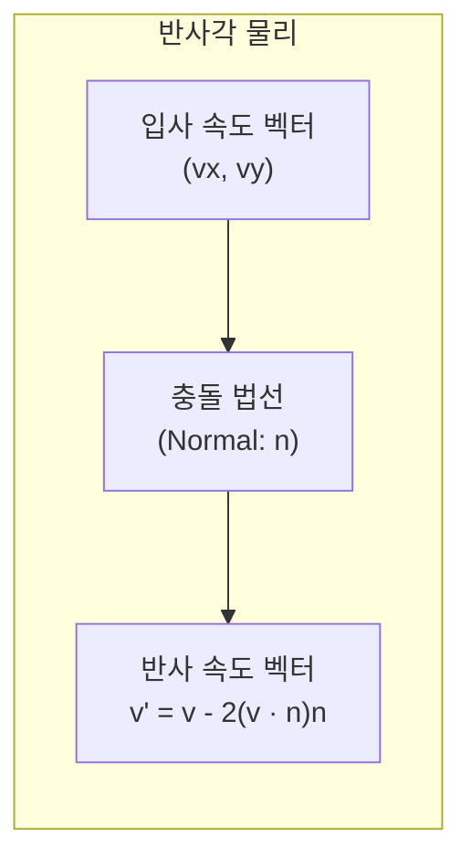

# 04. 게임 라이프사이클(States), BGM & UI HUD 🎵🧱

> **"메뉴 화면에서 공이 굴러다니거나, 일시정지(Pause) 중에 게임 오버가 되면 안 됩니다.  
> Bevy의 `States` 상태 머신과 이벤트 기반 사운드로 완벽한 게임 라이프사이클을 구축합니다."**

---

## 1. 게임 상태 머신(States)의 필요성

모든 상용 게임은 단순한 반복 루프가 아니라 엄격한 **상태 머신(Finite State Machine)**에 따라 동작합니다:



### 상태 분리가 없을 때 발생하는 버그들:
1. 타이틀 메뉴 화면인데 배경에서 공이 벽돌을 깨뜨려 점수가 오르는 버그
2. 게임을 일시정지(Pause)했는데 적 몬스터가 플레이어를 공격하는 버그
3. 게임 오버 화면 뒤에서 키보드 입력이 계속 먹히는 버그

---

## 2. Bevy의 상태 머신 프리미티브

Bevy는 Rust의 강력한 타입 시스템을 활용하여 상태를 열거형(Enum)으로 선언하고, 시스템의 실행 조건을 한 줄로 제어합니다:

### 1) 상태 정의
```rust
#[derive(States, Debug, Clone, Copy, Eq, PartialEq, Hash, Default)]
pub enum AppState {
    #[default]
    Menu,
    Playing,
    Paused,
    GameOver,
    Victory,
}
```

### 2) 시스템 스케줄링 프리미티브
Bevy는 상태 변경 시점에 실행되는 3가지 특수 스케줄과 조건부 실행 메서드를 제공합니다:

| 스케줄 / 조건 | 동작 시점 | 사용 예시 |
| :--- | :--- | :--- |
| `OnEnter(State)` | 해당 상태로 **진입하는 순간** 1회 실행 | 메뉴 UI 생성, 스테이지 벽돌 배치 |
| `OnExit(State)` | 해당 상태를 **빠져나가는 순간** 1회 실행 | 메뉴 UI 제거, 잔여 엔티티 정리 |
| `run_if(in_state(State))` | 해당 상태가 **유지되는 동안** 매 프레임 실행 | 공 물리 이동, 패들 조작, 충돌 감지 |

```rust
app.init_state::<AppState>()
    // Menu 상태 진입 시 UI 생성, 탈출 시 UI 정리
    .add_systems(OnEnter(AppState::Menu), setup_menu_ui)
    .add_systems(OnExit(AppState::Menu), cleanup_menu_ui)
    // Playing 상태일 때만 물리 연산 실행
    .add_systems(
        Update,
        (paddle_movement, ball_movement, collision_system)
            .run_if(in_state(AppState::Playing)),
    );
```

### 3) 상태 전이 (`NextState<T>`)
시스템 내부에서 상태를 바꾸고 싶을 때는 `ResMut<NextState<AppState>>`를 주입받아 `.set()`을 호출합니다:

```rust
pub fn pause_input_system(
    keyboard: Res<ButtonInput<KeyCode>>,
    state: Res<State<AppState>>,
    mut next_state: ResMut<NextState<AppState>>,
) {
    if keyboard.just_pressed(KeyCode::KeyP) {
        match state.get() {
            AppState::Playing => next_state.set(AppState::Paused),
            AppState::Paused => next_state.set(AppState::Playing),
            _ => {}
        }
    }
}
```

---

## 3. 2D 탄성 충돌과 반사각 물리

벽돌깨기 게임의 재미는 공이 벽이나 패들의 어디에 부딪히느냐에 따라 정밀하게 튕겨 나가는 **탄성 충돌(Elastic Collision)**에 있습니다.



### 1) 수직/수평 벽 충돌
- 좌우 벽 충돌: $v_x = -v_x$
- 천장 벽돌 충돌: $v_y = -v_y$

### 2) 패들 가변 반사각 (스킬샷)
공이 패들의 정중앙에 맞으면 수직으로 튕기지만, 패들의 모서리에 맞을수록 더 예리한 각도로 튕겨야 조작의 재미가 극대화됩니다:

$$\text{offset} = \frac{\text{ball.x} - \text{paddle.x}}{\text{paddle.half\_width}} \quad (-1.0 \le \text{offset} \le 1.0)$$

$$v_x = \text{speed} \times \text{offset} \times 0.85$$

$$v_y = \sqrt{\text{speed}^2 - v_x^2}$$

---

## 4. Bevy 오디오 시스템 (`bevy_audio`)

사운드는 타격감의 50% 이상을 차지합니다. Bevy는 `AudioPlayer` 컴포넌트나 일회성 사운드 발사를 지원합니다:

```rust
// 벽돌 파괴 시 효과음 스폰
commands.spawn((
    AudioPlayer::new(asset_server.load("audio/break.wav")),
    PlaybackSettings::DESPAWN, // 재생 완료 후 엔티티 자동 소멸
));
```

---

## 5. 요약: Phase 4에서 완성하는 아키텍처

1. **`States` 상태 격리**: 메뉴, 플레이, 일시정지, 게임오버, 클리어의 깔끔한 생명주기 관리
2. **`OnEnter` / `OnExit` 엔티티 청소**: 화면 전환 시 불필요한 UI나 벽돌을 자동으로 스폰/데스폰
3. **탄성 반사각 물리**: 패들 타격 위치에 따른 다이내믹한 궤적 굴절
4. **절차적 8-bit 오디오**: 패들 튕김, 벽돌 파괴, 게임 오버 레트로 SFX 탑재

