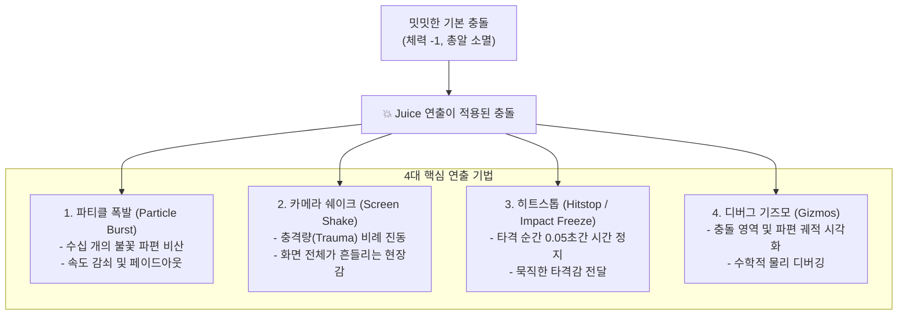
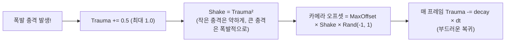

# 05. 파티클 폭발 이펙트 & 카메라 쉐이크 (Juice & Polish) ✨💥

> **"똑같은 충돌이라도 '화면이 흔들리고, 파티클이 터지며, 순간적으로 0.05초 멈추는 연출(Juice)'이 들어가면  
> 단순한 프로토타입이 손맛 넘치는 상용 명작 게임으로 변합니다."**

---

## 1. 게임의 손맛: 주스(Juice & Game Feel)란?

게임 개발 업계에서 **"Juice"**란 게임의 핵심 메커닉(이동, 사격, 충돌)에 **시각적·청각적 피드백을 풍성하게 덧입혀 플레이어의 감각을 자극하는 연출 기법**을 의미합니다.



---

## 2. 2D 파티클 시스템(Particle System)의 생명주기

파티클은 개별적으로는 매우 가볍지만, 수백 개가 모여 폭발, 연기, 스파크를 만듭니다. Bevy ECS에서는 순수 컴포넌트 조합으로 구현합니다:

```rust
#[derive(Component)]
pub struct Particle {
    pub lifetime: Timer,      // 생존 수명 (예: 0.4초)
    pub drag: f32,            // 공기 저항 감쇠율 (예: 0.92)
    pub initial_size: Vec2,   // 초기 크기
}
```

### 파티클 물리 갱신 공식 (매 프레임)
1. **위치 이동**: $P_{t} = P_{t-1} + V_{t} \times \Delta t$
2. **속도 감쇠(Drag)**: $V_{t} = V_{t-1} \times \text{drag}^{\Delta t \times 60}$
3. **크기 축소 및 투명도 페이드**:
   $$\text{progress} = \frac{\text{timer.elapsed\_secs()}}{\text{timer.duration().as\_secs\_f32()}}$$
   $$\alpha = 1.0 - \text{progress}, \quad \text{scale} = 1.0 - (\text{progress} \times 0.6)$$
4. **수명 만료 시**: `if timer.finished() { commands.entity(e).despawn(); }`

---

## 3. 카메라 쉐이크(Camera Shake)와 트라우마(Trauma) 모델

카메라를 단순히 무작위로 흔들면 화면이 어지럽고 부자연스럽습니다. 현대 게임 개발에서는 **트라우마(Trauma) 비선형 감쇠 모델**을 사용합니다:



```rust
#[derive(Resource, Default)]
pub struct CameraShake {
    pub trauma: f32, // 0.0 ~ 1.0
}

impl CameraShake {
    pub fn add_trauma(&mut self, amount: f32) {
        self.trauma = (self.trauma + amount).clamp(0.0, 1.0);
    }
}

pub fn camera_shake_system(
    time: Res<Time>,
    mut shake: ResMut<CameraShake>,
    mut camera_query: Query<&mut Transform, With<Camera2d>>,
) {
    if shake.trauma > 0.0 {
        let mut transform = camera_query.single_mut();
        let shake_power = shake.trauma * shake.trauma; // 2차 곡선

        let mut rng = rand::thread_rng();
        let offset_x = (rng.gen::<f32>() * 2.0 - 1.0) * 16.0 * shake_power;
        let offset_y = (rng.gen::<f32>() * 2.0 - 1.0) * 16.0 * shake_power;

        transform.translation.x = offset_x;
        transform.translation.y = offset_y;

        // 초당 1.4의 속도로 감쇠
        shake.trauma = (shake.trauma - 1.4 * time.delta_secs()).max(0.0);
    }
}
```

---

## 4. 히트스톱(Hitstop / Impact Freeze)

격투 게임(스트리트 파이터, 철권)이나 액션 게임(할로우 나이트, 데드 셀)에서 칼로 적을 벨 때 화면이 순간적으로 **0.05초(3프레임) 정도 딱 멈추는 연출**을 보셨을 것입니다.  
이 '시간 정지' 연출이 바로 타격감의 핵심 비밀입니다!

```rust
#[derive(Resource, Default)]
pub struct HitstopTimer(pub Option<Timer>);

// 강력한 폭발 명중 시 0.06초 히트스톱 예약
hitstop.0 = Some(Timer::from_seconds(0.06, TimerMode::Once));
```

---

## 5. Bevy Gizmos 디버그 렌더링

물리 엔진이나 복잡한 충돌체를 다룰 때, 수학적 충돌 박스와 파티클 궤적을 육안으로 확인하면 버그를 즉각 잡아낼 수 있습니다:

```rust
pub fn debug_gizmos_system(
    mut gizmos: Gizmos,
    query: Query<(&Transform, &Collider2d)>,
) {
    for (transform, col) in query.iter() {
        // 충돌체 외곽선을 밝은 녹색 와이어프레임 박스로 렌더링
        gizmos.rect_2d(
            transform.translation.truncate(),
            col.size,
            Color::srgb(0.2, 1.0, 0.4),
        );
    }
}
```

