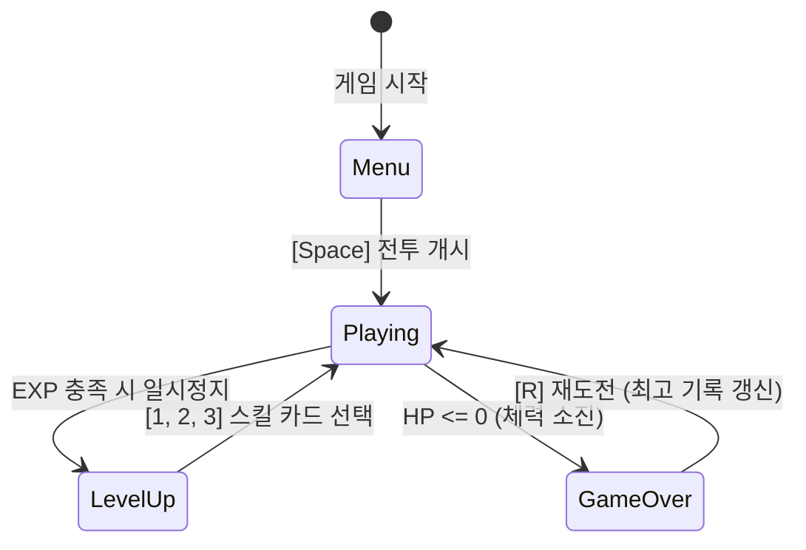

# Phase 6: 2D 서바이벌 아레나 종합 실전 (Vampire Survivors 류)

> **"수백 마리의 적이 화면을 뒤덮고, 무기는 자동으로 발사되며, 보석을 자석처럼 끌어당겨 레벨업한다!"**  
> 이번 Phase 6은 지난 1~5단계에서 연마한 **ECS 아키텍처, 스프라이트 애니메이션, AABB 물리 충돌, 상태 머신(States), 사운드, 그리고 게임 주스(파티클 & 쉐이크)**를 한곳에 집대성하는 최종 프로젝트입니다.

---

## 1. 서바이벌 아레나(Vampire Survivors 류) 핵심 아키텍처

서바이벌 아레나 장르는 단순한 조작(이동 전용)과 대규모 군집 적 처리, 자동 발사 무기, 그리고 성장의 쾌감을 주는 레벨업 루프가 결합된 구조입니다.



---

## 2. 플레이어 추적 벡터 스티어링(Steering) AI

화면에 등장하는 수많은 몬스터는 매 프레임 플레이어의 중심 위치 $\mathbf{p}_{\text{player}}$를 향해 방향 벡터를 계산하고 전진합니다.

$$\mathbf{v} = \text{normalize}(\mathbf{p}_{\text{player}} - \mathbf{p}_{\text{enemy}}) \times \text{speed}$$

```rust
pub fn enemy_ai_system(
    time: Res<Time>,
    player_query: Query<&Transform, With<Player>>,
    mut enemy_query: Query<(&mut Transform, &Enemy), Without<Player>>,
) {
    let Ok(player_tf) = player_query.get_single() else { return; };
    let player_pos = player_tf.translation.truncate();

    for (mut enemy_tf, enemy) in enemy_query.iter_mut() {
        let enemy_pos = enemy_tf.translation.truncate();
        let to_player = player_pos - enemy_pos;
        
        if to_player.length_squared() > 1.0 {
            let dir = to_player.normalize();
            enemy_tf.translation.x += dir.x * enemy.speed * time.delta_secs();
            enemy_tf.translation.y += dir.y * enemy.speed * time.delta_secs();
        }
    }
}
```

---

## 3. 자동 무기 시스템 2종 구현

플레이어가 이동에만 집중할 수 있도록 무기는 자동으로 동작합니다.

### A. 공전 궤도 마법 칼날 (Orbiting Blade)
플레이어 주위를 삼각함수($\cos \theta, \sin \theta$)로 일정 반지름 $R$을 그리며 회전합니다.

$$x = x_{\text{player}} + R \cdot \cos(\theta), \quad y = y_{\text{player}} + R \cdot \sin(\theta)$$

```rust
pub fn orbit_blade_system(
    time: Res<Time>,
    player_query: Query<&Transform, With<Player>>,
    mut blade_query: Query<(&mut Transform, &mut OrbitBlade), Without<Player>>,
) {
    let Ok(player_tf) = player_query.get_single() else { return; };
    let center = player_tf.translation.truncate();

    for (mut tf, mut blade) in blade_query.iter_mut() {
        blade.angle += blade.angular_speed * time.delta_secs();
        tf.translation.x = center.x + blade.radius * blade.angle.cos();
        tf.translation.y = center.y + blade.radius * blade.angle.sin();
    }
}
```

### B. 최단 거리 적 자동 유도 화살 (Homing Arrow)
발사 쿨다운 타이머가 차면 화면 내의 모든 `Enemy` 중 플레이어와 거리가 가장 가까운 적을 쿼리하여 유도탄을 발사합니다.

```rust
let nearest_enemy = enemy_query
    .iter()
    .min_by(|(_, tf_a), (_, tf_b)| {
        let dist_a = tf_a.translation.distance_squared(player_pos.extend(0.0));
        let dist_b = tf_b.translation.distance_squared(player_pos.extend(0.0));
        dist_a.partial_cmp(&dist_b).unwrap_or(std::cmp::Ordering::Equal)
    });
```

---

## 4. 마그넷 흡수 경험치 보석 (EXP Gem Attraction)

적이 쓰러지면 보석(`ExpGem`)을 드랍합니다. 플레이어가 일정 거리(마그넷 반경 $R_{\text{magnet}}$) 이내로 접근하면, 보석이 플레이어를 향해 가속하며 날아와 흡수됩니다.

```rust
let dist_sq = gem_pos.distance_squared(player_pos);
if dist_sq < player_stats.magnet_radius.powi(2) {
    // 플레이어를 향해 지수 가속
    let dir = (player_pos - gem_pos).normalize();
    gem_vel.0 += dir * 1200.0 * time.delta_secs();
}
```

---

## 5. 레벨업 & 3지선다 스킬 카드 UI

경험치가 $100\%$에 도달하면 `NextState::Pending(AppState::LevelUp)`으로 전이되어 시뮬레이션 시스템이 즉시 정지합니다.  
화면에 3장의 무작위 업그레이드 카드가 표시되며, 게이머가 `[1]`, `[2]`, `[3]` 키를 눌러 스킬을 선택하면 즉시 강화가 반영되고 `AppState::Playing`으로 복귀합니다.

| 선택지 | 효과 |
| :--- | :--- |
| **1. 궤도 칼날 추가** | 플레이어 주변을 도는 마법 칼날 $+1$개 추가 및 회전 속도 $+20\%$ |
| **2. 유도 화살 쿨다운 감소** | 번개 유도 화살 발사 주기 $30\%$ 단축 |
| **3. 긴급 체력 회복** | 체력 즉시 $+35$ 회복 및 최대 체력 $+20$ |
| **4. 마그넷 반경 증폭** | 보석 흡수 자석 반경 $+50\text{px}$ 확장 |
| **5. 이동 속도 증가** | 플레이어 이동 속도 $+15\%$ 증가 |

---

## 6. 최고 기록 로컬 영구 저장 (`serde_json`)

게임이 종료되면 생존 시간(초)과 처치 수를 파일 시스템(`assets/save/high_score.json`)에 영구 저장합니다.

```rust
#[derive(Serialize, Deserialize, Default, Clone)]
pub struct GameRecord {
    pub best_survival_time_sec: f32,
    pub max_kills: u32,
}
```

---

## 7. 단계별 완성 목표

- [ ] 2D 아레나 맵 경계선 및 플레이어(페리스) 부드러운 이동
- [ ] 적 몬스터 지속적 스폰 및 플레이어 방향 스티어링 AI
- [ ] 회전 궤도 칼날 및 자동 유도 화살 무기 구현
- [ ] 경험치 보석 드랍 & 마그넷 인력 흡수 시스템
- [ ] 게임 상태 머신(`Menu` $\leftrightarrow$ `Playing` $\leftrightarrow$ `LevelUp` $\leftrightarrow$ `GameOver`)
- [ ] 3지선다 레벨업 카드 UI 및 즉시 능력치 반영
- [ ] 파티클 버스트, 트라우마 카메라 쉐이크, 8-bit 사운드 효과
- [ ] 로컬 기록 영구 저장 및 100% 통과 단위 테스트

