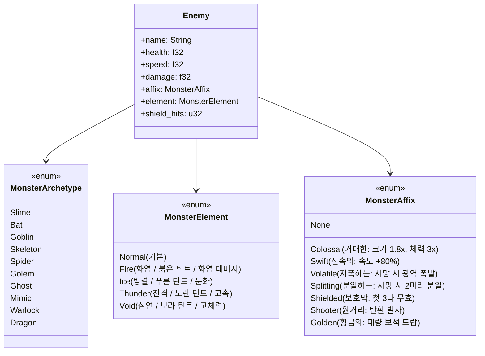

# Phase 7: 고도화 상업 인디 게임 아키텍처 (Ferris Survivors Ultimate) 🦀⚔️

> **"100종의 개성 넘치는 몬스터 군집, 대시 회피와 무적 프레임, 머리 위에 솟구치는 플로팅 데미지 텍스트, 그리고 90초 타이탄 보스전!"**  
> 본 가이드는 단순한 프로토타입을 넘어 스팀(Steam) 출시 수준의 **상업용 인디 서바이벌 액션 게임의 핵심 기술 아키텍처**를 다룹니다.

---

## 1. 100종 몬스터 도감(Codex) 및 절차적 접두사(Affix) 엔진

100개의 이미지를 개별적으로 로딩하는 대신, 《디아블로》 및 《뱀파이어 서바이벌》처럼 **10대 기본 종족 실루엣 $\times$ 5대 원소 속성 $\times$ 8대 특수 접두사(Affix)**를 조합하여 **수백 가지의 완전히 차별화된 몬스터**를 절차적으로 생성합니다.



---

## 2. 플레이어 대시(Dash) 및 무적 프레임(i-Frame)

플레이어가 위험한 군집을 뚫고 탈출할 수 있도록 **순간 가속 및 무적 판정**을 구현합니다.

```rust
// 대시 컴포넌트
#[derive(Component)]
pub struct DashState {
    pub is_dashing: bool,
    pub dash_timer: Timer,       // 0.18초 지속
    pub cooldown_timer: Timer,   // 1.8초 쿨다운
    pub direction: Vec2,
}
```

- 대시 중에는 `player.invulnerable = true`가 적용되어 적과의 AABB 충돌 시 피해를 입지 않습니다.
- 대시가 진행되는 동안 0.05초 간격으로 플레이어 위치에 **반투명 잔상 스프라이트(Ghost Trail)**를 스폰하여 화려한 연출을 선사합니다.

---

## 3. 플로팅 데미지 텍스트 (Floating Combat Text - FCT)

타격감의 핵심은 **내가 가한 피해량이 화면에 실시간으로 숫자로 튀어오르는 것**입니다.

- 적이 피격될 때마다 피격 좌표에 `DamageNumber` 엔티티 스폰
- 위쪽으로 포물선 이동($v_y > 0$, 중력 감속)
- 잔여 수명 비율($1.0 - \text{fraction}$)에 따라 알파 페이드아웃 후 자동 소멸
- 일반 공격은 노란색 폰트, 치명타(CRIT!)는 붉은색 대형 폰트로 렌더링

---

## 4. 4종 무기 아스널 & 지면 지속 장판 (Ground AOE)

1. **공전 궤도 칼날 (Orbit Blade)**: 플레이어 주변을 회전하며 근접 적을 지속 분쇄
2. **유도 번개 화살 (Homing Arrow)**: 가장 가까운 적을 조준하여 자동 저격
3. **성수 불꽃 장판 (Holy Water Pool)**:
   - 3초마다 적 군집 한가운데 성수 병을 투척
   - 지면에 4초간 화염 장판 형성, 장판 위에 서 있는 모든 적에게 초당 지속 틱 데미지
4. **관통 회전 도끼 (Parabolic Axe)**:
   - 위로 솟구친 후 중력에 의해 화면 아래로 회전 낙하하며 경로상의 모든 적 관통

---

## 5. 90초 타이탄 보스전 & 방사형 탄막 (Bullet Hell)

생존 시간 90초 도달 시 일반 스폰이 일시 둔화되고 **에픽 보스 '메모리 리크 타이탄'**이 강림합니다.

- **사이렌 경보**: 화면 붉은 플래시 점멸 및 `boss_spawn.wav` 재생
- **상단 대형 보스 체력바 UI**: 보스 실시간 남은 체력 표시
- **8방향 방사형 탄막 패턴**:
  - 보스가 4.5초마다 중심에서 $45^\circ$ 간격으로 8발의 흑마법 쇼크웨이브 탄환 발사
  - 플레이어는 탄환을 피하며 보스를 공략해야 함

---

## 6. 인게임 몬스터 도감 (Monster Bestiary)

게이머가 처치한 모든 변종 몬스터의 기록을 집계하여, 게임 오버 시 혹은 도감 화면에서 **"발견한 몬스터 종류 / 100종"** 통계를 확인하고 로컬 JSON 파일에 영구 저장합니다.

