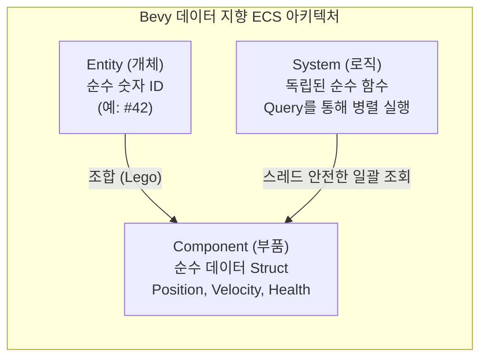
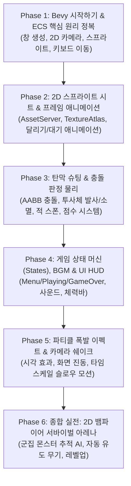

# 🎮 Rust 차세대 게임 엔진: Bevy 마스터 로드맵 (ECS & 2D 인터랙티브 게임 개발) 🚀

> **"객체지향(OOP)의 복잡한 상속 트리를 버리고,  
> 순수 데이터와 멀티코어 병렬 처리의 극치인 ECS(Entity-Component-System)로 게임을 만듭니다."**

---

## 1. 커리큘럼 비전 & 왜 Bevy인가?

게임 개발은 수천 개의 객체(몬스터, 총알, 파티클, 타일)가 매 프레임(60fps/120fps)마다 충돌하고 상호작용하는 **가장 극한의 성능과 데이터 동기화가 요구되는 소프트웨어 분야**입니다.

기존 C++이나 C#(Unity)에서는 클래스 상속(`GameObject -> Character -> Monster`)을 사용했지만, 이는 다음과 같은 치명적인 한계에 부딪혔습니다:
1. **깊은 상속의 저주**: 비행 몬스터, 헤엄치는 몬스터, 말하는 몬스터 등 요구사항이 바뀔 때마다 클래스 계층이 파괴됨 (다중 상속의 다이아몬드 문제)
2. **CPU 캐시 미스(Cache Miss)**: 객체들이 힙 메모리 여기저기 흩어져 있어 CPU가 데이터를 읽는 속도가 급격히 저하됨
3. **스레드 경합(Race Condition)**: 수천 개의 객체를 멀티스레드로 돌리려면 Mutex 락 획득 경쟁으로 프레임 드랍 발생

### 💡 Bevy의 해법: 데이터 지향 ECS (Entity Component System)
Rust의 대표 차세대 게임 엔진인 **Bevy**는 이를 완벽히 해결합니다:



- **Entity (엔티티)**: 아무 데이터도 없는 **단순한 식별자 숫자 ID** (예: `Entity(42)`).
- **Component (컴포넌트)**: 로직이 전혀 없는 **순수한 데이터 구조체** (예: `struct Position(Vec2);`, `struct Velocity(Vec2);`).
- **System (시스템)**: 데이터를 조작하는 **독립된 순수 함수**. Bevy의 스케줄러가 시스템 간의 데이터 충돌을 정적 분석하여 **아무런 수동 락(Lock) 없이 모든 CPU 코어에서 병렬(Multi-threaded)로 동시 실행**합니다!

---

## 2. 6단계(Phase 1 ~ Phase 6) 실습 로드맵



---

### [Phase 1] Bevy 시작하기 & ECS 핵심 원리 정복 (Hello Bevy) 🚀 (✅ 완료 - 2026-11-06)
- 📄 **이론 가이드**: `01_bevy_and_ecs_philosophy.md`
- 📦 **실습 프로젝트**: `projects/game/game-01-bevy-basics`
- **주요 학습 내용**:
  - [x] `App::new()`와 `DefaultPlugins` 엔진 코어 초기화
  - [x] 2D 카메라 스폰(`Camera2d`) 및 윈도우 창 해상도/제목 설정
  - [x] ECS 3대 요소: Entity 스폰, Component 부착, System 작성
  - [x] `Commands`: 안전한 월드 조작(스폰/제거) 커맨드 버퍼
  - [x] `Query<&mut Transform, With<Player>>`: 컴포넌트 조건 검색 및 위치 갱신
  - [x] 키보드 입력(`ButtonInput<KeyCode>`): 상하좌우 부드러운 플레이어 이동 시스템
  - [x] 경계 제한(Boundary Clamping) 및 틸트(회전) 애니메이션
  - [x] HUD 실시간 진단 텍스트 및 헤드리스(Headless) 단위 테스트 100% 통과

### [Phase 2] 2D 스프라이트 시트 & 프레임 애니메이션 🏃 (✅ 완료 - 2026-11-06)
- 📄 **이론 가이드**: `02_2d_rendering_and_assets.md`
- 📦 **실습 프로젝트**: `projects/game/game-02-sprite-animation`
- **주요 학습 내용**:
  - [x] `AssetServer`: 이미지 텍스처 및 스프라이트 시트 비동기 로딩
  - [x] `TextureAtlasLayout`: 격자형 스프라이트 시트 분할 및 인덱스 관리 (32x32, 4x2 그리드)
  - [x] `ImagePlugin::default_nearest()`: 선명한 레트로 픽셀 아트 렌더링 필터링
  - [x] 타이머 컴포넌트(`AnimationTimer`): 델타 타임(`Time::delta()`) 기반 프레임 전환
  - [x] 상태별 애니메이션(대기 Idle $\leftrightarrow$ 달리기 Run) 전환 시스템
  - [x] 이동 방향에 따른 스프라이트 좌우 반전(`Sprite::flip_x`)
  - [x] 실시간 HUD 텍스트 및 헤드리스(Headless) 단위 테스트 100% 통과

### [Phase 3] 탄막 슈팅 & AABB 충돌 감지 물리 💥
- 📄 **이론 가이드**: `03_physics_and_collision.md`
- 📦 **실습 프로젝트**: `projects/game/game-03-space-shooter`
- **주요 학습 내용**:
  - 우주선 플레이어 & 스페이스 배경 구성
  - 스페이스바 입력 시 레이저 총알(Bullet) 발사 및 화면 밖 자동 소멸(Despawn)
  - 주기적인 외계 적기(Enemy) 스폰 타이머 시스템 및 난수(`rand`) 위치 분배
  - 2D AABB(축 정렬 바운딩 박스) 충돌 판정 알고리즘 직접 구현
  - 총알과 적기 충돌 시 폭발 제거 및 글로벌 점수 자원(`Resource<Score>`) 누적

### [Phase 4] 게임 라이프사이클(States), BGM & UI HUD 🎵
- 📄 **이론 가이드**: `04_states_sound_and_ui.md`
- 📦 **실습 프로젝트**: `projects/game/game-04-breakout-game` (벽돌깨기 게임)
- **주요 학습 내용**:
  - 게임 상태 열거형(`States`): `Menu` $\rightarrow$ `Playing` $\rightarrow$ `Paused` $\rightarrow$ `GameOver`
  - `OnEnter`, `OnExit`, `run_if(in_state(...))`를 통한 모듈별 시스템 생명주기 격리
  - 벽돌 충돌 반사각 물리 및 공-패들 상호작용
  - Bevy Audio: 배경음악(BGM) 루프 재생 및 튕김/파괴 사운드 이펙트(SFX)
  - Bevy UI 노드 트리: 실시간 점수 텍스트, 남은 목숨 하트 아이콘, 게임오버 재시작 화면

### [Phase 5] 파티클 폭발 이펙트 & 카메라 쉐이크 (Juice & Polish) ✨
- 📄 **이론 가이드**: `05_game_juice_and_effects.md`
- 📦 **실습 프로젝트**: `projects/game/game-05-particle-effects`
- **주요 학습 내용**:
  - 게임의 손맛(Juice)을 결정짓는 연출 테크닉
  - 수백 개의 잔상 파티클(Particle) 생성, 속도 감쇠, 투명도 페이드아웃, 수명 타이머
  - 충돌 및 폭발 시 화면이 흔들리는 카메라 쉐이크(Camera Shake) 노이즈 시스템
  - 강한 타격 시 순간적으로 게임이 0.05초 멈추는 히트스톱(Hitstop) & 슬로우 모션
  - `Gizmos`: 디버그용 충돌 박스 및 이동 궤적 실시간 시각화

### [Phase 6] 종합 실전: 2D 서바이벌 아레나 (Vampire Survivor 류) ⚔️
- 📄 **이론 가이드**: `06_full_survival_game.md`
- 📦 **실습 프로젝트**: `projects/game/game-06-survival-arena`
- **주요 학습 내용**:
  - 수백 마리의 언데드 몬스터가 플레이어를 추적하는 벡터 스티어링(Steering) AI
  - 플레이어 주변을 회전하는 마법 칼날 & 가장 가까운 적을 조준하는 자동 유도 화살
  - 경험치 보석(Gem) 드랍, 마그넷 흡수, 레벨업 시스템
  - 레벨업 시 게임 일시정지 및 3지선다 스킬 카드 선택 UI
  - 생존 시간 타이머, 처치 수 집계 및 로컬 최고 기록(JSON) 영구 저장

---

## 3. 디렉토리 구조

```
rust-sandbox/
├── docs/
│   ├── backend/             # 📂 완성된 백엔드 마스터 가이드 (Phase 1 ~ 6)
│   ├── frontend/            # 📂 완성된 프론트엔드 마스터 가이드 (Phase 1 ~ 6)
│   ├── desktop/             # 📂 완성된 데스크톱 GUI 마스터 가이드 (Phase 1 ~ 6)
│   └── game/                # 📂 [NEW] Bevy 게임 엔진 마스터 가이드
│       ├── game_learning_plan.md
│       ├── 01_bevy_and_ecs_philosophy.md
│       ├── 02_2d_rendering_and_assets.md
│       ├── 03_physics_and_collision.md
│       ├── 04_states_sound_and_ui.md
│       ├── 05_game_juice_and_effects.md
│       └── 06_full_survival_game.md
└── projects/
    ├── backend/             # 📂 5대 백엔드 프로젝트
    ├── frontend/            # 📂 6대 프론트엔드 Wasm 프로젝트
    ├── desktop/             # 📂 6대 데스크톱 GUI 프로젝트
    └── game/                # 📂 [NEW] Bevy 게임 실습 프로젝트 모음
        ├── game-01-bevy-basics/       # ✅ Phase 1 완료 (ECS 2D 기초, 이동, HUD, 테스트)
        ├── game-02-sprite-animation/  # ✅ Phase 2 완료 (스프라이트 시트, 아틀라스, 프레임 애니메이션)
        ├── game-03-space-shooter/     # 🚀 Phase 3 예정
        ├── game-04-breakout-game/     # 🚀 Phase 4 예정
        ├── game-05-particle-effects/  # 🚀 Phase 5 예정
        └── game-06-survival-arena/    # 🚀 Phase 6 예정
```

