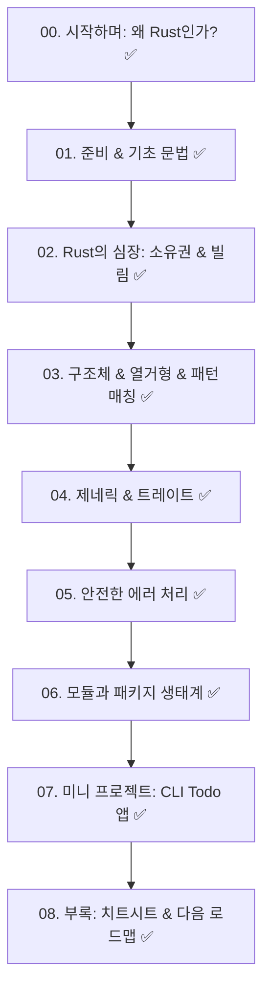

# 🦀 Rust 입문 E-Book 제작 작업계획서 (완료)

> **"두려움 없는 프로그래밍(Fearless Concurrency)의 세계로!"**  
> 본 계획서는 Rust를 처음 접하시는 분이 개념을 쉽고 재미있게 이해하고, 직접 실습하며 성장할 수 있도록 돕는 E-Book 제작 프로젝트 계획서입니다. 모든 챕터의 작성이 성공적으로 완료되었습니다!

---

## 1. 프로젝트 개요

| 항목 | 내용 |
| :--- | :--- |
| **도서명** | **러스트(Rust) 완벽 입문 가이드: 페리스와 함께 떠나는 안전하고 빠른 프로그래밍 여행** |
| **대상 독자** | 프로그래밍 기초 지식이 있으나 Rust는 처음인 개발자 및 학습자 |
| **집필 방향** | • 딱딱한 이론 대신 일상적인 비유와 쉬운 언어로 설명 • 핵심 개념(소유권, 빌림, 라이프타임 등)의 직관적 시각화 및 예시 • 복사해서 바로 실행해볼 수 있는 풍부한 예제 코드 및 실습 프로젝트 포함 |
| **저장 위치** | `c:\workdir\space-cap\rust-sandbox\docs` |
| **형식** | Markdown (mdBook 규격과 호환되는 챕터별 분권 및 종합본) |
| **진행 현황** | **전체 챕터 집필 완료 (100%)** 🎉 |

---

## 2. E-Book 목차 및 산출물 파일 현황

### 산출물 파일 목록

| 파일명 | 챕터명 | 상태 |
| :--- | :--- | :--- |
| [SUMMARY.md](SUMMARY.md) | 전체 목차 및 링크 네비게이션 | ✅ 완료 |
| [00_intro.md](00_intro.md) | 00장. 시작하며: 왜 Rust인가? | ✅ 완료 |
| [01_setup_and_first_step.md](01_setup_and_first_step.md) | 01장. 개발 환경 설정과 첫 발걸음 | ✅ 완료 |
| [02_basic_syntax.md](02_basic_syntax.md) | 02장. 기본 문법: 변수, 타입, 제어 흐름 | ✅ 완료 |
| [03_ownership_and_borrow.md](03_ownership_and_borrow.md) | 03장. Rust의 심장: 소유권과 빌림 | ✅ 완료 |
| [04_struct_and_enum.md](04_struct_and_enum.md) | 04장. 데이터 묶기와 패턴 매칭: 구조체와 열거형 | ✅ 완료 |
| [05_generics_and_traits.md](05_generics_and_traits.md) | 05장. 제네릭, 트레이트, 그리고 라이프타임 맛보기 | ✅ 완료 |
| [06_error_handling.md](06_error_handling.md) | 06장. 에러 처리와 안전한 코딩 | ✅ 완료 |
| [07_modules_and_crates.md](07_modules_and_crates.md) | 07장. 모듈과 패키지 생태계 | ✅ 완료 |
| [08_mini_project.md](08_mini_project.md) | 08장. 실전 미니 프로젝트: 나만의 CLI Todo 매니저 | ✅ 완료 |
| [09_appendix_cheatsheet.md](09_appendix_cheatsheet.md) | 09장. 부록: Rust 치트시트 & 추천 로드맵 | ✅ 완료 |

---

## 3. 진행 단계 완료 보고

1. **[1단계] 작업계획서 검토 및 확정** ✅
2. **[2단계] 기초 편 집필 (00장 ~ 03장)** ✅
   - 환경 설정, 기본 문법, Rust의 핵심인 소유권/빌림/슬라이스 완성
3. **[3단계] 응용 및 핵심 문법 편 집필 (04장 ~ 07장)** ✅
   - 구조체, `Option<T>`, 패턴매칭, 트레이트, 에러 처리(`?`), 모듈 시스템 완성
4. **[4단계] 실전 프로젝트 및 부록 편 집필 (08장 ~ 09장)** ✅
   - 실제로 빌드 및 동작 가능한 CLI Todo 앱 전체 소스 및 실행 시나리오 수록
   - 자주 쓰는 Cargo 명령어 및 컴파일 에러 Top 5 해결법 치트시트 완성
