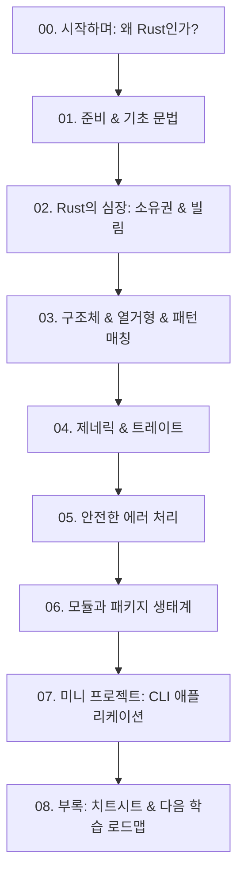

# 🦀 Rust 입문 E-Book 제작 작업계획서

> **"두려움 없는 프로그래밍(Fearless Concurrency)의 세계로!"**  
> 본 계획서는 Rust를 처음 접하시는 분이 개념을 쉽고 재미있게 이해하고, 직접 실습하며 성장할 수 있도록 돕는 E-Book 제작 프로젝트 계획서입니다.

---

## 1. 프로젝트 개요

| 항목 | 내용 |
| :--- | :--- |
| **도서명(가제)** | **러스트(Rust) 완벽 입문 가이드: 페리스와 함께 떠나는 안전하고 빠른 프로그래밍 여행** |
| **대상 독자** | 프로그래밍 기초 지식이 있으나 Rust는 처음인 개발자 및 학습자 |
| **집필 방향** | • 딱딱한 이론 대신 일상적인 비유와 쉬운 언어로 설명<br>• 핵심 개념(소유권, 빌림, 라이프타임 등)의 직관적 시각화 및 예시<br>• 복사해서 바로 실행해볼 수 있는 풍부한 예제 코드 및 실습 프로젝트 포함 |
| **저장 위치** | `c:\workdir\space-cap\rust-sandbox\docs` |
| **형식** | Markdown (mdBook 규격과 호환되는 챕터별 분권 및 종합본) |

---

## 2. E-Book 목차 및 챕터 구성안



### 상세 커리큘럼

- **00장. 시작하며: 왜 Rust인가?**
  - C/C++의 성능과 Python의 메모리 안전성을 동시에? Rust의 탄생 배경
  - Rust의 마스코트 페리스(Ferris)와의 인사 🦀
  - 이 책을 200% 활용하는 학습 팁

- **01장. 개발 환경 설정과 첫 발걸음**
  - `rustup`과 `cargo` 설치 및 환경 세팅 (VS Code 권장 확장)
  - `Hello, World!` 프로젝트 생성과 구조 분석
  - `cargo new`, `cargo run`, `cargo check`, `cargo build` 명령어 완전 정복

- **02장. 기본 문법: 변수, 데이터 타입, 흐름 제어**
  - 기본적으로 불변(Immutable)인 이유와 `mut` 키워드
  - 스칼라 타입(정수, 부동소수점, 불리언, 문자)과 복합 타입(튜플, 배열)
  - 함수, 주석, 표현식(Expression) vs 구문(Statement)
  - 조건문(`if`), 반복문(`loop`, `while`, `for`)

- **03장. Rust의 심장: 소유권(Ownership)과 빌림(Borrowing)** *(가장 중요한 핵심 파트!)*
  - 가비지 컬렉터 없이 메모리를 어떻게 관리할까? (스택 vs 힙)
  - 소유권의 3대 원칙
  - 이동(Move)과 복사(Copy)
  - 참조(Reference)와 빌림(Borrowing) 규칙 (불변 참조 vs 가변 참조)
  - 슬라이스(Slice) 타입

- **04장. 데이터 묶기와 패턴 매칭: 구조체와 열거형**
  - 구조체(Struct) 정의와 인스턴스 생성, 메서드(`impl`)
  - 열거형(Enum)의 마법: 값과 타입을 함께 담기
  - Rust에 `null`이 없는 이유: `Option<T>`
  - 강력한 제어 흐름 도구: `match`와 `if let`

- **05장. 제네릭, 트레이트, 그리고 라이프타임 맛보기**
  - 제네릭(Generics): 중복 없는 유연한 코드 만들기
  - 트레이트(Trait): 자바의 인터페이스와의 비교, 공통 동작 정의
  - 트레이트 바운드와 파생(`#[derive(...)]`)
  - 라이프타임(Lifetime) 기초 개념 쉽게 이해하기

- **06장. 에러 처리와 안전한 코딩**
  - 회복 불가능한 에러: `panic!`
  - 회복 가능한 에러: `Result<T, E>`
  - 에러 전파의 마법 열쇠: `?` 연산자

- **07장. 코드 조직화와 패키지 생태계**
  - 패키지, 크레이트, 모듈 시스템 (`mod`, `use`, `pub`)
  - `crates.io`에서 외부 라이브러리 가져와 사용하기

- **08장. 실전 미니 프로젝트: 나만의 CLI Todo 매니저**
  - 요구사항 정의: 터미널에서 할 일 추가, 목록 조회, 완료 처리
  - 입출력(`std::io`), 파일 저장(JSON 파일 활용)
  - 직접 빌드하고 실행해보기!

- **09장. 부록: Rust 치트시트 & 추천 로드맵**
  - 자주 쓰는 Cargo 명령어 요약
  - 초보자가 가장 자주 겪는 컴파일 에러 Top 5와 해결법
  - 앞으로 더 공부해볼 만한 분야 (동시성 프로그래밍, 비동기 `tokio`, 웹어셈블리 `Wasm`)

---

## 3. 문서 및 산출물 파일 구조

`c:\workdir\space-cap\rust-sandbox\docs` 폴더 내에 아래와 같이 구성할 예정입니다.

```
docs/
├── rust_ebook_plan.md        # 작업계획서 (본 문서)
├── SUMMARY.md                # 전체 목차 및 링크 네비게이션
├── 00_intro.md               # 00장. 시작하며: 왜 Rust인가?
├── 01_setup_and_first_step.md# 01장. 개발 환경 설정과 첫 발걸음
├── 02_basic_syntax.md        # 02장. 기본 문법
├── 03_ownership_and_borrow.md# 03장. 소유권과 빌림
├── 04_struct_and_enum.md     # 04장. 구조체와 열거형
├── 05_generics_and_traits.md # 05장. 제네릭과 트레이트
├── 06_error_handling.md      # 06장. 에러 처리
├── 07_modules_and_crates.md  # 07장. 모듈과 크레이트
├── 08_mini_project.md        # 08장. 미니 프로젝트 (CLI Todo)
└── 09_appendix_cheatsheet.md # 09장. 부록 및 치트시트
```

---

## 4. 단계별 진행 절차

1. **[1단계] 작업계획서 검토 및 확정 (현재 단계)**
   - 제안된 커리큘럼 및 목차 구성에 대한 사용자 피드백 반영
   - 특별히 더 집중해서 다루고 싶은 주제(예: 웹 백엔드, 웹어셈블리, 시스템 프로그래밍 등)가 있는지 확인
2. **[2단계] 기초 편 집필 (00장 ~ 03장)**
   - 환경 설정부터 Rust의 가장 핵심인 소유권/빌림 개념까지 쉽고 명쾌한 비유와 코드로 작성
3. **[3단계] 응용 및 핵심 문법 편 집필 (04장 ~ 07장)**
   - 구조체, 패턴매칭, 에러 처리, 모듈화 기법 작성
4. **[4단계] 실전 프로젝트 및 부록 편 집필 (08장 ~ 09장, 종합본 정리)**
   - 직접 따라 해볼 수 있는 CLI 프로그램 실습 코드 작성
   - 전체 문서 링크 검증 및 치트시트 완성

---

## 5. 확인 및 피드백 요청사항

- 목차 구성이 마음에 드시는지요?
- 혹시 커리큘럼에 추가하거나 먼저 집중적으로 다루고 싶은 내용이 있으신가요? (예: 특정 라이브러리, 웹 개발, 임베디드 등)
- 확인 후 계획대로 집필을 시작해도 좋을지 말씀해 주시면 즉시 본문 작성을 진행하겠습니다!

