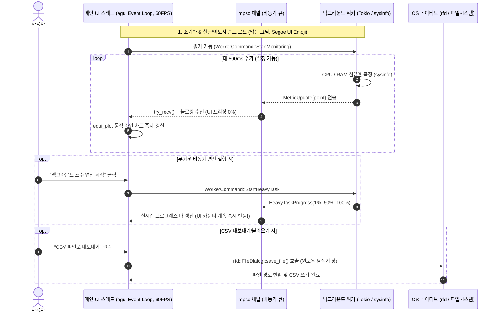

# desktop-02-egui-dashboard 📊⚡

> **Rust 데스크톱 실시간 시스템 모니터링 대시보드 & 비동기 워커 연동 실습**  
> `eframe 0.31` (egui)과 `Tokio` 비동기 런타임을 결합하여, **"메인 UI 스레드를 단 1밀리초도 멈추지 않는 논블로킹(Non-blocking) 아키텍처"**를 완성하고 `egui_plot`을 활용한 실시간 동적 차트 및 `rfd` 네이티브 파일 다이얼로그 기반의 CSV 데이터 입출력을 실습합니다.

---

## 🌟 핵심 학습 개념 & 아키텍처



---

## 📋 3대 메인 탭 화면 구성

### 1. 📈 실시간 모니터링 차트 (`DashboardTab::LiveChart`)
- **실시간 통계 카드**: 현재 CPU 사용률(%), RAM 사용량(MB) 및 점유율(%), 수집된 샘플 개수 실시간 표시
- **수집 제어부**: 수집 일시 정지/재개 토글, 수집 주기 슬라이더 (100ms ~ 2000ms), 차트 기록 초기화
- **동적 라인 플롯 (`egui_plot::Plot`)**:
  - 오렌지 라인: CPU 점유율 (%)
  - 에메랄드 라인: RAM 점유율 (%)
  - 범례(Legend), 자동 Y축 스케일링(0~100%), 부드러운 스트리밍 그래프

### 2. ⚡ 비동기 연산 워커 & UI 무중단 체험 (`DashboardTab::HeavyWorker`)
- **UI 프리징 방지 원리 검증**:
  - 버튼 이벤트 안에서 무거운 연산을 직접 돌리면 Windows가 즉시 "응답 없음"을 띄우는 문제를 설명
  - 1만 ~ 50만 개의 소수 판별 연산을 백그라운드 워커 스레드로 격리하여 실행
  - 연산 중 실시간 진행률(Progress Bar, 0~100%) 및 소요 시간 보고
- **즉각 반응성 검증 카운터**:
  - 백그라운드에서 CPU가 100% 풀로드를 겪고 있는 도중에도, 사용자가 카운터 버튼(`+1`, `-1`)을 누르면 **단 1ms의 딜레이도 없이 60FPS로 즉시 반응**하는 즉시 모드 GUI의 진가를 체험

### 3. 💾 데이터 관리 & CSV 입출력 (`DashboardTab::DataManager`)
- **OS 네이티브 파일 다이얼로그 (`rfd` 크레이트)**:
  - 윈도우 탐색기 스타일의 표준 파일 저장(`save_file`) 및 열기(`pick_file`) 창 호출
  - 시계열 메트릭 데이터를 CSV 파일로 내보내거나, 기존 CSV를 불러와 대시보드에 복원
- **실시간 데이터 그리드 (`egui::ScrollArea` + `egui::Grid`)**:
  - 인덱스, 타임스탬프, CPU(%), 사용 RAM(MB), 전체 RAM(MB), RAM(%) 표 렌더링

---

## 🛠️ 실행 및 테스트 방법

### 1. 네이티브 윈도우 창 실행
```powershell
cargo run --manifest-path projects/desktop/desktop-02-egui-dashboard/Cargo.toml
```
실행 즉시 1020x720 해상도의 GPU 하드웨어 가속 실시간 모니터링 대시보드가 뜹니다.

### 2. 단위 테스트 자동 검증
```powershell
cargo test --manifest-path projects/desktop/desktop-02-egui-dashboard/Cargo.toml
```
총 7개 단위 테스트를 자동 통과합니다:
1. `test_metric_point_creation`: 메트릭 데이터 포인트 생성 및 0~100% 클램핑
2. `test_metric_history_ring_buffer`: 고정 용량 링 버퍼 FIFO 만료 및 인덱스 정합성
3. `test_metric_statistics`: CPU 및 메모리 평균/최대값 통계 계산
4. `test_csv_serialization_and_deserialization`: CSV 내보내기 및 복원 역직렬화 정합성
5. `test_worker_channel_messages`: UI $\leftrightarrow$ 백그라운드 워커 채널 프로토콜 검증
6. `test_dashboard_tabs_metadata`: 탭 메타데이터 및 타이틀 완전성
7. `test_font_setup_and_korean_rendering`: 한글(맑은 고딕) 및 유니코드 이모지 레이아웃 검증

---

## 💡 성능 지표 (vs Electron)

| 항목 | Electron (웹 기반 데스크톱) | 본 Rust egui 대시보드 |
| :--- | :--- | :--- |
| **메모리 사용량 (RAM)** | 약 250MB ~ 400MB | **약 25MB ~ 35MB** (1/10 수준) |
| **바이너리 빌드 크기** | 약 80MB ~ 150MB | **약 15MB 내외** |
| **UI 렌더링 엔진** | Chromium DOM + Node.js IPC | **순수 GPU 가속 (DirectX/OpenGL)** |
| **실시간 차트 지연** | 수십 ms (가비지 컬렉션 스터터링) | **0에 가까운 레이턴시 (무가비지 컬렉션)** |

