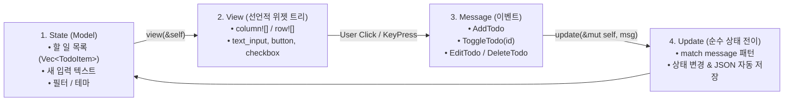

# desktop-03-iced-todo 🌲📋

> **Rust 순수 보유 모드(Retained Mode) GUI & Elm 아키텍처 실습 프로젝트**  
> 웹 기술(HTML/CSS) 없이 오직 **100% 순수 Rust 타입 안정성과 GPU 직접 렌더링**만으로 구축하는 모던 데스크톱 Todo & 작업 관리 애플리케이션입니다.

---

## 🌟 핵심 학습 개념: Elm 아키텍처 (The Elm Architecture)

`Iced`는 함수형 프론트엔드 언어인 Elm의 아키텍처를 Rust로 충실히 구현한 보유 모드(Retained Mode) 프레임워크입니다:



### 왜 Elm 아키텍처인가요?
1. **단방향 데이터 흐름 (Unidirectional Data Flow)**:
   - UI 이벤트가 발생하면 오직 `Message` enum으로 변환되어 `update(&mut self, message)` 단 한 곳으로만 전달됩니다.
   - 복잡한 콜백 지옥(Callback Hell)이나 부모-자식 간 상태 꼬임 버그가 원천적으로 불가능합니다.
2. **선언적 뷰 (Declarative View)**:
   - 개발자는 `view(&self)` 안에서 현재 상태를 읽어 화면에 표시될 위젯 트리(`column![]`, `row![]`, `container()`, `button()`)를 기술하기만 하면 됩니다.
   - `Iced` 런타임이 이전 프레임과 비교하여 필요한 그래픽 노드만 선별적으로 GPU에 렌더링합니다.

---

## 🆚 egui(즉시 모드) vs Iced(보유 모드) 비교

| 비교 항목 | egui (Phase 1, 2) | Iced (Phase 3) |
| :--- | :--- | :--- |
| **렌더링 패러다임** | **즉시 모드 (Immediate Mode)** | **보유 모드 (Retained Mode)** |
| **멘탈 모델** | 매 프레임 UI 함수를 실행하며 그 자리에서 버튼 클릭 체크 | 상태(Model) $\rightarrow$ 위젯 트리(View) $\rightarrow$ 메시지(Update) 단방향 루프 |
| **주요 사용처** | 게임 에디터, 실시간 디버거, 데이터 시각화 도구 | 생산성 도구, 비즈니스 앱, 디자인 완성도 높은 데스크톱 앱 |
| **배치 방식** | 절차적 레이아웃 (`ui.horizontal`, `ui.vertical`) | 선언적 매크로 (`column![]`, `row![]`, Flexbox 스타일) |
| **상태 관리** | 변수 직접 바인딩 (`&mut self.value`) | `Message` 패턴 매칭을 통한 상태 전이 집중화 |

---

## 📋 주요 기능

1. **할 일 관리 & 인라인 수정**:
   - 새 할 일 입력 후 `Enter` 또는 `➕ 추가` 버튼 클릭으로 등록
   - 체크박스 클릭 시 완료 상태 토글 (완료 항목 취소선 표시)
   - 연필 아이콘(`✏️`) 클릭 시 인라인 텍스트 필드로 전환되어 그 자리에서 즉시 수정 후 저장
   - 휴지통 아이콘(`🗑️`)으로 개별 삭제
2. **진행 상태별 탭 필터링**:
   - `📋 전체` / `⏳ 진행 중` / `✅ 완료` 필터 탭 제공 (선택된 탭 하이라이트 스타일 적용)
   - 완료 항목이 존재할 경우 `🗑️ 완료 항목 정리` 원클릭 일괄 정리 버튼 활성화
3. **로컬 파일시스템(JSON) 영구 저장소**:
   - 변경 사항 발생 시 `todos.json`에 자동으로 직렬화 저장
   - 앱 재실행 시 기존 작업 내역 자동 복원
4. **한글 폰트(맑은 고딕) 지원**:
   - Windows DirectWrite / fontdb 시스템 폰트를 통해 한글이 선명하게 출력되도록 `default_font` 설정

---

## 🛠️ 실행 및 테스트 방법

### 1. 네이티브 윈도우 창 실행
```powershell
cargo run --manifest-path projects/desktop/desktop-03-iced-todo/Cargo.toml
```
실행 즉시 760x700 크기의 네이티브 GPU 가속 윈도우 창이 뜹니다.

### 2. 단위 테스트 자동 검증
```powershell
cargo test --manifest-path projects/desktop/desktop-03-iced-todo/Cargo.toml
```
총 7개 단위 테스트를 자동 통과합니다:
1. `test_todo_item_creation`: 생성 기본값 및 시간 포맷팅
2. `test_filter_matching`: All, Active, Completed 필터링 규칙
3. `test_elm_update_add_todo`: 메시지 기반 추가 및 공백 입력 방어
4. `test_elm_update_toggle_todo`: 체크박스 토글 상태 전이
5. `test_elm_update_inline_editing`: 인라인 수정 모드 진입/변경/저장/취소 사이클
6. `test_elm_update_delete_and_clear_completed`: 단일 삭제 및 일괄 정리
7. `test_storage_json_roundtrip`: JSON 파일 저장 및 역직렬화 복원 일치성

