# desktop-04-tauri-basics ⚡

> **Tauri 2.0 상용 표준 하이브리드 데스크톱 아키텍처 실습 프로젝트**  
> 고성능 Rust 백엔드 Core와 모던 웹 프론트엔드(HTML5/CSS3/Vanilla JS)를 결합한 무프레임 데스크톱 애플리케이션입니다.

---

## 1. 프로젝트 개요

Tauri 2.0은 기존 Electron의 고질적인 단점(Chromium 통째 번들링으로 인한 거대한 용량 및 수백 MB의 RAM 점유율)을 완벽하게 극복한 차세대 데스크톱 프레임워크입니다:
- **OS 내장 웹뷰 활용**: Windows의 Microsoft Edge WebView2를 활용하여 앱 바이너리 크기를 수 MB 수준으로 경량화
- **초고속 직렬화 IPC**: `#[tauri::command]` 매크로와 자바스크립트 `invoke()`를 통한 비동기 RPC 통신
- **스레드 안전 인메모리 상태 관리**: `tauri::State`와 Rust `Mutex`를 통한 안전한 전역 데이터 공유
- **실시간 비동기 이벤트 스트림**: Rust Tokio 백그라운드 태스크에서 웹뷰로 1초 주기 실시간 데이터(`sys-pulse`) 브로드캐스팅
- **커스텀 무프레임 윈도우**: `data-tauri-drag-region`을 통한 마우스 드래그 창 이동 및 커스텀 창 조작(최소화, 최대화, 닫기)

---

## 2. 아키텍처 다이어그램

```mermaid
flowchart TD
    subgraph Frontend["프론트엔드 UI 계층 (ui/)"]
        HTML["index.html (구조)"]
        CSS["style.css (글래스모피즘 모던 다크 UI)"]
        JS["app.js (Tauri 2 글로벌 API 연동)"]
        JS -->|"invoke('greet', { name })"| Commands
        JS -->|"invoke('add_item', { item })"| StateLock
        JS -->|"invoke('calculate_hash')"| NativeCrypto
        JS -->|"listen('sys-pulse')"| EventStream
    end

    subgraph IPCBridge["초고속 직렬화 IPC 브리지 (JSON-RPC)"]
        Commands["#[tauri::command] RPC 핸들러"]
        EventStream["tauri::Emitter (이벤트 방송 채널)"]
    end

    subgraph Backend["Rust 백엔드 코어 계층 (src/)"]
        Core["Tauri 2.0 Runtime Core"]
        StateLock["tauri::State<AppState><br/>Mutex&lt;Vec&lt;String&gt;&gt;"]
        NativeCrypto["sha2 Crate (SHA-256 고속 암호화)"]
        SysInfo["sysinfo Crate (OS 하드웨어 감지)"]
        TokioTask["Tokio Background Task (1초 주기 메트릭 수집)"]
        
        Tao["Tao (Win32 창 제어/이벤트 루프)"]
        Wry["Wry (Edge Chromium WebView2 제어)"]

        Core --> Tao & Wry
        TokioTask -->|"app_handle.emit('sys-pulse')"| EventStream
    end
```



---

## 3. 디렉토리 구조

```
desktop-04-tauri-basics/
├── Cargo.toml                 # Tauri 2.0, sysinfo, sha2, tokio 의존성 설정
├── build.rs                   # tauri_build::build() 자동 빌드 스크립트
├── tauri.conf.json            # Tauri 2.0 공식 스키마 설정 (창 크기, 무프레임, 권한)
├── capabilities/              # Tauri 2.0 Capabilities 보안 정책
│   └── default.json           # default window 보안 권한 명세
├── icons/                     # Windows 리소스 아이콘 (.ico, .png)
│   ├── icon.ico
│   ├── 32x32.png
│   ├── 128x128.png
│   └── icon.png
├── ui/                        # 모던 웹 프론트엔드 자산
│   ├── index.html             # 커스텀 타이틀바 및 4대 쇼케이스 탭 레이아웃
│   ├── style.css              # 글래스모피즘 다크 테마 반응형 CSS
│   └── app.js                 # IPC 호출, 상태 렌더링, 이벤트 리스너 제어
└── src/                       # Rust 백엔드 소스코드
    ├── lib.rs                 # 모듈 export 및 공개 인터페이스
    ├── models.rs              # SystemInfoDto, HashResponse, MetricPulse DTO
    ├── state.rs               # AppState (인메모리 Mutex 스레드 안전 상태)
    ├── commands.rs            # #[tauri::command] 10개 핵심 RPC 함수
    └── main.rs                # 앱 진입점, 백그라운드 이벤트 스트리머 및 단위 테스트 7종
```

---

## 4. 4대 인터랙티브 쇼케이스 탭 구성

1. **⚡ IPC Commands & State (양방향 RPC & 상태 관리)**:
   - `greet`: 이름 입력 시 Rust 백엔드로부터 타입 안전한 인사말 응답 수신 및 호출 지연시간(ms) 측정
   - `AppState`: Rust `Mutex`로 관리되는 인메모리 항목 목록의 실시간 추가·삭제·초기화
   - `calculate_hash`: SHA-256 암호화 해시 연산을 Rust 네이티브 코어로 수 마이크로초($\mu\text{s}$) 만에 수행
2. **🖥️ 하드웨어 모니터 (Native Hardware & OS)**:
   - `sysinfo` 크레이트로 운영체제 이름, 커널 버전, CPU 아키텍처, 논리 코어 수, 메모리 점유율, 가동 시간(Uptime) 실시간 조회
3. **📡 실시간 이벤트 스트림 (Live Event Pulse)**:
   - Rust 백그라운드 태스크가 1초마다 브로드캐스팅하는 `sys-pulse` 이벤트를 `listen()`으로 수신
   - 실시간 CPU/메모리 게이지 및 최근 15개 펄스 타임스탬프 로그 출력
4. **📖 Tauri 2.0 아키텍처 학습 (Architecture & Security Guide)**:
   - Tauri 2.0 vs Electron 메모리/용량/보안 상세 비교표
   - `Tao` + `Wry` + `Tauri Core` 3대 하부 구조 및 Capabilities 보안 모델 분석

---

## 5. 빌드 및 실행 방법

### 1) 실행 환경 준비 (Windows GNU 툴체인)
```powershell
# 터미널 PATH 새로고침
$env:PATH = "H:\lee\rust-sandbox\target\debug;" + [Environment]::GetEnvironmentVariable("Path", "User") + ";" + [Environment]::GetEnvironmentVariable("Path", "Machine")
```

### 2) 단위 테스트 실행 (7개 테스트 통과)
```powershell
cd H:\lee\rust-sandbox\projects\desktop\desktop-04-tauri-basics
cargo test
```

### 3) 애플리케이션 실행
```powershell
cargo run
```
> 노드(Node.js) 번들러나 웹팩/Vite 서버 구동 없이, 순수 `cargo run` 명령어 하나만으로 즉시 Edge WebView2 기반 네이티브 창이 실행됩니다.

