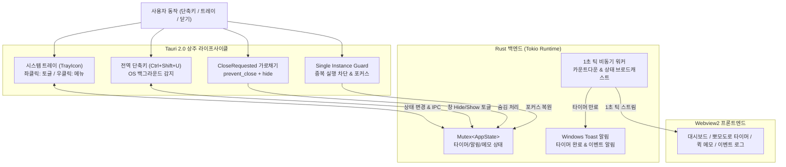

# Desktop 05: Tauri 2.0 시스템 트레이 & 백그라운드 상주 유틸리티 📌

> **Tauri 2.0 기반 상용급 백그라운드 상주(Resident) 데스크톱 유틸리티**  
> 시스템 트레이(Tray Icon), 창 닫기 방지(`prevent_close`), 전역 단축키(`Ctrl+Shift+U`), Windows 네이티브 토스트 알림, 중복 실행 방지(Single Instance)의 5대 필수 메커니즘을 완성합니다.

---

## 1. 프로젝트 개요

일반적인 데스크톱 앱과 달리 메신저(Slack, Discord), 클립보드 관리자, 시스템 모니터링 도구 등은 **사용자가 창을 닫아도 백그라운드에 계속 살아있으며 단축키나 트레이로 즉시 재호출**되어야 합니다.

본 프로젝트는 Tauri 2.0의 공식 플러그인 생태계와 윈도우 라이프사이클 이벤트를 결합하여 완벽한 백그라운드 상주 도구를 구현합니다:



---

## 2. 5대 핵심 상주 메커니즘

| 메커니즘 | 구현 기술 | 주요 역할 및 실무 패턴 |
| :--- | :--- | :--- |
| **1. 시스템 트레이** | `tauri::tray::TrayIconBuilder` | 윈도우 작업표시줄 우측 트레이 아이콘 등록 및 컨텍스트 메뉴(토글, 알림, 타이머, 완전 종료) |
| **2. 닫기 방지** | `tauri::WindowEvent::CloseRequested` | `✕` 클릭 시 프로세스를 종료하지 않고 `api.prevent_close()` 및 `window.hide()`로 백그라운드 유지 |
| **3. 전역 단축키** | `tauri-plugin-global-shortcut` | 다른 프로그램(브라우저, 게임 등) 활성 중에도 `Ctrl+Shift+U` 입력 시 창을 즉시 표시/숨김 |
| **4. 네이티브 알림** | `tauri-plugin-notification` | 타이머 만료, 백그라운드 이벤트 발생 시 Windows 10/11 네이티브 토스트 알림 발송 |
| **5. 중복 실행 방지** | `tauri-plugin-single-instance` | 중복 실행 시도 차단 및 기존 인스턴스 창을 맨 앞으로 활성화하여 메모리 낭비 방지 |

---

## 3. 디렉토리 구조

```
desktop-05-tauri-tray-tool/
├── Cargo.toml                  # Tauri 2.2 + 공식 플러그인 의존성
├── build.rs                    # tauri-build 컴파일러 스크립트
├── tauri.conf.json             # 무프레임(Frameless), 창 크기 및 Capabilities 바인딩
├── capabilities/
│   └── default.json            # core, notification, global-shortcut 권한 선언
├── icons/                      # 멀티 해상도 Windows 앱 및 트레이 아이콘
├── src/
│   ├── models.rs               # 타이머, 클립보드 메모, 알림 모델 정의
│   ├── state.rs                # Mutex 기반 스레드 안전 상주 상태 관리
│   ├── commands.rs             # Tauri IPC Commands (알림, 타이머, 메모, 창 조작)
│   ├── lib.rs                  # 라이브러리 모듈 재내보내기
│   └── main.rs                 # 트레이, 단축키, 싱글 인스턴스, 백그라운드 워커 및 단위 테스트
└── ui/
    ├── index.html              # 4개 탭 레이아웃 (대시보드, 타이머, 메모, 이벤트 로그)
    ├── style.css               # 글래스모피즘 모던 다크 테마 CSS
    ├── app.js                  # IPC 바인딩 및 실시간 이벤트 스트림 처리기
    └── tauri.global.js         # Tauri 2 코어 IPC 번들
```

---

## 4. 빌드 및 테스트

### 1) 단위 테스트 (Rust 백엔드)
```bash
cargo test --bin desktop-05-tauri-tray-tool
```
- 타이머 생명주기 및 틱 만료 로직
- 클립보드 메모 CRUD 및 메모리 제한
- 전역 단축키 문자열 파싱 검증
- 알림 및 단축키 카운터 동기화

### 2) 앱 실행
```bash
cargo run
```
- **창 토글**: 타이틀바 `✕` 클릭 시 트레이로 숨겨지며, <kbd>Ctrl+Shift+U</kbd> 또는 트레이 아이콘 좌클릭으로 언제든 다시 복원됩니다.
- **백그라운드 타이머**: `10초 테스트`를 누르고 창을 닫아두면, 10초 뒤 Windows 바탕화면 우측 하단에 완료 알림이 뜹니다.
- **중복 실행 테스트**: 앱이 실행 중인 상태에서 새 터미널을 열고 `cargo run`을 다시 실행하면, 기존 창이 자동으로 앞으로 튀어나오며 차단 알림이 뜹니다.

