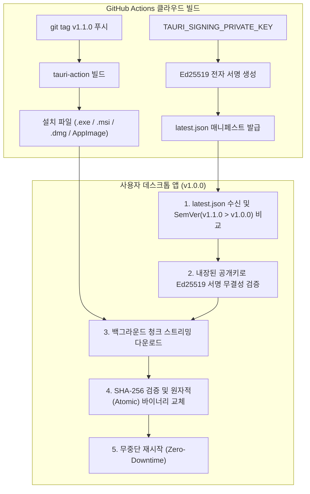

# Desktop 06: Tauri 2.0 프로덕션 패키징 & 자동 업데이트 파이프라인 📦🚀

> **Tauri 2.0 기반 상용 데스크톱 배포 완벽 가이드**  
> Windows 인스톨러 번들링(NSIS/WiX), Ed25519 비대칭 암호화 서명, 무중단 자동 업데이트(`tauri-plugin-updater`), Windows SmartScreen/코드 서명, GitHub Actions 크로스 플랫폼 자동 릴리즈 파이프라인을 완성합니다.

---

## 1. 프로젝트 개요

데스크톱 앱 개발의 최종 단계는 **"개발자의 로컬 환경에서 돌아가는 바이너리를 안전한 설치 파일로 패키징하고, 악성코드 경고 없이 전 세계 사용자 PC에 배포하며, 새 버전 출시 시 스스로 무중단 패치되도록 만드는 일"**입니다.

본 프로젝트는 Tauri 2.0 공식 업데이터 플러그인과 Ed25519 디지털 서명 엔진을 결합하여 프로덕션 배포 파이프라인의 모든 핵심 메커니즘을 시각화하고 검증합니다:



---

## 2. 5대 핵심 프로덕션 배포 메커니즘

| 메커니즘 | 구현 기술 | 주요 역할 및 실무 패턴 |
| :--- | :--- | :--- |
| **1. 무중단 자동 업데이트** | `tauri-plugin-updater` | `latest.json` 매니페스트 기반 버전 비교, 백그라운드 청크 다운로드, 무중단 자동 교체 |
| **2. Ed25519 암호화 서명** | `ed25519-dalek` | 비밀키로 릴리즈 파일을 서명하고, 클라이언트에 내장된 공개키로 위변조/중간자 공격(MITM) 차단 |
| **3. Windows 설치 파일** | `NSIS` (.exe) & `WiX` (.msi) | 원클릭/마법사 설치, 한글/영어 다국어 선택기, 프로그램 추가/제거 및 단축아이콘 자동 등록 |
| **4. 코드 서명 & SmartScreen** | Authenticode & RFC 3161 | Windows SmartScreen 파란 경고창 방어 원리, EV/OV 인증서 평판(Reputation) 축적 전략 |
| **5. 크로스 플랫폼 CI/CD** | `GitHub Actions` | 태그 푸시 한 번으로 Windows, macOS, Linux 설치 파일을 동시 빌드하여 GitHub Release 자동 배포 |

---

## 3. 디렉토리 구조

```
desktop-06-packaging-updater/
├── Cargo.toml                  # Tauri 2.2 + 업데이터 + Ed25519 암호화 의존성
├── build.rs                    # tauri-build 컴파일 스크립트
├── tauri.conf.json             # NSIS/WiX 번들 타겟, 아이콘, Updater 엔드포인트 선언
├── capabilities/
│   └── default.json            # updater 및 core 필수 권한 선언
├── icons/                      # 16~256px 멀티 레이어 Windows 아이콘
├── ci/
│   └── desktop-release.yml     # GitHub Actions 전 플랫폼 자동 릴리즈 워크플로우 템플릿
├── src/
│   ├── models.rs               # latest.json 규격, 암호화 키 쌍, 번들 설정 모델
│   ├── crypto.rs               # Ed25519 키 생성, 서명, 검증 및 SHA-256 엔진
│   ├── updater.rs              # SemVer 버전 비교 및 latest.json 자동 생성기
│   ├── commands.rs             # Tauri IPC Commands
│   ├── lib.rs                  # 라이브러리 모듈 재내보내기
│   └── main.rs                 # Tauri 2 메인 진입점 및 단위 테스트 7종
└── ui/
    ├── index.html              # 4대 탭 UI (업데이터, 서명 스튜디오, 번들러, CI/CD)
    ├── style.css               # 모던 다크 글래스모피즘 CSS
    ├── app.js                  # 실시간 5단계 업데이트 시뮬레이션 및 서명 검증기
    └── tauri.global.js         # Tauri 2 코어 IPC 번들
```

---

## 4. 빌드 및 테스트

### 1) 단위 테스트 검증 (Rust 백엔드)
```bash
cargo test --bin desktop-06-packaging-updater
```
- Ed25519 키 생성, 서명 및 정상 검증
- 변조된 데이터(Tampered Payload) 검증 실패 차단
- 변조된 서명(Tampered Signature) 차단
- 유의적 버전(SemVer) 비교 정확성
- Tauri 공식 `latest.json` 매니페스트 직렬화
- NSIS/WiX 번들 구성 유효성 검사

### 2) 앱 실행
```bash
cargo run
```
- **자동 업데이트 탭**: `🔍 업데이트 확인 & 패치 시뮬레이션` 클릭 시 5단계 무중단 패치 라이프사이클이 실시간 진행됩니다.
- **암호화 서명 스튜디오**: `새 키 쌍 생성` -> `디지털 서명 발급` -> `서명 검증 실행`을 통해 위변조 방지 원리를 체험할 수 있습니다.
- **고의 변조 테스트**: `⚠️ 데이터 고의 변조 테스트` 클릭 시 단 1글자만 변조되어도 서명 검증이 즉시 거부되는 보안성을 확인할 수 있습니다.

